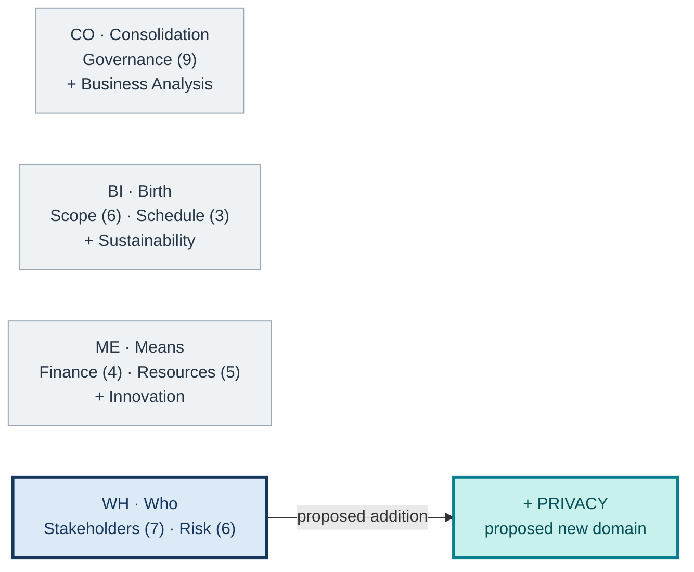
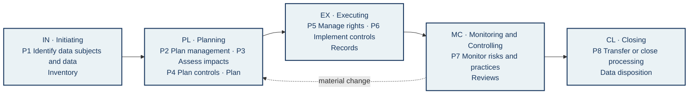
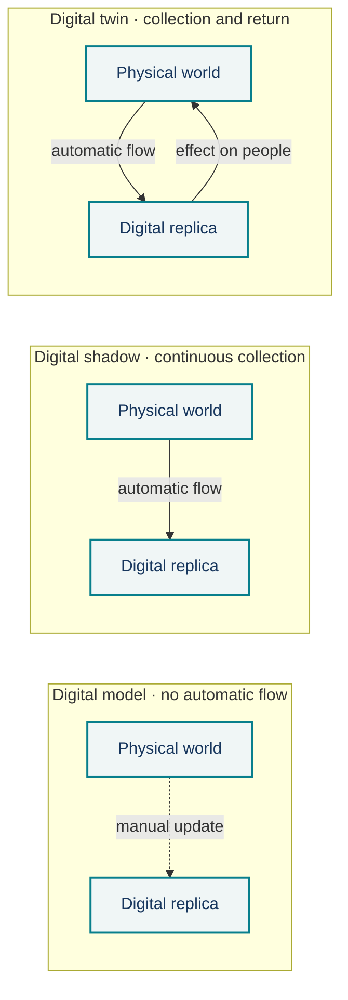

# Privacy as a proposed PMBOK 8 performance domain

**SIPA Privacy 2 group · Who (WH) concentration**  
**Academic proposal:** processes P1–P8 **are not official PMBOK 8 processes**.

## Problem and contribution

PMBOK 8 [14] mentions data protection and privacy, but its seven domains and 40 processes do not organize the processing of personal data as a management object of its own. The digital twin studies examined address legal requirements and technical controls, not project management processes [5, 11, 17]. We propose **Privacy** alongside **Stakeholders (7 processes)** and **Risk (6 processes)**. The central question is: **what effects does the project produce on the people whose data it processes, and what evidence supports its decisions?**

## Figure 1 — Where Privacy fits

<!-- Visual direction for the final poster:
Position: central upper band, occupying about one third of the usable area.
Draw four concentration cards. The first three are light gray;
Who gets a dark blue outline. Next to Who, show Privacy as an added
teal card, linked to Stakeholders and Risk.
The numbers 9/6/3/4/5/7/6 count only official PMBOK 8 processes.
Do not use the PMI logo or suggest that the four SIPA domains are already official.
Caption under the figure: blue = PMBOK 8 domains of Who; teal = proposal;
gray = context of the other concentrations. No decorative photography.
Alt text: four concentrations; Privacy enters Who,
alongside Stakeholders and Risk. -->

*Reading:* the four concentrations are an organization adopted in this work; **Privacy** is this group's contribution to the **Who** concentration.

## Figure 2 — How the domain spans the project

<!-- Visual direction for the final poster:
Position: central band, the most prominent figure. Five columns linked by
solid arrows represent the Focus Areas IN, PL, EX, MC, and CL. Each column
contains codes P1–P8, a short verb, and the evidence produced. A dashed arrow
from MC back to PL indicates review when data, purpose, or risk change;
it does not indicate that the areas are rigid stages. Use the same codes as the report.
Evidence in a smaller line below the process, no paragraphs. Vector icons
may differentiate inventory, plan, control, review, and data disposition;
no icon replaces the written label. Alt text: eight proposed
processes distributed across five Focus Areas, with monitoring returning
to planning. -->

*Reading:* **P1–P8 are group proposals**. The return arrow represents reassessment; data processing may continue after the project closes.

## Adherence to the 6 principles

**1AHV** holistic view of the data flow · **2FOV** benefit compared with potential harm · **3QPD** privacy as a verifiable quality criterion · **4BAL** decisions and owners recorded · **5SPA** lasting effects on people · **6BEC** channels for contestation and learning.

## Figure 3 — Digital twins: the direction of the flow defines the exposure

<!-- Visual direction for the final poster:
Position: visual footer, before the sources. Three horizontal bands, one for each type
of digital replica (model, shadow, twin), each with the blocks "Physical world"
and "Digital replica". Dashed arrow in the model (manual update); solid arrow
from physical to digital in the shadow; arrows in both directions in the twin, with the
return arrow in teal and the label "effect on people". To the right of each band,
a short sentence with the predominant privacy risk. The figure is a conceptual
schema, not a legal compliance diagram. Alt text: three types
of digital replica, distinguished by the direction of data flow. -->

*Reading:* the classification follows Kritzinger et al. [12]; the more automatic and frequent the flow, the greater the exposure of people. P1–P8 should identify data subjects, purposes, sharing, risks, and the disposition of records without duplicating Stakeholders and Risk. The proposed additions to the 13 existing processes and the interfaces with the other concentrations are in the report (§7).

**References** (numbering of the full report, in alphabetical order):
[1] ANPD, Relatório de Impacto à Proteção de Dados Pessoais (RIPD): perguntas e respostas. ·
[2] BRAZIL, Lei nº 13.709/2018 (LGPD). ·
[3] BROOKS et al., NISTIR 8062, 2017. ·
[5] DHINAKARAN et al., *MethodsX*, 2025. ·
[6] DTC, Digital Twin Consortium defines digital twin, 2020. ·
[7] DTC, Digital twins capabilities periodic table, v1.2, 2025. ·
[8] DTC, AI agent capabilities periodic table, v1.0, 2025. ·
[11] KORCHENKO et al., *Sustainability*, 2026. ·
[12] KRITZINGER et al., *IFAC-PapersOnLine*, 2018. ·
[13] NIST, Privacy Framework v1.0, 2020. ·
[14] PMI, *PMBOK Guide*, 8th ed., 2025 (§§2.5 and 2.7). ·
[17] WANG et al., *IEEE Internet of Things Journal*, 2023.

Full references, with DOI and URL, in the report.
