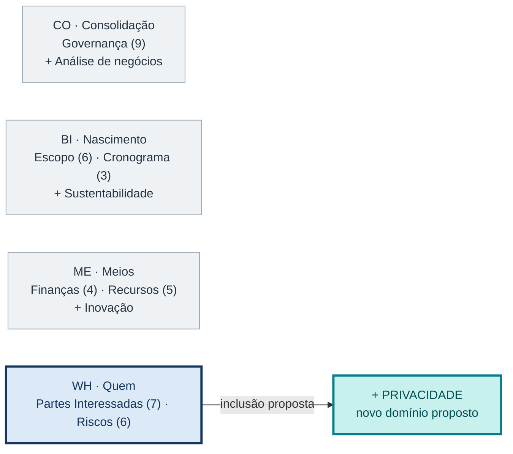
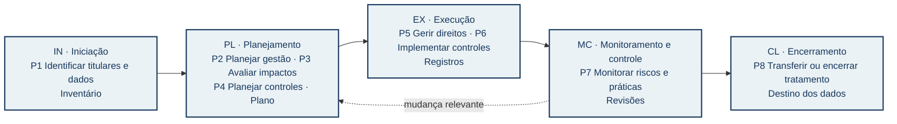
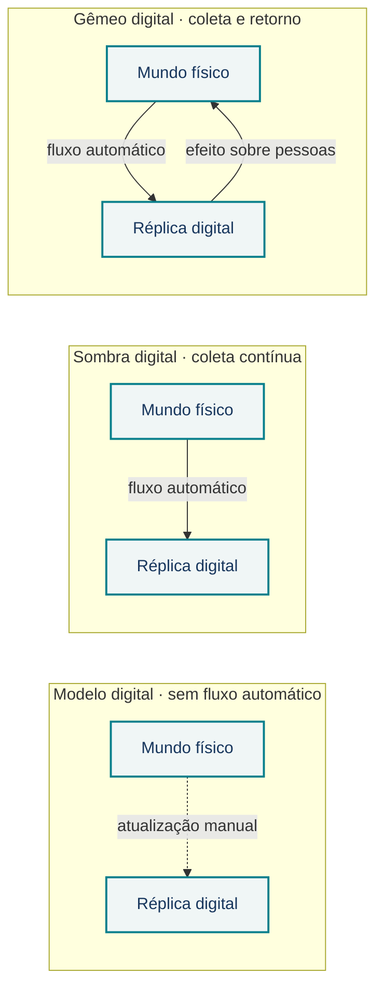

# Privacidade como domínio de desempenho proposto para o PMBOK 8

**Grupo SIPA Privacidade 2 · Concentração Quem (WH)**  
**Proposta acadêmica:** os processos P1–P8 **não integram oficialmente o PMBOK 8**.

## Problema e contribuição

O PMBOK 8 [13] menciona proteção de dados e privacidade, mas seus sete domínios e 40 processos não organizam o tratamento de dados pessoais como objeto de gestão próprio. Os estudos sobre gêmeos digitais examinados tratam de requisitos legais e controles técnicos, não de processos de gestão de projetos [5, 10, 17]. Propomos **Privacidade** ao lado de **Partes Interessadas (7 processos)** e **Riscos (6 processos)**. A pergunta central é: **que efeitos o projeto produz sobre as pessoas cujos dados trata, e que evidências justificam suas decisões?**

## Figura 1 — Onde entra Privacidade

<!-- Direção visual para o pôster final:
Posição: faixa superior central, ocupando cerca de um terço da área útil.
Desenhar quatro cartões de concentração. Os três primeiros ficam em cinza-claro;
Quem ganha contorno azul-escuro. Junto a Quem, mostrar Privacidade como cartão
turquesa acrescentado, ligado a Partes Interessadas e Riscos.
Os números 9/6/3/4/5/7/6 contam apenas processos oficiais do PMBOK 8.
Não usar logotipo do PMI nem sugerir que os quatro domínios SIPA já são oficiais.
Legenda sob a figura: azul = domínios PMBOK 8 de Quem; turquesa = proposta;
cinza = contexto das outras concentrações. Sem fotografia decorativa.
Texto alternativo: quatro concentrações; Privacidade entra em Quem,
ao lado de Partes Interessadas e Riscos. -->

*Leitura:* as quatro concentrações são uma organização adotada neste trabalho; **Privacidade** é a contribuição deste grupo à concentração **Quem**.

## Figura 2 — Como o domínio percorre o projeto

<!-- Direção visual para o pôster final:
Posição: faixa central, a figura de maior destaque. Cinco colunas ligadas por
setas sólidas representam as áreas de foco IN, PL, EX, MC e CL. Cada coluna
contém códigos P1–P8, verbo curto e evidência produzida. Uma seta tracejada
de MC de volta a PL indica revisão quando mudam dados, finalidade ou risco;
não indica que as áreas sejam etapas rígidas. Usar os mesmos códigos do relatório.
Evidências em linha menor abaixo do processo, sem parágrafos. Ícones vetoriais
podem diferenciar inventário, plano, controle, revisão e destino dos dados;
nenhum ícone substitui o rótulo escrito. Texto alternativo: oito processos
propostos distribuídos por cinco áreas de foco, com retorno de monitoramento
para planejamento. -->

*Leitura:* os **P1–P8 são propostas do grupo**. A seta de retorno representa reavaliação; o tratamento de dados pode continuar após o encerramento do projeto.

## Aderência aos 6 princípios

**1AHV** visão integral do fluxo de dados · **2FOV** benefício comparado ao dano potencial · **3QPD** privacidade como critério verificável de qualidade · **4BAL** decisões e responsáveis registrados · **5SPA** efeitos duradouros sobre pessoas · **6BEC** canais para contestação e aprendizado.

## Figura 3 — Gêmeos digitais: a direção do fluxo define a exposição

<!-- Direção visual para o pôster final:
Posição: rodapé visual, antes das fontes. Três faixas horizontais, uma por tipo
de réplica digital (modelo, sombra, gêmeo), cada uma com os blocos "Mundo físico"
e "Réplica digital". Seta tracejada no modelo (atualização manual); seta contínua
do físico ao digital na sombra; setas nos dois sentidos no gêmeo, com a seta de
retorno em turquesa e o rótulo "efeito sobre pessoas". À direita de cada faixa,
uma frase curta com o risco de privacidade predominante. A figura é esquema
conceitual, não diagrama de conformidade legal. Texto alternativo: três tipos
de réplica digital, distinguidos pela direção do fluxo de dados. -->

*Leitura:* a classificação segue Kritzinger et al. [11]; quanto mais automático e frequente o fluxo, maior a exposição das pessoas. P1–P8 devem identificar titulares, finalidades, compartilhamentos, riscos e destino dos registros sem duplicar Partes Interessadas e Riscos. As inclusões propostas aos 13 processos existentes e as interfaces com as demais concentrações estão no relatório (§7).

**Referências** (numeração do relatório completo, em ordem alfabética):
[1] ANPD, Relatório de Impacto à Proteção de Dados Pessoais (RIPD): perguntas e respostas. ·
[2] BRASIL, Lei nº 13.709/2018 (LGPD). ·
[3] BROOKS et al., NISTIR 8062, 2017. ·
[5] DHINAKARAN et al., *MethodsX*, 2025. ·
[6] DTC, Digital Twin Consortium defines digital twin, 2020. ·
[7] DTC, Digital twins capabilities periodic table, v1.2, 2025. ·
[8] DTC, AI agent capabilities periodic table, v1.0, 2025. ·
[10] KORCHENKO et al., *Sustainability*, 2026. ·
[11] KRITZINGER et al., *IFAC-PapersOnLine*, 2018. ·
[12] NIST, Privacy Framework v1.0, 2020. ·
[13] PMI, *PMBOK Guide*, 8. ed., 2025 (§§2.5 e 2.7). ·
[17] WANG et al., *IEEE Internet of Things Journal*, 2023.
Referências completas, com DOI e endereço, no relatório.
