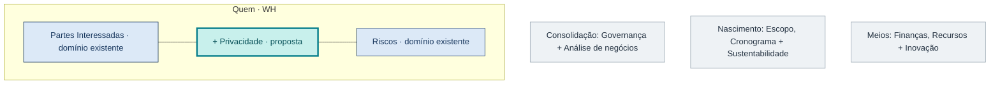
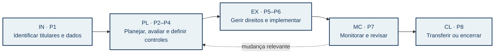
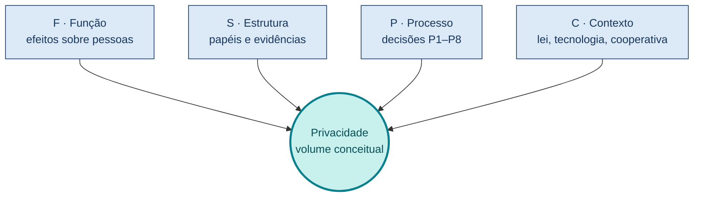
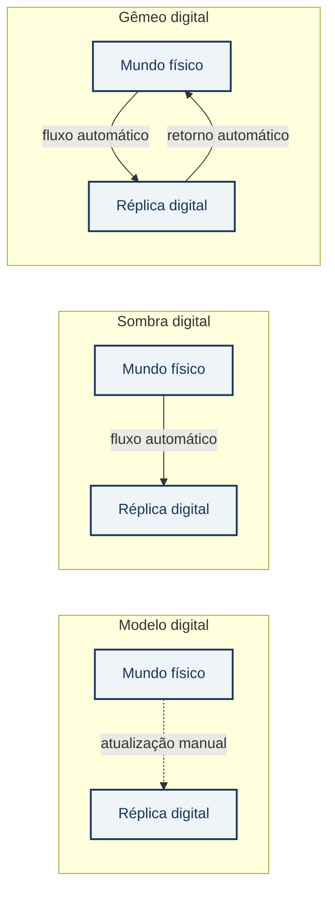
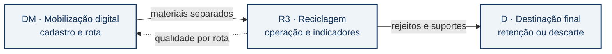

# Privacidade como domínio de desempenho proposto para o PMBOK 8

**Grupo SIPA:** Privacidade 2  
**Concentração:** Quem (*Who*)  
**Domínios existentes relacionados:** Partes Interessadas (*Stakeholders*) e Riscos (*Risk*)  
**Natureza:** proposta acadêmica de extensão; os processos P1–P8 abaixo **não são processos oficiais do PMI**.

## Resumo

Este relatório propõe um domínio de desempenho Privacidade como extensão do PMBOK 8. O método combina leitura dirigida do *Standard* e do *Guide*, análise dos domínios Partes Interessadas e Riscos, revisão de estudos sobre privacidade em gêmeos digitais e comparação com referências de proteção de dados. A análise encontrou referências explícitas a proteção de dados, GDPR e privacidade no PMBOK 8, sobretudo em restrições legais, no exemplo de conformidade em Finanças e no apêndice sobre inteligência artificial. Não encontrou, entre seus sete domínios e 40 processos, um domínio cujo objeto principal sejam os efeitos do tratamento de dados sobre pessoas identificadas ou identificáveis. Os estudos examinados sobre gêmeos digitais tratam de requisitos legais, arquiteturas e controles técnicos, mas não organizam essas preocupações como processos de gestão de projetos. Propõem-se oito processos, distribuídos pelas cinco áreas de foco, com ferramentas e técnicas, inclusões e alterações nos treze processos existentes de Partes Interessadas e Riscos, adaptação por contexto e critérios de verificação de resultados. A proposta é avaliada frente aos seis princípios de gestão de projetos e ilustrada com um cenário hipotético de gêmeo digital em reciclagem por cooperativas. O resultado é um modelo a testar e ajustar; sua inclusão formal dependeria de validação editorial e empírica posterior.

**Palavras-chave:** privacidade; proteção de dados; PMBOK 8; domínios de desempenho; gêmeos digitais; partes interessadas; riscos; extensão de área de aplicação.

## 1. Objeto, escopo e método

Este trabalho situa os quatro domínios SIPA — Sustentabilidade, Inovação, Privacidade e Análise de Negócios com Decisões Ajustadas a Riscos — em quatro concentrações que agrupam os sete domínios do PMBOK 8: Consolidação (Governança), Nascimento (Escopo e Cronograma), Meios (Finanças e Recursos) e Quem (Partes Interessadas e Riscos). Esse agrupamento é uma organização adotada neste trabalho; **não é uma classificação do PMI**. Como grupo SIPA de Privacidade, desenvolvemos **P → Quem**, junto aos domínios oficiais Partes Interessadas e Riscos. Os demais domínios SIPA aparecem apenas no mapa de integração (Figura 1).

O corpus principal é a oitava edição de *The Standard for Project Management and A Guide to the Project Management Body of Knowledge* [13]. Identificamos os sete domínios e 40 processos na organização do *Guide*, com atenção às seções 2.5 (Partes Interessadas), 2.7 (Riscos) e à tabela que associa processos às áreas de foco. Lemos os seis princípios no *Standard*. Fizemos uma busca textual dirigida por termos de privacidade no texto da edição e conferimos o sentido dos trechos relevantes. A busca textual não prova ausência conceitual em todo o livro; serve apenas para localizar linguagem explícita.

Para a literatura sobre gêmeos digitais, fizemos busca bibliográfica na Web of Science combinando gêmeos digitais, privacidade e proteção de dados, e examinamos os estudos mais aderentes ao tema. Os resultados citados no texto são Wang et al. [17], Dhinakaran et al. [5], Korchenko et al. [10], Shaikh et al. [14], Son et al. [15] e Jørgensen e Ma [9]. A conceituação de gêmeo digital apoia-se no Digital Twin Consortium [6] e na classificação de Kritzinger et al. [11].

Para a dimensão de proteção de dados, tomamos a LGPD brasileira [2] como referência normativa, o *NIST Privacy Framework* [12] como referência de gestão de risco à pessoa e o NIST IR 8062 [3] como referência de engenharia de privacidade. O GDPR [16] aparece como contraponto comparativo, não como regra automaticamente aplicável a qualquer cooperativa brasileira. Não fizemos auditoria jurídica ou medição empírica de conformidade.

### 1.1 Critério para propor um domínio próprio

Uma extensão faz sentido se acrescentar um **objeto de gestão identificável**, decisões e evidências que os domínios existentes não tornam visíveis de forma suficiente. Aqui, o objeto é o tratamento de dados pessoais e seus possíveis efeitos sobre os titulares. O projeto pode atingir prazo, custo e escopo e ainda produzir riscos indevidos às pessoas. Uma matriz genérica de riscos pode registrar esses eventos, mas não garante, por si só, inventário de dados, finalidade, hipótese legal, direitos dos titulares ou destino dos dados ao final do ciclo. A gestão de partes interessadas identifica pessoas relevantes ao projeto, mas um titular pode não participar dele, sequer saber que seus dados foram inferidos, e continuar titular de direitos.

Esse argumento é **organizacional**, não uma alegação de que o PMBOK 8 desconheça privacidade. O *Guide* menciona proteção de dados em restrições legais, GDPR em exemplo de conformidade no domínio Finanças e privacidade no apêndice sobre IA [13]. A proposta reúne essas preocupações em um domínio verificável, situado em Quem porque coloca pessoas afetadas e suas relações com o projeto no centro.

## 2. Diagnóstico do PMBOK 8

### 2.1 O que já existe

O domínio **Partes Interessadas** contém sete processos: identificar partes interessadas; planejar seu engajamento; planejar comunicações; gerenciar o engajamento; gerenciar comunicações; monitorar o engajamento; e monitorar comunicações [13, §2.5.2]. A própria definição de *Manage Communications* alcança criação, distribuição, armazenamento, recuperação e disposição de informação do projeto. Esse é um ponto de contato real com governança de dados, embora não especifique todo o ciclo dos dados pessoais nem os direitos dos titulares.

O domínio **Riscos** contém seis processos: planejar gestão de riscos; identificar riscos; analisar riscos; planejar respostas; implementar respostas; monitorar riscos [13, §2.7.2]. É uma estrutura adequada para reconhecer incertezas e acompanhar respostas. Entretanto, sua descrição geral abrange ameaças e oportunidades para os objetivos do projeto; uma avaliação de privacidade precisa considerar também problemas que o tratamento de dados pode causar às pessoas, mesmo sem falha de segurança. O NIST Privacy Framework afirma que gerir risco de cibersegurança contribui para gerir risco de privacidade, mas não é suficiente, pois há riscos de privacidade que surgem por meios alheios a incidentes de cibersegurança [12].

Há ainda referências dispersas no PMBOK 8: leis de proteção de dados podem limitar opções de projeto; ferramentas de IA introduzem questões de privacidade; comunicações podem exigir proteção de informação sensível [13]. Logo, a hipótese que sustentamos é mais precisa: **o tema aparece, mas não está organizado como domínio e conjunto de processos dedicados** nos sete domínios oficiais.

### 2.2 O que a nova organização precisa tornar observável

| Questão de gestão | Cobertura já disponível | Evidência adicional proposta |
| --- | --- | --- |
| Quem pode ser afetado pelo tratamento? | Identificar e engajar partes interessadas | Categorias de titulares, inclusive pessoas sem participação ativa no projeto |
| Que evento pode prejudicar alguém? | Identificar, analisar e monitorar riscos | Cenários de dano à pessoa associados a operações de dados, com critérios próprios |
| Que informação circula e por quê? | Planejar e gerenciar comunicações | Inventário de dados, finalidade, hipótese legal, necessidade, retenção e compartilhamento |
| Quando intervir no projeto? | Áreas de foco e decisões de governança | Critérios para prosseguir, modificar ou interromper um tratamento de dados |
| Como demonstrar resultado? | Relatórios, registros e lições aprendidas | Evidências de controles, solicitações de titulares, revisão de impacto e destino dos dados |

O quadro descreve **responsabilidades propostas**, sem afirmar que todos os projetos necessitem de todas as técnicas. O próprio PMBOK 8 enfatiza *tailoring*: intensidade, formalidade e artefatos devem refletir o contexto [13, cap. 3 do *Guide*]. A ANPD, por exemplo, orienta que o relatório de impacto à proteção de dados pessoais (RIPD) é recomendado quando o tratamento pode gerar alto risco aos princípios de proteção de dados, e que a LGPD prevê situações em que ele pode ser exigido [1]; não o tratamos como obrigação universal para todo projeto.

### 2.3 O que a literatura sobre gêmeos digitais acrescenta

Os estudos examinados convergem em pontos que sustentam a proposta.

**Coleta e compartilhamento como origem do risco.** Em levantamento sobre a Internet dos gêmeos digitais, Wang et al. [17] apontam que violações de privacidade podem surgir da coleta individual generalizada de dados e do compartilhamento massivo de dados entre gêmeos. Son et al. [15] observam que os dados gerados por ativos físicos podem conter informação sensível de seus proprietários e que o vazamento causa problemas graves de privacidade, o que torna o compartilhamento seguro de dados de gêmeos um desafio central.

**Questões éticas e legais em gêmeos que envolvem pessoas.** Dhinakaran et al. [5], ao tratar de gêmeos digitais domésticos, identificam privacidade, segurança de dados, consentimento e responsabilização como questões centrais, além de conformidade regulatória, inclusive fluxo transfronteiriço de dados. As práticas que o estudo revisa incluem privacidade desde a concepção, transparência, projeto centrado no usuário, auditorias e atualizações periódicas e anonimização.

**Resolução dos dados e identificação indireta.** Em gêmeos digitais ambientais, Korchenko et al. [10] mostram que alta resolução espaço-temporal dos dados pode permitir identificação indireta, e propõem mapear GDPR e NIS2 ao longo de todo o ciclo de vida dos dados: recepção, transporte, armazenamento, análise, compartilhamento e publicação. O estudo também menciona avaliação de impacto à proteção de dados e privacidade diferencial como instrumentos.

**Controles técnicos existem; a prática de conformidade é a lacuna.** Em revisão sobre gêmeos digitais em saúde com blockchain, Shaikh et al. [14] encontram que a tecnologia é usada sobretudo para controle de acesso, registro de auditoria, integridade, gestão de consentimento e proveniência de dados, e identificam lacunas na implementação formal de práticas de engenharia conformes ao GDPR e ao HIPAA. Jørgensen e Ma [9] mostram que seis normas europeias (entre elas GDPR, Data Act, AI Act e NIS2) governam em conjunto os gêmeos digitais, com obrigações que se sobrepõem em governança de dados, privacidade e cibersegurança.

Nos estudos examinados, o foco recai sobre requisitos legais, arquiteturas e controles técnicos. Não encontramos neles a organização dessas preocupações como processos de gestão de projetos alinhados ao PMBOK 8. Essa observação se limita ao conjunto examinado e não é uma afirmação sobre toda a literatura.

## 3. Justificativa da extensão em quatro aspectos

### 3.1 CN — Caracterização da necessidade

Projetos que constroem plataformas, gêmeos digitais ou modelos de IA podem coletar, combinar, inferir, compartilhar e descartar dados sobre pessoas. Nesse contexto, um incidente de confidencialidade é apenas uma das formas possíveis de dano. Também importam uso incompatível com a finalidade informada, inferências indevidas, exposição de localização, retenção excessiva e decisões automatizadas que afetem indivíduos. O NIST distingue riscos oriundos do processamento daqueles decorrentes de incidentes de segurança [12]; a LGPD organiza princípios, hipóteses de tratamento, direitos e prestação de contas [2]. A literatura sobre gêmeos digitais confirma que a coleta contínua, o compartilhamento entre gêmeos e a resolução dos dados criam exposição das pessoas [10, 17]. A necessidade da extensão é criar uma linha de decisão visível do início ao encerramento do projeto.

### 3.2 CD — Critérios de desenvolvimento

O domínio proposto deve: (i) ter escopo próprio e não duplicar integralmente Partes Interessadas ou Riscos; (ii) usar verbos e artefatos reconhecíveis no vocabulário de processos do PMBOK 8; (iii) deixar claro onde há entrada, ferramenta ou técnica, decisão, responsável e saída; (iv) ser adaptável conforme volume, sensibilidade, tecnologia, finalidade e contexto institucional; (v) registrar risco **para os titulares** além do risco **para a organização**; e (vi) permitir avaliação por evidências observáveis. Esses critérios são proposta editorial do grupo.

### 3.3 PF — Publicação e formato

Propomos uma seção de domínio com a mesma estrutura dos domínios do *Guide*: conceitos-chave (§4.1), processos com entradas, ferramentas e técnicas e saídas (§4.2), considerações de adaptação (§4.3), interações com outros domínios (§7) e verificação de resultados (§4.6). As tabelas de aderência às áreas de foco e aos princípios fariam parte do material de apoio. Na publicação, cada processo receberia exemplo de aplicação e ressalva de que as obrigações legais dependem do caso concreto e da jurisdição. Neste trabalho, o domínio é um **protótipo acadêmico**; seu número e seus nomes podem mudar após revisão.

### 3.4 DM — Desenvolvimento e manutenção

Uma versão posterior deveria passar por revisão de profissionais de projetos, privacidade, operação de sistemas e representantes de titulares; teste em casos com características diferentes; registro de decisões editoriais; e revisão quando normas, tecnologia ou evidências mudarem. As medidas de êxito incluem cobertura do fluxo de dados, qualidade dos registros de decisão, identificação de riscos a pessoas e capacidade de corrigir tratamento inadequado. Não propomos afirmar conformidade jurídica a partir da simples adoção do domínio.

## 4. O domínio Privacidade na concentração Quem

**Finalidade proposta:** fazer com que projetos que tratem dados pessoais reconheçam titulares, expliquem finalidades, avaliem impactos às pessoas e produzam evidências proporcionais de proteção ao longo do ciclo de vida. O domínio dialoga diretamente com Partes Interessadas e Riscos. Sua posição em **Quem** é uma decisão de modelagem deste trabalho, não uma classificação oficial do PMI.

**Resultados esperados:** dados e titulares identificados na medida necessária; decisões sobre finalidade e hipótese legal registradas; riscos a pessoas avaliados; controles e responsáveis definidos; solicitações de titulares encaminhadas; mudanças e encerramento do tratamento documentados. Indicadores concretos dependerão do projeto. O NIST IR 8062 oferece três objetivos úteis para avaliar o desenho: previsibilidade sobre o uso dos dados, capacidade de administrá-los e limitação de associação de dados a pessoas além do necessário [3].

**Figura 1 — Posição do domínio proposto entre as concentrações.** Os cartões cinza situam as outras concentrações; o cartão azul delimita **Quem** e o turquesa identifica a contribuição deste grupo. A figura distingue os domínios existentes do PMBOK 8 das inclusões SIPA propostas. *Elaboração própria.*

<!-- Projeto da Figura 1 para eventual diagramação:
Desenhar quatro faixas de concentração, cada uma com os domínios existentes
e a inclusão SIPA correspondente. Dar maior largura visual a Quem. Dentro
de Quem, Partes Interessadas e Riscos permanecem em azul; Privacidade entra
em turquesa com um sinal de adição. As outras três inclusões ficam em cinza,
pois são apenas contexto neste trabalho. Uma linha contínua liga Privacidade
a Partes Interessadas e Riscos; interfaces com as demais concentrações
devem ser tracejadas. Não chamar os domínios SIPA de PMI.
Texto alternativo: Privacidade proposta dentro de Quem, junto aos dois domínios
oficiais, em um mapa das quatro concentrações. -->

### 4.1 Conceitos-chave

Como nos domínios do *Guide*, a seção começa pelos conceitos que os processos usam. Os sentidos abaixo seguem a LGPD [2, art. 5º] e o NIST Privacy Framework [12].

| Conceito | Sentido adotado |
| --- | --- |
| **Dado pessoal** | Informação relacionada a pessoa natural identificada ou identificável. |
| **Titular** | Pessoa natural a quem se referem os dados. Pode não participar do projeto nem conhecer o tratamento. |
| **Tratamento** | Toda operação com dados pessoais: coleta, produção, recepção, classificação, uso, acesso, reprodução, transmissão, distribuição, processamento, arquivamento, armazenamento, eliminação, avaliação, controle, modificação, comunicação, transferência, difusão ou extração. |
| **Controlador e operador** | Quem decide sobre o tratamento e quem o realiza em nome do controlador. A equipe de projeto não assume um desses papéis automaticamente. |
| **Finalidade, adequação e necessidade** | Princípios da LGPD (art. 6º): propósito legítimo e informado, compatibilidade do tratamento com ele e limitação ao mínimo necessário. |
| **Hipótese legal** | Fundamento que autoriza o tratamento (art. 7º; art. 11 para dados sensíveis) [2]. Não é sinônimo de consentimento. |
| **Ação de dados** | Operação do ciclo de vida dos dados, como coleta, retenção, registro, geração, transformação, uso, divulgação, compartilhamento, transmissão e descarte [12]. O risco de privacidade vem do conjunto dessas ações. |
| **Relatório de impacto (RIPD)** | Documento do controlador que descreve processos de tratamento que podem gerar riscos às liberdades civis e aos direitos fundamentais, e as medidas de mitigação [2, art. 5º, XVII]. |
| **Evento de privacidade e incidente de segurança** | Conceitos distintos. Um tratamento pode prejudicar pessoas sem que haja falha de segurança [12]. |

### 4.2 Processos propostos pelo grupo

Os códigos **P1–P8** abaixo identificam apenas esta proposta. As entradas e saídas são exemplos para orientar o *tailoring*; não reproduzem tabelas oficiais do PMBOK 8.

| Código e processo proposto | Área de foco principal | Entrada → decisão/atividade → saída | Interface com processo existente |
| --- | --- | --- | --- |
| **P1 Identificar titulares e dados pessoais** | Iniciação | Ideia de projeto, fluxos previstos → reconhecer categorias de pessoas, dados, pontos de coleta e direção dos fluxos → inventário inicial | *Identify Stakeholders*; *Identify Risks* |
| **P2 Planejar a gestão de privacidade** | Planejamento | Inventário, objetivos, ambiente jurídico → definir finalidade, hipótese legal a verificar, papéis, retenção e resposta a titulares → plano de privacidade | *Plan Risk Management*; *Plan Communications Management* |
| **P3 Avaliar impactos à privacidade** | Planejamento | Operações de dados, arquitetura e riscos → avaliar possíveis efeitos sobre pessoas e necessidade de RIPD → registro de avaliação e, quando cabível, RIPD | *Perform Risk Analysis* |
| **P4 Planejar respostas e controles** | Planejamento | Avaliação de impactos → selecionar minimização, acesso, transparência, retenção e outras respostas proporcionais → plano de controles, responsáveis e critérios de aceitação | *Plan Risk Responses* |
| **P5 Gerir comunicação e direitos dos titulares** | Execução | Plano, canais e solicitações → informar, receber e encaminhar pedidos conforme a regra aplicável → registros de comunicação e resposta | *Manage Stakeholder Engagement*; *Manage Communications* |
| **P6 Implementar controles e tratar incidentes** | Execução | Plano de controles, mudanças e alertas → implementar salvaguardas, registrar ocorrência e acionar resposta → evidência de implementação e registro de incidentes | *Implement Risk Responses* |
| **P7 Monitorar riscos e práticas de privacidade** | Monitoramento e controle | Métricas, registros e mudanças → revisar eficácia, novas finalidades e riscos → recomendações, revisões de plano e evidências | *Monitor Risks*; *Monitor Stakeholder Engagement* |
| **P8 Encerrar ou transferir o tratamento sob controle** | Encerramento | Inventário atualizado, requisitos de retenção e transição → decidir conservação, transferência ou eliminação conforme o caso → registro de destino e responsabilidades futuras | *Close Project or Phase* |

**Figura 2 — Sequência e retorno dos oito processos propostos.** As setas contínuas mostram a ordem inicial sugerida; a seta tracejada representa a necessidade de voltar ao planejamento quando a observação revela nova finalidade, tecnologia ou risco. O registro e a gestão de dados podem prosseguir na operação depois de encerrado o projeto. *Elaboração própria; correspondências com áreas de foco fundamentadas no PMBOK 8 e propostas pelo grupo.*

<!-- Projeto da Figura 2:
Usar uma faixa horizontal com cinco blocos IN, PL, EX, MC e CL. Dentro deles,
mostrar P1; P2–P4; P5–P6; P7; P8, respectivamente, com uma linha de evidência:
inventário, plano e impacto, registros, revisão, destino. A seta MC→PL deve
ser tracejada e rotulada "mudança relevante". Não sugerir que o PMBOK 8 traz
esses oito processos; usar legenda "processos propostos pelo grupo".
Texto alternativo: oito processos de Privacidade distribuídos em cinco áreas
de foco, com retorno do monitoramento ao planejamento. -->

**P1** precisa ocorrer cedo para que o tratamento não seja descoberto apenas quando o sistema entra em produção. A identificação pode ser revisitada em qualquer área de foco quando houver novo dado, titular ou finalidade. O inventário deve distinguir dado pessoal de dado operacional sem pessoa identificável; não se presume que todo sensor processe dados pessoais. Em projetos de gêmeo digital, o inventário classifica também cada fluxo por direção e frequência (§4.5).

**P2** registra a decisão de projeto sobre por que, por quem e por quanto tempo dados seriam tratados. A hipótese legal não é sinônimo de consentimento: ela deve ser determinada no contexto concreto por quem tem competência para isso. O processo integra planejamento de comunicação, compras, arquitetura e responsabilidade institucional, e incorpora a privacidade desde a concepção, prática recorrente nos estudos sobre gêmeos digitais [5].

**P3** avalia efeitos potenciais sobre pessoas, inclusive quando não existe vazamento. Conforme orientação da ANPD, um RIPD é recomendado especialmente quando o tratamento pode gerar alto risco e pode ser exigido pela autoridade [1]. A decisão de elaborar ou não o documento precisa ser justificada; o processo não estabelece automaticamente sua obrigatoriedade para todos os casos.

**P4** transforma os riscos analisados em alternativas de desenho e operação. Exemplos são reduzir coleta, restringir acesso, separar identificadores, limitar compartilhamento, agregar dados, aplicar privacidade diferencial quando cabível [10] e definir prazo de retenção. A escolha tem de considerar benefício, custo, viabilidade, efeitos residuais e responsabilidade por implantação.

**P5** aproxima titulares e equipe sem presumir que todo titular seja usuário do produto. O projeto deve prever informação inteligível e fluxo para pedidos de acesso, correção ou outras providências cabíveis [2, art. 18]. O atendimento efetivo depende do controlador e das regras aplicáveis; a equipe de projeto desenha e documenta o mecanismo de transição para a operação. Quando houver consentimento, a gestão do consentimento é parte do mecanismo [14].

**P6** implementa os controles aprovados e responde a ocorrências. Incidente de segurança e evento de privacidade não são conceitos idênticos [12]; ambos podem demandar investigação e mudança. O registro de acessos e operações sustenta a auditoria [14]. Não se deve prometer que uma medida técnica isolada garanta conformidade.

**P7** verifica se as decisões continuam adequadas após mudanças de escopo, tecnologia, fornecedores ou finalidade. Pode produzir revisão da avaliação de impacto, plano e critérios de aceitação. A avaliação da eficácia precisa incluir efeitos sobre pessoas, não apenas continuidade do serviço. Auditorias e atualizações periódicas são prática recomendada na literatura [5].

**P8** não significa apagar todos os dados quando o projeto termina. O encerramento deve definir o destino de cada conjunto conforme obrigações de conservação, finalidade remanescente e responsabilidade operacional [2, arts. 15 e 16]. A saída mínima é uma decisão rastreável de conservação, transferência ou eliminação, com responsáveis.

#### 4.2.1 Ferramentas e técnicas e fundamentos

Os processos do PMBOK 8 são descritos por entradas, ferramentas e técnicas e saídas. A tabela completa o desenho dos processos propostos com exemplos de ferramentas e técnicas e com o fundamento de cada uma. São exemplos para o *tailoring*, não prescrições.

| Processo | Ferramentas e técnicas (exemplos) | Fundamento |
| --- | --- | --- |
| **P1** | Mapeamento de dados e fluxos; entrevistas e oficinas com partes interessadas; análise de documentos de requisitos; classificação dos fluxos por direção (modelo, sombra, gêmeo); juízo especializado | [2, art. 5º] (dado pessoal, titular); [11]; [17] |
| **P2** | Análise de hipótese legal e de finalidade, necessidade e adequação; definição de papéis (matriz de responsabilidades); privacidade desde a concepção | [2, arts. 6º, 7º e 11]; [5] |
| **P3** | Relatório de impacto (RIPD); avaliação dos problemas de privacidade decorrentes do processamento; modelagem de ameaças à privacidade (por exemplo, LINDDUN); critérios de alto risco | [2, arts. 5º, XVII, e 38]; [1]; [12]; [4] |
| **P4** | Minimização, agregação, pseudonimização e anonimização, controle de acesso, privacidade diferencial; seleção de respostas por benefício, custo e risco residual | [3]; [10]; [5] |
| **P5** | Canais de atendimento ao titular; modelos de aviso e comunicação; gestão de consentimento quando aplicável; registro de pedidos | [2, art. 18]; [14] |
| **P6** | Controles técnicos e organizacionais; registro de auditoria; plano de resposta a incidentes; comunicação de incidente | [2, art. 48]; [14]; [15] |
| **P7** | Auditorias periódicas; indicadores de eficácia; revisão do RIPD em mudanças; gatilhos de reavaliação | [5]; [12] |
| **P8** | Política de retenção e eliminação; decisão de transferência com registro; verificação de responsáveis futuros | [2, arts. 15 e 16]; [10], ciclo de vida dos dados |

### 4.3 Adaptação conforme contexto

O PMBOK 8 pede que processos e domínios sejam adaptados ao contexto [13, cap. 3 do *Guide*]. Para Privacidade, as variáveis mais relevantes são volume de dados, sensibilidade, resolução (espacial e temporal), direção dos fluxos, existência de decisão automatizada e tipo de operador. A tabela gradua o esforço em três perfis.

| Perfil do projeto | Esforço esperado | Exemplos de ajuste |
| --- | --- | --- |
| **A. Dados agregados, sem possibilidade razoável de identificar pessoas** | Mínimo, concentrado em demonstrar e revisar essa condição | P1 e P8 curtos; P3 limitado à análise de reidentificação por cruzamento; P7 revisa se houver novos cruzamentos |
| **B. Dados pessoais comuns, em escala limitada** | Moderado | Plano de privacidade enxuto (P2); avaliação de impacto registrada, RIPD só se justificada (P3); canal simples para titulares (P5) |
| **C. Dados sensíveis, larga escala, decisão automatizada ou gêmeo com fluxo bidirecional** | Alto | RIPD elaborado antes do tratamento (P3); controles reforçados e auditoria periódica (P4, P6, P7); revisão independente; registro explícito de decisão de prosseguir, modificar ou interromper |

A graduação em C acompanha os critérios que a ANPD indica como referência de alto risco: um critério geral, como larga escala, combinado a um específico, como dados sensíveis ou decisões automatizadas, em lista não exaustiva [1]. O responsável pelo projeto documenta o perfil escolhido e o revisa quando o contexto mudar. Essa gradação evita tanto um ritual documental desproporcional quanto a omissão de riscos relevantes.

### 4.4 Leitura sistêmica por função, estrutura, processo e contexto

O domínio pode ser caracterizado como sistema aberto. **Função:** tornar visíveis e governáveis os efeitos do tratamento de dados sobre pessoas, preservando o valor legítimo do projeto. **Estrutura:** papéis, processos P1–P8, registros, canais, critérios de decisão e interfaces com Partes Interessadas e Riscos. **Processo:** identificar, planejar, avaliar, implementar, monitorar e transferir ou encerrar o tratamento, com retorno a decisões anteriores quando o contexto mudar. **Contexto:** PMBOK 8 e sua adaptação, marco brasileiro de proteção de dados, instituições envolvidas, tecnologia e cenário de cooperativas. A dimensão Contexto impede tratar privacidade como simples configuração técnica do produto; Estrutura e Processo impedem que permaneça apenas como valor abstrato.

O modelo de encadeamento Procura, Industrialização, Solução e Oferta (PISO) pode servir à leitura do valor: a procura por informação deve ser justificada antes de industrializar a coleta; a solução deve demonstrar benefício; e a oferta ao usuário ou operador precisa preservar as condições sob as quais os dados foram obtidos. Esse uso é interpretativo e não acrescenta quatro processos ao domínio.

**Figura 3 — O tetraedro F/S/P/C como instrumento de leitura.** Os quatro vértices representam as perguntas sistêmicas de função, estrutura, processo e contexto; **Privacidade** ocupa o volume conceitual que elas delimitam. A projeção em Mermaid é um esquema de relações, não um desenho geométrico em perspectiva. *Elaboração própria.*

<!-- Projeto da Figura 3:
Na versão gráfica, desenhar um tetraedro em perspectiva com quatro vértices
F, S, P e C e faces semitransparentes. Colocar "Privacidade" no volume central.
Ao lado de cada vértice, uma pergunta e um exemplo: F—que efeito proteger;
S—quem e quais artefatos; P—que decisões no ciclo; C—em qual ambiente jurídico
e operacional. Usar cores suaves e não atribuir a geometria literal ao PMI.
Texto alternativo: tetraedro com vértices Função, Estrutura, Processo e Contexto
e Privacidade como volume interno. -->

### 4.5 Gêmeos digitais: fluxo de dados e privacidade

O Digital Twin Consortium define gêmeo digital como "uma representação virtual de entidades e processos do mundo real, sincronizada a uma frequência e fidelidade específicas" [6] (tradução nossa). Na classificação de Kritzinger et al. [11], o que distingue as réplicas digitais é a **direção do fluxo automático de dados** entre o objeto físico e o digital. Essa distinção importa para a privacidade porque cada tipo expõe as pessoas de forma diferente.

| Tipo de réplica | Fluxo de dados | Implicação para privacidade | Processos mais acionados |
| --- | --- | --- | --- |
| **Modelo digital** | Nenhum fluxo automático; atualização manual | Exposição limitada às cargas de dados feitas pela equipe; risco concentrado na origem dos dados | P1, P2, P8 |
| **Sombra digital** | Automático, do físico para o digital | Coleta contínua sobre pessoas e ambientes; risco de vigilância e de inferência por acúmulo | P1, P3, P4, P7 |
| **Gêmeo digital** | Automático nos dois sentidos | Além da coleta, o retorno automático pode afetar pessoas (decisões ou recomendações aplicadas ao mundo físico); exige canal de contestação e revisão humana | P3, P5, P6, P7 |

**Figura 4 — Direção do fluxo de dados nos três tipos de réplica digital.** O modelo digital não tem fluxo automático; a sombra tem fluxo do físico ao digital; o gêmeo tem fluxo nos dois sentidos. *Elaboração própria, com base em Kritzinger et al. [11].*

<!-- Projeto da Figura 4:
Três faixas horizontais, uma para cada tipo (modelo, sombra, gêmeo). Em cada
faixa, dois blocos, "Mundo físico" e "Réplica digital", ligados por seta:
tracejada e rotulada "atualização manual" no modelo; contínua do físico ao digital
na sombra; contínua nos dois sentidos no gêmeo, com a seta de retorno em turquesa
e o rótulo "efeito sobre pessoas". À direita de cada faixa, uma frase curta com o
risco de privacidade predominante. Texto alternativo: três tipos de réplica
digital, distinguidos pela direção do fluxo de dados entre o físico e o digital. -->

A frequência e a fidelidade da sincronização, que a própria definição do DTC destaca, ampliam a exposição. Os achados sobre identificação indireta por resolução espaço-temporal [10] indicam que maior fidelidade tende a aumentar a possibilidade de identificar pessoas, o que justifica que P1 registre frequência e resolução, e P3 as considere. Trata-se de hipótese de trabalho a testar.

O DTC também lista a privacidade entre as capacidades de confiabilidade do gêmeo digital (categoria *Trustworthiness*, com a capacidade de privacidade ao lado de segurança, proteção física, confiabilidade e resiliência) e, na tabela de capacidades de agentes de IA, entre as de governança e segurança [7, 8]. Essas tabelas descrevem **o que o gêmeo é capaz de fazer** do ponto de vista técnico. O domínio proposto descreve **como o projeto que constrói ou opera o gêmeo planeja, decide e comprova** que essas capacidades existem e são adequadas às pessoas afetadas. Em termos práticos, P4 seleciona os controles que realizam as capacidades de privacidade e de criptografia de dados, P6 os implementa e P7 verifica seu funcionamento. A gestão do projeto de um gêmeo digital passa a incluir, assim, uma linha de decisão sobre o tratamento de dados que as tabelas de capacidades, por si, não organizam.

### 4.6 Verificação de resultados

O PMBOK 8 conclui cada domínio com orientação para manter o foco em valor [13]: para cada saída de processo deve haver um resultado de ordem superior em vista. O quadro aplica essa lógica a Privacidade.

| Resultado esperado | Perguntas de verificação | Evidência | Processos |
| --- | --- | --- | --- |
| Titulares e fluxos de dados conhecidos | O inventário cobre categorias de titulares, fluxos, frequência e direção? Há revisão quando surge dado ou finalidade nova? | Inventário atualizado e datado | P1, P7 |
| Finalidade e hipótese legal decididas por quem tem competência | A finalidade é específica e a hipótese legal foi determinada, sem presumir consentimento? | Plano de privacidade com responsável | P2 |
| Riscos às pessoas avaliados e tratados | A avaliação considerou dano à pessoa, além de risco ao projeto? A decisão sobre RIPD está justificada? | Registro de avaliação; RIPD quando cabível | P3, P4 |
| Direitos dos titulares atendíveis | Há canal inteligível, fluxo de pedidos e responsável pela resposta após a transição? | Registros de pedidos e respostas | P5 |
| Controles implementados e eficazes | Os controles aprovados foram implementados e testados? As ocorrências foram registradas e tratadas? | Evidência de implementação; registro de incidentes e auditoria | P6, P7 |
| Tratamento encerrado ou transferido sob controle | Cada conjunto de dados tem destino decidido, responsável e prazo? | Registro de destino e transição | P8 |

## 5. Aderência às cinco áreas de foco

A matriz abaixo indica a área **principal** de cada processo proposto, sem proibir iterações em outras áreas. As áreas de foco são categorias de atividades, não uma sequência única para todos os projetos [13, §4.5 do *Standard*].

| Área de foco | Pergunta de privacidade | Processos da proposta | Evidência de decisão |
| --- | --- | --- | --- |
| **IN — Iniciação** | Quem pode ser afetado e que tratamento é previsto? | P1 | Inventário inicial de dados e categorias de titulares; premissas e incertezas |
| **PL — Planejamento** | Por que tratar os dados, quais os riscos e quais respostas são proporcionais? | P2, P3, P4 | Plano de privacidade; avaliação de impacto; critérios de controle e aceitação |
| **EX — Execução** | As comunicações, direitos e salvaguardas planejados funcionam na prática? | P5, P6 | Registros de implementação, solicitações e ocorrências |
| **MC — Monitoramento e controle** | Mudanças alteraram finalidade, exposição ou eficácia das respostas? | P7 | Indicadores, revisão de risco, decisões corretivas e trilha de auditoria |
| **CL — Encerramento** | Quem passa a responder pelos dados e qual será seu destino? | P8 | Registro de transição, conservação ou eliminação e responsáveis |

**Iniciação.** Identificar pessoas afetadas no termo de abertura do projeto ajuda a revelar uma externalidade que poderia ficar escondida em requisitos técnicos. O grupo não propõe avaliar definitivamente toda a licitude nessa fase: o resultado é um mapa inicial que orienta o planejamento. Se o projeto ainda não sabe quais dados coletará, essa incerteza deve constar do registro.

**Planejamento.** O plano de privacidade conecta propósito do tratamento, responsáveis, riscos e controle. A análise deve distinguir risco à entrega do projeto e risco à pessoa. Uma ação pode melhorar a eficiência da operação e, ao mesmo tempo, ampliar exposição individual. A decisão exige comparação documentada entre alternativas, incluindo a de não coletar ou reduzir granularidade.

**Execução.** A conformidade não decorre apenas de um texto aprovado. É preciso verificar implementação de canais, políticas de acesso, avisos e resposta a eventos. Quando a operação passa a uma cooperativa ou a outro responsável, a interface entre equipe de projeto e operação precisa estar clara. O processo P5 não transforma o gerente do projeto automaticamente em controlador ou encarregado.

**Monitoramento e controle.** Mudanças de arquitetura, contratos, sensores, modelos de IA ou públicos atendidos podem criar tratamento novo sem uma alteração visível no escopo físico. Por isso, o monitoramento compara operação real, plano e efeitos observados. Uma mudança relevante deve reabrir avaliação e decisão, inclusive quando o projeto está perto do encerramento.

**Encerramento.** A área de foco de encerramento exige uma transição auditável: que dados e registros ficam com a operação, sob qual justificativa, e quais devem ser eliminados ou ter sua retenção revista. Encerrar o projeto não encerra necessariamente o tratamento. A saída de P8 é a atribuição de responsabilidade e a documentação do destino dos dados.

## 6. Aderência aos seis princípios

Esta é uma **análise de aderência** do domínio Privacidade aos seis princípios do PMBOK 8 [13, cap. 3 do *Standard*]. Aderência não significa equivalência: um princípio orienta julgamento, enquanto o domínio e seus processos organizam trabalho específico.

| Princípio do PMBOK 8 | Como o domínio proposto o sustenta | Teste de aderência |
| --- | --- | --- |
| **1AHV — Adopt a Holistic View** | Segue os dados do planejamento ao encerramento, entre equipe, fornecedores, operação e pessoas afetadas. | O mapa de fluxos inclui compartilhamentos e transições entre sistemas? |
| **2FOV — Focus on Value** | Compara benefício do uso de dados com possíveis danos às pessoas e à confiança no serviço. | A decisão explicita benefício, finalidade e custo social da alternativa? |
| **3QPD — Embed Quality into Processes and Deliverables** | Inclui minimização, transparência e controles como critérios verificáveis de entregas. | Os critérios são testáveis antes da aceitação do produto? |
| **4BAL — Be an Accountable Leader** | Registra quem decidiu, quem implementa, quem supervisiona e como questões são escaladas. | Há responsável e evidência para cada decisão relevante? |
| **5SPA — Integrate Sustainability Within All Project Areas** | Considera efeitos duradouros do tratamento sobre pessoas, relações de confiança e continuidade do serviço. | O projeto avalia consequências além da entrega imediata? |
| **6BEC — Build an Empowered Culture** | Dá à equipe e aos afetados canais para sinalizar problemas e melhorar práticas sem ocultar falhas. | O fluxo permite contestação, aprendizado e correção? |

A relação com **5SPA** merece atenção, pois a proposta SIPA associa sustentabilidade e privacidade sem fundi-las. Um projeto ambientalmente benéfico ainda pode produzir dano informacional; tratar ambos melhora a avaliação global de valor. Os estudos sobre gêmeos digitais ambientais reforçam esse ponto: dados ambientais de alta resolução podem identificar pessoas indiretamente [10].

## 7. Interações com os domínios existentes e com as demais concentrações

### 7.1 Inclusões e alterações nos processos de Partes Interessadas e Riscos

O domínio Privacidade não substitui os treze processos existentes em Quem [13, §§2.5.2 e 2.7.2]: utiliza seus registros e acrescenta uma pergunta específica sobre tratamento de dados e efeitos sobre titulares. A tabela propõe, para cada processo, a inclusão ou alteração mínima que o torna sensível à privacidade, sem mudar seu nome nem sua finalidade geral. Todas são propostas deste trabalho.

| Processo existente | Tipo | Inclusão ou alteração proposta |
| --- | --- | --- |
| **Identify Stakeholders** | Alteração e entrada | Estender a análise a titulares de dados que não participam do projeto; marcar no registro de partes interessadas a categoria "titular de dados pessoais"; incluir o inventário de P1 como entrada. |
| **Plan Stakeholder Engagement** | Inclusão | Prever, no plano de engajamento, estratégia para titulares sem participação ativa: canal, linguagem e momento de informação. |
| **Plan Communications Management** | Inclusão | Incluir requisitos de comunicação sobre o tratamento (finalidade, canal de direitos) e restrições ao compartilhamento de informação com dados pessoais. |
| **Manage Stakeholder Engagement** | Inclusão | Registrar manifestações e pedidos de titulares como questões, encaminhadas a P5. |
| **Manage Communications** | Alteração | Aplicar, à armazenagem, recuperação e disposição de informação do projeto, as regras de acesso e retenção definidas em P2 e P8. |
| **Monitor Stakeholder Engagement** | Inclusão | Acrescentar indicador de efetividade do canal de titulares (por exemplo, pedidos recebidos e respondidos). |
| **Monitor Communications** | Inclusão | Verificar se a informação destinada aos titulares chega e é compreendida. |
| **Plan Risk Management** | Inclusão | Definir critérios de probabilidade e impacto que considerem dano às pessoas, além dos objetivos do projeto, e o nível de risco aceitável com responsável. |
| **Identify Risks** | Inclusão e entrada | Incluir o inventário de P1 como entrada e categorias de risco de privacidade no registro de riscos, descritas por causa, evento e consequência para o titular. |
| **Perform Risk Analysis** | Inclusão | Adotar escala de impacto sobre titulares e análise de cenários de dano; receber a avaliação de P3 como entrada. |
| **Plan Risk Responses** | Inclusão | Incluir as respostas de minimização e controle de P4 entre as opções, com aceitação de risco residual por responsável nomeado. |
| **Implement Risk Responses** | Inclusão | Vincular a evidência de implementação dos controles (P6) ao risco correspondente. |
| **Monitor Risks** | Inclusão | Reavaliar o risco residual de privacidade em mudanças de finalidade, tecnologia ou fornecedor, com gatilhos definidos. |

### 7.2 Interfaces potenciais com as demais concentrações

Registramos à parte, como hipóteses de trabalho, as interfaces que Privacidade pode ter com os domínios das outras concentrações. **Não** as tratamos como alterações propostas a esses processos.

| Concentração | Interface a avaliar | Decisão potencial |
| --- | --- | --- |
| **Consolidação / Governança** | Critérios de aprovação, atribuição de responsabilidade, escalonamento e prestação de contas | Quem aceita risco residual e com que evidência? |
| **Nascimento / Escopo** | Requisitos e limites do produto, inclusive necessidade de dados e transparência | É possível cumprir a função com menos identificação? |
| **Nascimento / Cronograma** | Momento da avaliação de impacto e da verificação dos controles | Um marco deve impedir implantação antes da análise necessária? |
| **Meios / Finanças** | Recursos para controle, atendimento a titulares e revisão independente | O orçamento reflete o risco e o ciclo completo dos dados? |
| **Meios / Recursos** | Competências, fornecedores, treinamento e operação | Quem executa e mantém controles após a transição? |

## 8. Cenário ilustrativo: reciclagem por cooperativas e gêmeos digitais

Para testar os processos propostos, consideramos um **cenário hipotético**, elaborado pelos autores: um projeto de gêmeo digital para um sistema de reciclagem por cooperativas de catadores, com um aplicativo de mobilização de moradores, triagem em galpão e destinação final de rejeitos. Nesse cenário, o aplicativo poderia coletar cadastro, localização e imagens de moradores; o gêmeo da reciclagem poderia receber, por rota, indicadores de qualidade da separação; trabalhadores do galpão poderiam ser registrados em controles de presença ou produtividade; e suportes físicos com dados seriam descartados ao final. Trata-se de ilustração, não de descrição de uma operação existente.

**Figura 5 — Cenário usado como teste da extensão.** Setas contínuas representam movimento de materiais; a seta tracejada indica retorno de informação por rota. Em cada componente, P1–P8 fazem as mesmas perguntas: **de quem são os dados, para qual finalidade, quem os recebe e qual seu destino?** A figura é hipotética e não representa fluxo real auditado. *Elaboração própria.*

<!-- Projeto da Figura 5:
Três blocos de mesma altura: Mobilização Digital (DM), Reciclagem (R3) e
Destinação Final (D). Setas sólidas cinza levam materiais separados e depois
rejeitos/suportes; uma seta azul tracejada retorna de R3 a DM com indicador
de qualidade por rota. Sobre os três blocos, colocar uma régua turquesa com
quatro perguntas de privacidade. A legenda separa fluxos físicos de informação.
O texto da figura deve dizer "cenário hipotético" e não "operação comprovada".
Texto alternativo: cadeia DM→R3→D de materiais, com retorno informacional R3→DM
e perguntas de privacidade válidas nos três componentes. -->

O cenário ajuda a testar P1–P8. Na iniciação, P1 pergunta quais dados do cadastro e dos trabalhadores são indispensáveis para a finalidade do gêmeo e classifica o fluxo de indicadores por rota como retorno automático do tipo gêmeo (§4.5). No planejamento, P2 fixa papéis e condições de compartilhamento entre componentes; P3 compara riscos de inferir comportamento de domicílios ou de ranquear pessoas, e considera que a resolução por rota e por horário pode permitir identificação indireta [10]; P4 considera agregação de indicadores e restrição de acesso. Na execução, P5 torna os canais inteligíveis e P6 verifica controles. No monitoramento, P7 detecta nova finalidade quando um modelo passa a cruzar dados antes separados. No encerramento, P8 decide sobre conservação e descarte de registros digitais e suportes físicos.

Esse exemplo explica por que a concentração **Quem** é apropriada: moradores, catadores, representantes de cooperativas e outras pessoas afetadas não têm a mesma posição no projeto. A identificação de partes interessadas deve ser complementada pela análise de titulares e operações de dados. Também explica por que **Riscos** permanece interface indispensável: há incertezas técnicas e organizacionais, mas o critério de dano precisa incluir o efeito sobre as pessoas. O exemplo não prova que os oito processos sejam o único desenho possível; oferece um caso para testar cobertura e redundância.

## 9. Limites, validação e conclusão

Este é um projeto de extensão acadêmica, não uma publicação do PMI nem uma declaração de conformidade com a LGPD. Sua evidência principal é documental. Oito processos podem ser muitos ou poucos; alguns podem ser reunidos depois de testes. O mapa das cinco áreas de foco atribui uma localização principal a cada processo, mas a prática pode exigir retorno a etapas anteriores. A observação sobre a literatura limita-se aos estudos examinados. Os demais domínios SIPA aparecem apenas no mapa de integração.

Para validar a proposta, recomendamos uma matriz de revisão por três perfis: gestão de projetos, proteção de dados e operação de cooperativas. Cada perfil deve verificar se os processos têm objeto claro, entradas obtíveis, decisões reais e saídas que possam ser auditadas sem burocracia excessiva. Testes em casos com poucos dados pessoais e casos com alta granularidade ajudariam a calibrar o *tailoring*. Testes em projetos de gêmeo digital com fluxo bidirecional permitiriam avaliar a hipótese sobre frequência e resolução (§4.5).

Concluímos que o PMBOK 8 oferece instrumentos de gestão úteis para privacidade, mas a organização proposta pode tornar esse objeto mais explícito e contínuo. O domínio **Privacidade → Quem** acrescenta o ciclo dos dados pessoais e a avaliação dos efeitos sobre titulares ao diálogo com **Partes Interessadas** e **Riscos**. Para projetos de gêmeos digitais, ele oferece uma linha de decisão sobre o tratamento de dados que as tabelas de capacidades técnicas não organizam. A contribuição é uma estrutura de perguntas, processos e evidências a ser avaliada, não uma promessa de conformidade automática.

## 10. Relatório final do trabalho

Seguindo o formato do *Final report*, saída do processo *Close Project or Phase* [13, §2.1.6.9], este item resume o desempenho do trabalho de elaboração da proposta, tomado como o projeto relatado.

| Item do relatório final | Situação do trabalho |
| --- | --- |
| **Descrição resumida** | Elaboração de uma proposta de domínio Privacidade para o PMBOK 8, na concentração Quem: diagnóstico, justificativa em quatro aspectos, oito processos com ferramentas e técnicas, inclusões e alterações nos treze processos existentes, adaptação, verificação de resultados e aderência às áreas de foco e aos princípios. |
| **Objetivos de escopo e evidência de conclusão** | Escopo: justificar e propor o domínio, mapear aderência às cinco áreas de foco e aos seis princípios e registrar interfaces com as demais concentrações. Critério de conclusão: seções 3 a 7 produzidas. Evidência: tabelas das seções 4 a 7. Limite: nenhum outro domínio SIPA foi desenvolvido. |
| **Objetivos de qualidade e verificação** | Critérios de desenvolvimento da seção 3.2 usados como critérios de aceitação. Verificação: nomes, contagens e seções do PMBOK 8 conferidos no texto da edição; mesmas estruturas e dados nas versões em português e em inglês. Sem revisão externa. |
| **Objetivos de custo e variações** | O trabalho não teve orçamento financeiro. O esforço da equipe não é reportado aqui. |
| **Validação do resultado final** | Conferência documental feita. Validação por especialistas em gestão de projetos, proteção de dados e operação de cooperativas, proposta na seção 9, ainda pendente. |
| **Cronograma e realização de benefícios** | Trabalho realizado em ciclo curto de elaboração, revisão e conferência, com entrega na data prevista. Os benefícios de adoção do domínio são hipóteses a testar. |
| **Necessidades de negócio atendidas** | A necessidade descrita na seção 3.1, gerir os efeitos do tratamento de dados pessoais ao longo do projeto, recebeu uma proposta estruturada. Seu atendimento efetivo depende de validação. |
| **Riscos e questões encontrados** | (i) Delimitação de escopo: optou-se por desenvolver um único domínio, Privacidade. (ii) Redundância com Partes Interessadas e Riscos: tratada pela tabela de inclusões e alterações (§7.1) e pelo critério de não duplicar. (iii) Formulação da lacuna: a hipótese inicial de ausência foi substituída por uma formulação mais precisa, após a leitura do *Guide* (§2.1). (iv) Aplicação jurídica variável conforme o caso e a jurisdição: tratada com ressalvas ao longo do texto. |

## Referências

Numeradas em ordem alfabética do primeiro autor (ou da entidade responsável). No texto, a numeração aparece entre colchetes, com a seção ou o artigo quando pertinente.

[1] ANPD — AUTORIDADE NACIONAL DE PROTEÇÃO DE DADOS. *Relatório de Impacto à Proteção de Dados Pessoais (RIPD): perguntas e respostas*. Brasília: ANPD, [s.d.]. Disponível em: https://www.gov.br/anpd/pt-br/canais_atendimento/agente-de-tratamento/relatorio-de-impacto-a-protecao-de-dados-pessoais-ripd. Acesso em: 4 nov. 2026.

[2] BRASIL. *Lei nº 13.709, de 14 de agosto de 2018*. Lei Geral de Proteção de Dados Pessoais (LGPD). Disponível em: https://www.planalto.gov.br/ccivil_03/_ato2015-2018/2018/lei/l13709.htm. Acesso em: 4 nov. 2026.

[3] BROOKS, S.; GARCIA, M.; LEFKOVITZ, N.; LIGHTMAN, S.; NADEAU, E. *An introduction to privacy engineering and risk management in federal systems*. NISTIR 8062. Gaithersburg: National Institute of Standards and Technology, 2017. Disponível em: https://csrc.nist.gov/pubs/ir/8062/final. Acesso em: 4 nov. 2026.

[4] DENG, M.; WUYTS, K.; SCANDARIATO, R.; PRENEEL, B.; JOOSEN, W. A privacy threat analysis framework: supporting the elicitation and fulfillment of privacy requirements. *Requirements Engineering*, v. 16, n. 1, p. 3-32, 2011. DOI: 10.1007/s00766-010-0115-7.

[5] DHINAKARAN, D.; RAJA, S. E.; RAMATHILAGAM, A.; VENNILA, G.; ALAGULAKSHMI, A. Ethical and legal challenges with IoT in home digital twins. *MethodsX*, v. 14, art. 103409, 2025. DOI: 10.1016/j.mex.2025.103409.

[6] DIGITAL TWIN CONSORTIUM (DTC). *Digital Twin Consortium defines digital twin*. [S.l.]: DTC, 2020.

[7] DIGITAL TWIN CONSORTIUM (DTC). *Digital twins capabilities periodic table*. Versão 1.2. [S.l.]: DTC, 2025.

[8] DIGITAL TWIN CONSORTIUM (DTC). *AI agent capabilities periodic table: user guide*. Versão 1.0. [S.l.]: DTC, 2025.

[9] JØRGENSEN, B. N.; MA, Z. G. Digital twins under EU law: a unified compliance framework across smart cities, industry, transportation, and energy systems. *Electronics*, v. 14, n. 24, art. 4881, 2025. DOI: 10.3390/electronics14244881.

[10] KORCHENKO, O.; KORCHENKO, A.; PROKOPOVYCH-TKACHENKO, D.; KARPINSKI, M.; KAZMIRCHUK, S. Multi-layered open data, differential privacy, and secure engineering: the operational framework for environmental digital twins. *Sustainability*, v. 18, n. 4, art. 1912, 2026. DOI: 10.3390/su18041912.

[11] KRITZINGER, W.; KARNER, M.; TRAAR, G.; HENJES, J.; SIHN, W. Digital twin in manufacturing: a categorical literature review and classification. *IFAC-PapersOnLine*, v. 51, n. 11, p. 1016-1022, 2018. DOI: 10.1016/j.ifacol.2018.08.474.

[12] NIST — NATIONAL INSTITUTE OF STANDARDS AND TECHNOLOGY. *NIST Privacy Framework: a tool for improving privacy through enterprise risk management*. Versão 1.0. Gaithersburg: NIST, 2020. Disponível em: https://www.nist.gov/privacy-framework. Acesso em: 4 nov. 2026.

[13] PMI — PROJECT MANAGEMENT INSTITUTE. *The Standard for Project Management and A Guide to the Project Management Body of Knowledge (PMBOK Guide)*. 8. ed. Newtown Square: PMI, 2025.

[14] SHAIKH, M. F.; HASSAN, S. H.; SHAMSI, J.; MACCARO, A.; PIAGGIO, D. Blockchain-enabled digital twin systems in healthcare: a systematic scoping review of architectural integration, privacy, governance, ethical challenges, and regulatory solutions under GDPR and HIPAA. *Frontiers in Digital Health*, v. 8, art. 1898383, 2026. DOI: 10.3389/fdgth.2026.1898383.

[15] SON, S.; KWON, D.; LEE, J.; YU, S.; JHO, N.-S.; PARK, Y. On the design of a privacy-preserving communication scheme for cloud-based digital twin environments using blockchain. *IEEE Access*, v. 10, p. 75365-75375, 2022. DOI: 10.1109/ACCESS.2022.3191414.

[16] UNIÃO EUROPEIA. *Regulamento (UE) 2016/679 do Parlamento Europeu e do Conselho, de 27 de abril de 2016* (Regulamento Geral sobre a Proteção de Dados).

[17] WANG, Y.; SU, Z.; GUO, S.; DAI, M.; LUAN, T. H.; LIU, Y. A survey on digital twins: architecture, enabling technologies, security and privacy, and future prospects. *IEEE Internet of Things Journal*, v. 10, n. 17, p. 14965-14987, 2023. DOI: 10.1109/JIOT.2023.3263909.
