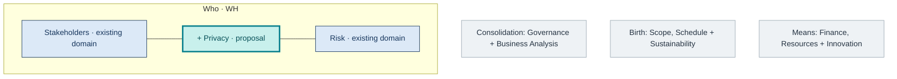
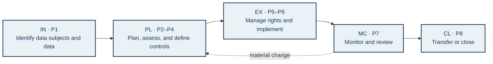
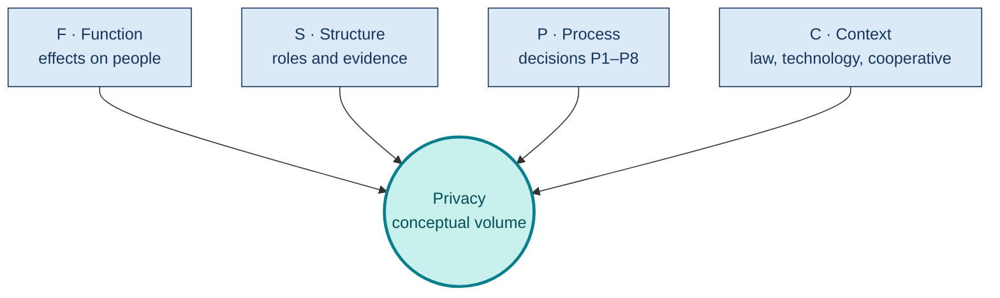
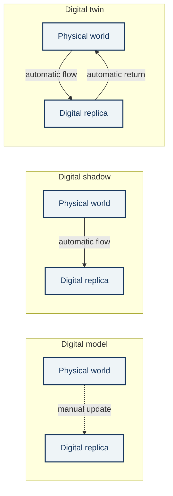
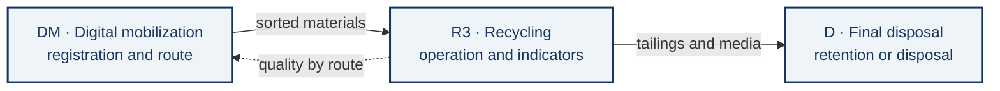

# Privacy as a proposed PMBOK 8 performance domain

**SIPA group:** Privacy 2  
**Concentration:** Who  
**Related existing domains:** Stakeholders and Risk  
**Nature:** academic extension proposal; processes P1–P8 below **are not official PMI processes**.

## Abstract

This report proposes a Privacy performance domain as an extension of PMBOK 8. The method combines a focused reading of the *Standard* and the *Guide*, an analysis of the Stakeholders and Risk domains, a review of studies on privacy in digital twins, and a comparison with data protection references. The analysis found explicit references to data protection, the GDPR, and privacy in PMBOK 8, chiefly in legal constraints, in the compliance example under Finance, and in the appendix on artificial intelligence. It did not find, among its seven domains and 40 processes, a domain whose main object is the effects of data processing on identified or identifiable people. The digital twin studies examined address legal requirements, architectures, and technical controls, but do not organize these concerns as project management processes. Eight processes are proposed, distributed across the five Focus Areas, with tools and techniques, additions and changes to the thirteen existing Stakeholders and Risk processes, tailoring by context, and criteria for verifying results. The proposal is assessed against the six project management principles and illustrated with a hypothetical scenario of a digital twin for recycling by cooperatives. The result is a model to be tested and adjusted; its formal inclusion would depend on subsequent editorial and empirical validation.

**Keywords:** privacy; data protection; PMBOK 8; performance domains; digital twins; stakeholders; risk; application area extension.

## 1. Object, scope, and method

This work places the four SIPA domains — Sustainability, Innovation, Privacy, and Business Analysis with Risk-Adjusted Decisions — in four concentrations that group the seven PMBOK 8 domains: Consolidation (Governance), Birth (Scope and Schedule), Means (Finance and Resources), and Who (Stakeholders and Risk). This grouping is an organization adopted in this work; **it is not a PMI classification**. As the SIPA Privacy group, we develop **P → Who**, alongside the official Stakeholders and Risk domains. The other SIPA domains appear only in the integration map (Figure 1).

The main corpus is the eighth edition of *The Standard for Project Management and A Guide to the Project Management Body of Knowledge* [14]. We identified the seven domains and 40 processes in the organization of the *Guide*, paying particular attention to sections 2.5 (Stakeholders) and 2.7 (Risk) and to the table that associates processes with Focus Areas. We read the six principles in the *Standard*. We ran a targeted text search on privacy terms in the text of the edition and checked the meaning of the relevant passages. The text search does not prove conceptual absence across the whole book; it serves only to locate explicit language.

For the digital twin literature, we searched the Web of Science combining digital twins, privacy, and data protection, and examined the studies most closely related to the topic. The results cited in the text are Wang et al. [17], Dhinakaran et al. [5], Korchenko et al. [11], Shaikh et al. [15], Son et al. [16], and Jørgensen and Ma [10]. The conceptualization of the digital twin draws on the Digital Twin Consortium [6] and on the classification by Kritzinger et al. [12].

For the data protection dimension, we take Brazil's LGPD [2] as the normative reference, the *NIST Privacy Framework* [13] as the reference for managing risk to individuals, and NIST IR 8062 [3] as the reference for privacy engineering. The GDPR [9] appears as a comparative counterpoint, not as a rule that automatically applies to any Brazilian cooperative. We carried out neither a legal audit nor an empirical measurement of compliance.

### 1.1 Criterion for proposing a domain of its own

An extension makes sense if it adds an **identifiable management object**, decisions, and evidence that existing domains do not make sufficiently visible. Here, the object is the processing of personal data and its possible effects on data subjects. A project may meet its schedule, cost, and scope and still cause undue risks to people. A generic risk matrix can record such events, but it does not, by itself, guarantee a data inventory, purpose, legal basis, data subject rights, or the disposition of data at the end of the life cycle. Stakeholder management identifies people relevant to the project, but a data subject may not take part in it, may not even know that their data were inferred, and remains a holder of rights.

This argument is **organizational**, not a claim that PMBOK 8 is unaware of privacy. The *Guide* mentions data protection in legal constraints, the GDPR in a compliance example in the Finance domain, and privacy in the appendix on AI [14]. The proposal brings these concerns together in a verifiable domain, located in Who because it places affected people and their relationships with the project at the center.

## 2. Diagnosis of PMBOK 8

### 2.1 What already exists

The **Stakeholders** domain contains seven processes: Identify Stakeholders; Plan Stakeholder Engagement; Plan Communications Management; Manage Stakeholder Engagement; Manage Communications; Monitor Stakeholder Engagement; and Monitor Communications [14, §2.5.2]. The definition of *Manage Communications* itself reaches the creation, distribution, storage, retrieval, and disposition of project information. This is a real point of contact with data governance, although it does not specify the entire life cycle of personal data or data subject rights.

The **Risk** domain contains six processes: Plan Risk Management; Identify Risks; Perform Risk Analysis; Plan Risk Responses; Implement Risk Responses; and Monitor Risks [14, §2.7.2]. It is an adequate structure for recognizing uncertainty and tracking responses. However, its general description covers threats and opportunities for project objectives; a privacy assessment must also consider problems that data processing may cause to people, even without a security failure. The NIST Privacy Framework states that managing cybersecurity risk contributes to managing privacy risk but is not sufficient, since there are privacy risks that arise by means other than cybersecurity incidents [13].

There are also scattered references in PMBOK 8: data protection laws may limit project options; AI tools raise privacy issues; communications may require protection of sensitive information [14]. Hence, the hypothesis we support is more precise: **the topic appears, but it is not organized as a dedicated domain and set of processes** among the seven official domains.

### 2.2 What the new organization needs to make observable

| Management question | Coverage already available | Additional evidence proposed |
| --- | --- | --- |
| Who may be affected by the processing? | Identify and engage stakeholders | Categories of data subjects, including people with no active participation in the project |
| What event may harm someone? | Identify, analyze, and monitor risks | Scenarios of harm to the person associated with data operations, with their own criteria |
| What information circulates and why? | Plan and manage communications | Data inventory, purpose, legal basis, necessity, retention, and sharing |
| When to intervene in the project? | Focus Areas and governance decisions | Criteria to proceed with, modify, or halt a data processing activity |
| How to demonstrate results? | Reports, records, and lessons learned | Evidence of controls, data subject requests, impact review, and data disposition |

The table describes **proposed responsibilities**, without claiming that every project needs every technique. PMBOK 8 itself emphasizes *tailoring*: intensity, formality, and artifacts should reflect the context [14, Ch. 3 of the Guide]. The ANPD, for example, advises that the data protection impact assessment (DPIA/RIPD) is recommended when processing may generate high risk to data protection principles, and that the LGPD provides for situations in which it may be required [1]; we do not treat it as a universal obligation for every project.

### 2.3 What the digital twin literature adds

The studies examined converge on points that support the proposal.

**Collection and sharing as the origin of risk.** In a survey on the Internet of Digital Twins, Wang et al. [17] point out that privacy violations may arise from pervasive individual data collection and from massive data sharing among twins. Son et al. [16] observe that data generated by physical assets may contain sensitive information about their owners and that leakage causes serious privacy problems, which makes secure sharing of twin data a central challenge.

**Ethical and legal issues in twins that involve people.** Dhinakaran et al. [5], addressing home digital twins, identify privacy, data security, consent, and accountability as central issues, in addition to regulatory compliance, including cross-border data flows. The practices the study reviews include privacy by design, transparency, user-centered design, periodic audits and updates, and anonymization.

**Data resolution and indirect identification.** In environmental digital twins, Korchenko et al. [11] show that high spatiotemporal data resolution may allow indirect identification, and they propose mapping the GDPR and NIS2 across the entire data life cycle: reception, transport, storage, analysis, sharing, and publication. The study also mentions data protection impact assessment and differential privacy as instruments.

**Technical controls exist; compliance practice is the gap.** In a review of blockchain-enabled digital twins in healthcare, Shaikh et al. [15] find that the technology is used mainly for access control, audit logging, integrity, consent management, and data provenance, and they identify gaps in the formal implementation of engineering practices compliant with the GDPR and HIPAA. Jørgensen and Ma [10] show that six European regulations (among them the GDPR, the Data Act, the AI Act, and NIS2) jointly govern digital twins, with overlapping obligations in data governance, privacy, and cybersecurity.

In the studies examined, the focus falls on legal requirements, architectures, and technical controls. We did not find in them an organization of these concerns as project management processes aligned with PMBOK 8. This observation is limited to the set examined and is not a claim about the literature as a whole.

## 3. Justification of the extension in four aspects

### 3.1 CN — Characterization of the need

Projects that build platforms, digital twins, or AI models may collect, combine, infer, share, and discard data about people. In this context, a confidentiality incident is only one of the possible forms of harm. Also relevant are use incompatible with the stated purpose, improper inferences, location exposure, excessive retention, and automated decisions that affect individuals. NIST distinguishes risks arising from processing from those arising from security incidents [13]; the LGPD organizes principles, legal bases for processing, rights, and accountability [2]. The digital twin literature confirms that continuous collection, sharing among twins, and data resolution create exposure for people [11, 17]. The need for the extension is to create a visible line of decision from the start to the closing of the project.

### 3.2 CD — Development criteria

The proposed domain must: (i) have its own scope and not fully duplicate Stakeholders or Risk; (ii) use verbs and artifacts recognizable in the PMBOK 8 process vocabulary; (iii) make clear where there is an input, tool or technique, decision, owner, and output; (iv) be tailorable according to volume, sensitivity, technology, purpose, and institutional context; (v) record risk **to data subjects** in addition to risk **to the organization**; and (vi) allow assessment through observable evidence. These criteria are an editorial proposal of the group.

### 3.3 PF — Publication and format

We propose a domain section with the same structure as the domains of the *Guide*: key concepts (§4.1), processes with inputs, tools and techniques, and outputs (§4.2), tailoring considerations (§4.3), interactions with other domains (§7), and verification of results (§4.6). The tables on adherence to the Focus Areas and to the principles would form part of the supporting material. In publication, each process would receive an application example and a caveat that legal obligations depend on the specific case and jurisdiction. In this work, the domain is an **academic prototype**; its number and names may change after review.

### 3.4 DM — Development and maintenance

A later version should undergo review by project management, privacy, and systems operation professionals and by representatives of data subjects; testing in cases with different characteristics; recording of editorial decisions; and revision when norms, technology, or evidence change. Success measures include coverage of the data flow, quality of decision records, identification of risks to people, and the ability to correct inadequate processing. We do not propose to assert legal compliance from the mere adoption of the domain.

## 4. The Privacy domain in the Who concentration

**Proposed purpose:** to make projects that process personal data recognize data subjects, explain purposes, assess impacts on people, and produce proportionate evidence of protection throughout the life cycle. The domain interacts directly with Stakeholders and Risk. Its position in **Who** is a modeling decision of this work, not an official PMI classification.

**Expected results:** data and data subjects identified to the extent necessary; decisions on purpose and legal basis recorded; risks to people assessed; controls and owners defined; data subject requests routed; changes and closing of processing documented. Concrete indicators will depend on the project. NIST IR 8062 offers three useful objectives for assessing the design: predictability about the use of data, the ability to administer them, and limiting the association of data with individuals beyond what is necessary [3].

**Figure 1 — Position of the proposed domain among the concentrations.** The gray cards situate the other concentrations; the blue card delimits **Who**, and the teal one identifies this group's contribution. The figure distinguishes the existing PMBOK 8 domains from the proposed SIPA additions. *Authors' own elaboration.*

<!-- Design of Figure 1 for eventual layout:
Draw four concentration bands, each with its existing domains
and the corresponding SIPA addition. Give Who greater visual width. Within
Who, Stakeholders and Risk remain in blue; Privacy enters
in teal with a plus sign. The other three additions stay in gray,
as they are only context in this work. A solid line links Privacy
to Stakeholders and Risk; interfaces with the other concentrations
should be dashed. Do not call the SIPA domains PMI domains.
Alt text: Privacy proposed within Who, alongside the two official
domains, in a map of the four concentrations. -->

### 4.1 Key concepts

As in the domains of the *Guide*, the section begins with the concepts that the processes use. The meanings below follow the LGPD [2, Art. 5] and the NIST Privacy Framework [13].

| Concept | Meaning adopted |
| --- | --- |
| **Personal data** | Information relating to an identified or identifiable natural person. |
| **Data subject** | Natural person to whom the data refer. May not take part in the project or know about the processing. |
| **Processing** | Any operation with personal data: collection, production, reception, classification, use, access, reproduction, transmission, distribution, processing, archiving, storage, deletion, evaluation, control, modification, communication, transfer, dissemination, or extraction. |
| **Controller and processor** | Whoever decides on the processing and whoever carries it out on behalf of the controller. The project team does not automatically assume either of these roles. |
| **Purpose, adequacy, and necessity** | LGPD principles (Art. 6): legitimate and informed purpose, compatibility of the processing with it, and limitation to the minimum necessary. |
| **Legal basis** | Ground that authorizes the processing (Art. 7; Art. 11 for sensitive data) [2]. It is not a synonym for consent. |
| **Data action** | Operation in the data life cycle, such as collection, retention, logging, generation, transformation, use, disclosure, sharing, transmission, and disposal [13]. Privacy risk arises from the set of these actions. |
| **Impact assessment report (DPIA/RIPD)** | Controller's document that describes processing activities that may generate risks to civil liberties and fundamental rights, and the mitigation measures [2, Art. 5, XVII]. |
| **Privacy event and security incident** | Distinct concepts. Processing may harm people without any security failure [13]. |

### 4.2 Processes proposed by the group

The codes **P1–P8** below identify only this proposal. The inputs and outputs are examples to guide *tailoring*; they do not reproduce official PMBOK 8 tables.

| Proposed code and process | Primary Focus Area | Input → decision/activity → output | Interface with existing process |
| --- | --- | --- | --- |
| **P1 Identify data subjects and personal data** | Initiating | Project idea, expected flows → recognize categories of people, data, collection points, and direction of flows → initial inventory | *Identify Stakeholders*; *Identify Risks* |
| **P2 Plan privacy management** | Planning | Inventory, objectives, legal environment → define purpose, legal basis to be verified, roles, retention, and response to data subjects → privacy plan | *Plan Risk Management*; *Plan Communications Management* |
| **P3 Assess privacy impacts** | Planning | Data operations, architecture, and risks → assess possible effects on people and the need for a DPIA → assessment record and, when applicable, DPIA | *Perform Risk Analysis* |
| **P4 Plan responses and controls** | Planning | Impact assessment → select minimization, access, transparency, retention, and other proportionate responses → control plan, owners, and acceptance criteria | *Plan Risk Responses* |
| **P5 Manage communication and data-subject rights** | Executing | Plan, channels, and requests → inform, receive, and route requests according to the applicable rule → communication and response records | *Manage Stakeholder Engagement*; *Manage Communications* |
| **P6 Implement controls and handle incidents** | Executing | Control plan, changes, and alerts → implement safeguards, log the occurrence, and trigger a response → implementation evidence and incident log | *Implement Risk Responses* |
| **P7 Monitor privacy risks and practices** | Monitoring and Controlling | Metrics, records, and changes → review effectiveness, new purposes, and risks → recommendations, plan revisions, and evidence | *Monitor Risks*; *Monitor Stakeholder Engagement* |
| **P8 Close or transfer processing under control** | Closing | Updated inventory, retention and transition requirements → decide retention, transfer, or deletion as appropriate → record of disposition and future responsibilities | *Close Project or Phase* |

**Figure 2 — Sequence and return of the eight proposed processes.** The solid arrows show the suggested initial order; the dashed arrow represents the need to return to planning when observation reveals a new purpose, technology, or risk. Data recording and management may continue in operations after the project is closed. *Authors' own elaboration; correspondences with Focus Areas grounded in PMBOK 8 and proposed by the group.*

<!-- Design of Figure 2:
Use a horizontal band with five blocks IN, PL, EX, MC, and CL. Inside them,
show P1; P2–P4; P5–P6; P7; P8, respectively, with an evidence line:
inventory, plan and impact, records, review, disposition. The MC→PL arrow must
be dashed and labeled "material change". Do not suggest that PMBOK 8 contains
these eight processes; use the caption "processes proposed by the group".
Alt text: eight Privacy processes distributed across five Focus Areas,
with monitoring returning to planning. -->

**P1** needs to occur early so that processing is not discovered only when the system goes into production. The identification may be revisited in any Focus Area when there is a new data item, data subject, or purpose. The inventory must distinguish personal data from operational data with no identifiable person; it is not presumed that every sensor processes personal data. In digital twin projects, the inventory also classifies each flow by direction and frequency (§4.5).

**P2** records the project decision on why, by whom, and for how long data would be processed. The legal basis is not a synonym for consent: it must be determined in the concrete context by whoever has the competence to do so. The process integrates communication planning, procurement, architecture, and institutional accountability, and it incorporates privacy by design, a recurring practice in studies on digital twins [5].

**P3** assesses potential effects on people, including when no leak exists. According to ANPD guidance, a DPIA is recommended especially when processing may generate high risk and may be required by the authority [1]. The decision to prepare the document or not must be justified; the process does not automatically establish that it is mandatory in all cases.

**P4** turns the analyzed risks into design and operation alternatives. Examples are reducing collection, restricting access, separating identifiers, limiting sharing, aggregating data, applying differential privacy where appropriate [11], and defining a retention period. The choice must consider benefit, cost, feasibility, residual effects, and responsibility for implementation.

**P5** brings data subjects and the team closer together without presuming that every data subject is a user of the product. The project must provide intelligible information and a flow for requests for access, correction, or other applicable measures [2, Art. 18]. Effective handling depends on the controller and the applicable rules; the project team designs and documents the mechanism for transition to operations. Where there is consent, consent management is part of the mechanism [15].

**P6** implements the approved controls and responds to occurrences. A security incident and a privacy event are not identical concepts [13]; both may require investigation and change. Logging of accesses and operations supports auditing [15]. One should not promise that an isolated technical measure guarantees compliance.

**P7** verifies whether decisions remain adequate after changes in scope, technology, suppliers, or purpose. It may produce a revision of the impact assessment, plan, and acceptance criteria. The assessment of effectiveness must include effects on people, not only continuity of the service. Periodic audits and updates are a recommended practice in the literature [5].

**P8** does not mean erasing all data when the project ends. Closing must define the disposition of each dataset according to retention obligations, remaining purpose, and operational responsibility [2, Arts. 15 and 16]. The minimum output is a traceable decision to retain, transfer, or delete, with owners.

#### 4.2.1 Tools and techniques and their foundations

PMBOK 8 processes are described by inputs, tools and techniques, and outputs. The table completes the design of the proposed processes with examples of tools and techniques and with the foundation of each. They are examples for *tailoring*, not prescriptions.

| Process | Tools and techniques (examples) | Foundation |
| --- | --- | --- |
| **P1** | Data and flow mapping; interviews and workshops with stakeholders; analysis of requirements documents; classification of flows by direction (model, shadow, twin); expert judgment | [2, Art. 5] (personal data, data subject); [12]; [17] |
| **P2** | Analysis of legal basis and of purpose, necessity, and adequacy; definition of roles (responsibility matrix); privacy by design | [2, Arts. 6, 7, and 11]; [5] |
| **P3** | Impact assessment report (DPIA/RIPD); assessment of privacy problems arising from processing; privacy threat modeling (for example, LINDDUN); high-risk criteria | [2, Arts. 5, XVII, and 38]; [1]; [13]; [4] |
| **P4** | Minimization, aggregation, pseudonymization and anonymization, access control, differential privacy; selection of responses by benefit, cost, and residual risk | [3]; [11]; [5] |
| **P5** | Data subject service channels; notice and communication templates; consent management where applicable; request logging | [2, Art. 18]; [15] |
| **P6** | Technical and organizational controls; audit logging; incident response plan; incident communication | [2, Art. 48]; [15]; [16] |
| **P7** | Periodic audits; effectiveness indicators; DPIA review upon changes; reassessment triggers | [5]; [13] |
| **P8** | Retention and deletion policy; transfer decision with record; verification of future owners | [2, Arts. 15 and 16]; [11], data life cycle |

### 4.3 Tailoring to context

PMBOK 8 asks that processes and domains be tailored to the context [14, Ch. 3 of the Guide]. For Privacy, the most relevant variables are data volume, sensitivity, resolution (spatial and temporal), direction of flows, existence of automated decision-making, and type of operator. The table grades the effort in three profiles.

| Project profile | Expected effort | Examples of adjustment |
| --- | --- | --- |
| **A. Aggregated data, with no reasonable possibility of identifying people** | Minimal, concentrated on demonstrating and reviewing this condition | Short P1 and P8; P3 limited to the analysis of re-identification by cross-referencing; P7 reviews if there are new cross-references |
| **B. Ordinary personal data, on a limited scale** | Moderate | Lean privacy plan (P2); recorded impact assessment, DPIA only if justified (P3); simple channel for data subjects (P5) |
| **C. Sensitive data, large scale, automated decision-making, or twin with bidirectional flow** | High | DPIA prepared before processing (P3); reinforced controls and periodic audit (P4, P6, P7); independent review; explicit record of the decision to proceed, modify, or halt |

The grading in C follows the criteria that the ANPD indicates as a reference for high risk: a general criterion, such as large scale, combined with a specific one, such as sensitive data or automated decisions, in a non-exhaustive list [1]. The person responsible for the project documents the chosen profile and reviews it when the context changes. This gradation avoids both a disproportionate documentary ritual and the omission of relevant risks.

### 4.4 Systemic reading by function, structure, process, and context

The domain can be characterized as an open system. **Function:** to make the effects of data processing on people visible and governable, while preserving the legitimate value of the project. **Structure:** roles, processes P1–P8, records, channels, decision criteria, and interfaces with Stakeholders and Risk. **Process:** identify, plan, assess, implement, monitor, and transfer or close processing, returning to earlier decisions when the context changes. **Context:** PMBOK 8 and its tailoring, the Brazilian data protection framework, the institutions involved, technology, and the cooperative scenario. The Context dimension prevents privacy from being treated as a mere technical configuration of the product; Structure and Process prevent it from remaining only an abstract value.

The chaining model Demand, Industrialization, Solution, and Offer (PISO) can serve the reading of value: the demand for information must be justified before collection is industrialized; the solution must demonstrate benefit; and the offer to the user or operator must preserve the conditions under which the data were obtained. This use is interpretive and does not add four processes to the domain.

**Figure 3 — The F/S/P/C tetrahedron as a reading instrument.** The four vertices represent the systemic questions of function, structure, process, and context; **Privacy** occupies the conceptual volume that they delimit. The Mermaid projection is a schema of relationships, not a geometric drawing in perspective. *Authors' own elaboration.*

<!-- Design of Figure 3:
In the graphic version, draw a tetrahedron in perspective with four vertices
F, S, P, and C and semi-transparent faces. Place "Privacy" in the central volume.
Beside each vertex, a question and an example: F—what effect to protect;
S—who and which artifacts; P—which decisions in the cycle; C—in which legal
and operational environment. Use soft colors and do not attribute the literal geometry to the PMI.
Alt text: tetrahedron with vertices Function, Structure, Process, and Context
and Privacy as the internal volume. -->

### 4.5 Digital twins: data flow and privacy

The Digital Twin Consortium defines a digital twin as "a virtual representation of real-world entities and processes, synchronized at a specific frequency and fidelity" [6]. In the classification by Kritzinger et al. [12], what distinguishes digital replicas is the **direction of the automatic data flow** between the physical and the digital object. This distinction matters for privacy because each type exposes people differently.

| Type of replica | Data flow | Implication for privacy | Processes most engaged |
| --- | --- | --- | --- |
| **Digital model** | No automatic flow; manual update | Exposure limited to the data loads made by the team; risk concentrated at the data source | P1, P2, P8 |
| **Digital shadow** | Automatic, from physical to digital | Continuous collection about people and environments; risk of surveillance and of inference by accumulation | P1, P3, P4, P7 |
| **Digital twin** | Automatic in both directions | Beyond collection, the automatic return may affect people (decisions or recommendations applied to the physical world); requires a channel for contestation and human review | P3, P5, P6, P7 |

**Figure 4 — Direction of data flow in the three types of digital replica.** The digital model has no automatic flow; the shadow has flow from physical to digital; the twin has flow in both directions. *Authors' own elaboration, based on Kritzinger et al. [12].*

<!-- Design of Figure 4:
Three horizontal bands, one for each type (model, shadow, twin). In each
band, two blocks, "Physical world" and "Digital replica", linked by an arrow:
dashed and labeled "manual update" in the model; solid from physical to digital
in the shadow; solid in both directions in the twin, with the return arrow in teal
and the label "effect on people". To the right of each band, a short sentence with the
predominant privacy risk. Alt text: three types of digital replica,
distinguished by the direction of data flow between the physical and the digital. -->

The frequency and fidelity of synchronization, which the DTC definition itself highlights, increase exposure. The findings on indirect identification through spatiotemporal resolution [11] indicate that greater fidelity tends to increase the possibility of identifying people, which justifies P1 recording frequency and resolution and P3 considering them. This is a working hypothesis to be tested.

The DTC also lists privacy among the trustworthiness capabilities of the digital twin (*Trustworthiness* category, with the privacy capability alongside security, safety, reliability, and resilience) and, in its table of AI agent capabilities, among those of governance and security [7, 8]. These tables describe **what the twin is capable of doing** from a technical standpoint. The proposed domain describes **how the project that builds or operates the twin plans, decides, and demonstrates** that these capabilities exist and are adequate for the affected people. In practical terms, P4 selects the controls that realize the privacy and data encryption capabilities, P6 implements them, and P7 verifies that they work. Managing a digital twin project thus comes to include a line of decision on data processing that the capability tables, by themselves, do not organize.

### 4.6 Verification of results

PMBOK 8 closes each domain with guidance on keeping the focus on value [14]: for each process output there should be a higher-order result in view. The table applies this logic to Privacy.

| Expected result | Verification questions | Evidence | Processes |
| --- | --- | --- | --- |
| Data subjects and data flows known | Does the inventory cover categories of data subjects, flows, frequency, and direction? Is there a review when a new data item or purpose arises? | Updated and dated inventory | P1, P7 |
| Purpose and legal basis decided by whoever has the competence | Is the purpose specific, and was the legal basis determined without presuming consent? | Privacy plan with owner | P2 |
| Risks to people assessed and addressed | Did the assessment consider harm to the person, in addition to risk to the project? Is the decision on the DPIA justified? | Assessment record; DPIA when applicable | P3, P4 |
| Data subject rights can be honored | Is there an intelligible channel, a request flow, and an owner for the response after the transition? | Records of requests and responses | P5 |
| Controls implemented and effective | Were the approved controls implemented and tested? Were occurrences logged and handled? | Implementation evidence; incident and audit log | P6, P7 |
| Processing closed or transferred under control | Does each dataset have a decided disposition, owner, and deadline? | Record of disposition and transition | P8 |

## 5. Adherence to the five Focus Areas

The matrix below indicates the **primary** Focus Area of each proposed process, without prohibiting iterations in other areas. Focus Areas are categories of activities, not a single sequence for all projects [14, §4.5 of the Standard].

| Focus Area | Privacy question | Processes in the proposal | Decision evidence |
| --- | --- | --- | --- |
| **IN — Initiating** | Who may be affected and what processing is anticipated? | P1 | Initial inventory of data and categories of data subjects; assumptions and uncertainties |
| **PL — Planning** | Why process the data, what are the risks, and which responses are proportionate? | P2, P3, P4 | Privacy plan; impact assessment; control and acceptance criteria |
| **EX — Executing** | Do the planned communications, rights, and safeguards work in practice? | P5, P6 | Records of implementation, requests, and occurrences |
| **MC — Monitoring and Controlling** | Have changes altered the purpose, exposure, or effectiveness of the responses? | P7 | Indicators, risk review, corrective decisions, and audit trail |
| **CL — Closing** | Who becomes responsible for the data and what will be their disposition? | P8 | Record of transition, retention, or deletion and owners |

**Initiating.** Identifying affected people in the project charter helps reveal an externality that could remain hidden in technical requirements. The group does not propose to definitively assess all lawfulness at this stage: the result is an initial map that guides planning. If the project does not yet know which data it will collect, this uncertainty must be entered in the record.

**Planning.** The privacy plan connects the purpose of the processing, owners, risks, and control. The analysis must distinguish risk to project delivery from risk to the person. An action may improve the efficiency of the operation and, at the same time, increase individual exposure. The decision requires a documented comparison between alternatives, including not collecting or reducing granularity.

**Executing.** Compliance does not result merely from an approved text. It is necessary to verify the implementation of channels, access policies, notices, and response to events. When operation passes to a cooperative or another responsible party, the interface between project team and operations must be clear. Process P5 does not automatically turn the project manager into a controller or data protection officer.

**Monitoring and Controlling.** Changes in architecture, contracts, sensors, AI models, or the audiences served may create new processing without a visible change in the physical scope. Monitoring therefore compares actual operation, plan, and observed effects. A material change must reopen assessment and decision, including when the project is close to closing.

**Closing.** The closing Focus Area requires an auditable transition: which data and records stay with operations, on what justification, and which must be deleted or have their retention reviewed. Closing the project does not necessarily end the processing. The output of P8 is the assignment of responsibility and the documentation of the disposition of the data.

## 6. Adherence to the six principles

This is an **adherence analysis** of the Privacy domain against the six PMBOK 8 principles [14, Ch. 3 of the Standard]. Adherence does not mean equivalence: a principle guides judgment, whereas the domain and its processes organize specific work.

| PMBOK 8 principle | How the proposed domain supports it | Adherence test |
| --- | --- | --- |
| **1AHV — Adopt a Holistic View** | Follows the data from planning to closing, across team, suppliers, operations, and affected people. | Does the flow map include sharing and transitions between systems? |
| **2FOV — Focus on Value** | Compares the benefit of data use with possible harm to people and to trust in the service. | Does the decision make explicit the benefit, purpose, and social cost of the alternative? |
| **3QPD — Embed Quality into Processes and Deliverables** | Includes minimization, transparency, and controls as verifiable criteria for deliverables. | Are the criteria testable before acceptance of the product? |
| **4BAL — Be an Accountable Leader** | Records who decided, who implements, who oversees, and how issues are escalated. | Is there an owner and evidence for each relevant decision? |
| **5SPA — Integrate Sustainability Within All Project Areas** | Considers lasting effects of processing on people, relationships of trust, and continuity of the service. | Does the project assess consequences beyond immediate delivery? |
| **6BEC — Build an Empowered Culture** | Gives the team and those affected channels to flag problems and improve practices without hiding failures. | Does the flow allow contestation, learning, and correction? |

The relationship with **5SPA** deserves attention, since the SIPA proposal associates sustainability and privacy without merging them. An environmentally beneficial project may still produce informational harm; addressing both improves the overall assessment of value. Studies on environmental digital twins reinforce this point: high-resolution environmental data may identify people indirectly [11].

## 7. Interactions with existing domains and with the other concentrations

### 7.1 Additions and changes to the Stakeholders and Risk processes

The Privacy domain does not replace the thirteen existing processes in Who [14, §§2.5.2 and 2.7.2]: it uses their records and adds a specific question about data processing and effects on data subjects. The table proposes, for each process, the minimal addition or change that makes it privacy-sensitive, without changing its name or general purpose. All are proposals of this work.

| Existing process | Type | Proposed addition or change |
| --- | --- | --- |
| **Identify Stakeholders** | Change and input | Extend the analysis to data subjects who do not take part in the project; mark the category "personal data subject" in the stakeholder register; include the P1 inventory as an input. |
| **Plan Stakeholder Engagement** | Addition | Provide, in the engagement plan, a strategy for data subjects with no active participation: channel, language, and timing of information. |
| **Plan Communications Management** | Addition | Include communication requirements on the processing (purpose, rights channel) and restrictions on sharing information containing personal data. |
| **Manage Stakeholder Engagement** | Addition | Record statements and requests from data subjects as issues, routed to P5. |
| **Manage Communications** | Change | Apply, to the storage, retrieval, and disposition of project information, the access and retention rules defined in P2 and P8. |
| **Monitor Stakeholder Engagement** | Addition | Add an indicator of the effectiveness of the data subject channel (for example, requests received and answered). |
| **Monitor Communications** | Addition | Verify whether the information intended for data subjects reaches them and is understood. |
| **Plan Risk Management** | Addition | Define probability and impact criteria that consider harm to people, in addition to project objectives, and the acceptable risk level with an owner. |
| **Identify Risks** | Addition and input | Include the P1 inventory as an input and privacy risk categories in the risk register, described by cause, event, and consequence for the data subject. |
| **Perform Risk Analysis** | Addition | Adopt an impact scale on data subjects and analysis of harm scenarios; receive the P3 assessment as an input. |
| **Plan Risk Responses** | Addition | Include the minimization and control responses of P4 among the options, with acceptance of residual risk by a named owner. |
| **Implement Risk Responses** | Addition | Link the evidence of control implementation (P6) to the corresponding risk. |
| **Monitor Risks** | Addition | Reassess residual privacy risk upon changes in purpose, technology, or supplier, with defined triggers. |

### 7.2 Potential interfaces with the other concentrations

We record separately, as working hypotheses, the interfaces that Privacy may have with the domains of the other concentrations. We do **not** treat them as proposed changes to those processes.

| Concentration | Interface to assess | Potential decision |
| --- | --- | --- |
| **Consolidation / Governance** | Approval criteria, assignment of responsibility, escalation, and accountability | Who accepts residual risk, and with what evidence? |
| **Birth / Scope** | Product requirements and limits, including data necessity and transparency | Can the function be fulfilled with less identification? |
| **Birth / Schedule** | Timing of the impact assessment and of control verification | Should a milestone prevent deployment before the necessary analysis? |
| **Means / Finance** | Resources for control, handling of data subjects, and independent review | Does the budget reflect the risk and the full data life cycle? |
| **Means / Resources** | Skills, suppliers, training, and operation | Who executes and maintains controls after the transition? |

## 8. Illustrative scenario: recycling by cooperatives and digital twins

To test the proposed processes, we considered a **hypothetical scenario**, devised by the authors: a digital twin project for a recycling system run by cooperatives of waste pickers, with an app to mobilize residents, sorting in a warehouse, and final disposal of tailings. In this scenario, the app could collect registration data, location, and images of residents; the recycling twin could receive, by route, indicators of sorting quality; warehouse workers could be recorded in attendance or productivity controls; and physical media holding data would be discarded at the end. This is an illustration, not a description of an existing operation.

**Figure 5 — Scenario used as a test of the extension.** Solid arrows represent movement of materials; the dashed arrow indicates return of information by route. At each component, P1–P8 ask the same questions: **whose data are they, for what purpose, who receives them, and what is their disposition?** The figure is hypothetical and does not represent an audited real flow. *Authors' own elaboration.*

<!-- Design of Figure 5:
Three blocks of equal height: Digital Mobilization (DM), Recycling (R3), and
Final Disposal (D). Solid gray arrows carry sorted materials and then
tailings/media; a dashed blue arrow returns from R3 to DM with a quality
indicator by route. Above the three blocks, place a teal ruler with
four privacy questions. The legend separates physical flows from information.
The text of the figure must say "hypothetical scenario" and not "proven operation".
Alt text: DM→R3→D chain of materials, with informational return R3→DM
and privacy questions valid across the three components. -->

The scenario helps test P1–P8. In initiating, P1 asks which registration and worker data are indispensable for the twin's purpose and classifies the flow of indicators by route as an automatic return of the twin type (§4.5). In planning, P2 fixes roles and conditions for sharing among components; P3 compares risks of inferring household behavior or of ranking people, and considers that resolution by route and by time of day may allow indirect identification [11]; P4 considers aggregation of indicators and restriction of access. In executing, P5 makes the channels intelligible and P6 verifies controls. In monitoring, P7 detects a new purpose when a model begins to cross-reference previously separate data. In closing, P8 decides on retention and disposal of digital records and physical media.

This example explains why the **Who** concentration is appropriate: residents, waste pickers, cooperative representatives, and other affected people do not hold the same position in the project. The identification of stakeholders must be complemented by the analysis of data subjects and data operations. It also explains why **Risk** remains an indispensable interface: there are technical and organizational uncertainties, but the harm criterion must include the effect on people. The example does not prove that the eight processes are the only possible design; it offers a case for testing coverage and redundancy.

## 9. Limits, validation, and conclusion

This is an academic extension project, not a PMI publication or a declaration of compliance with the LGPD. Its main evidence is documentary. Eight processes may be too many or too few; some may be merged after testing. The map of the five Focus Areas assigns a primary location to each process, but practice may require returning to earlier stages. The observation about the literature is limited to the studies examined. The other SIPA domains appear only in the integration map.

To validate the proposal, we recommend a review matrix by three profiles: project management, data protection, and cooperative operation. Each profile should verify whether the processes have a clear object, obtainable inputs, real decisions, and outputs that can be audited without excessive bureaucracy. Tests in cases with few personal data and cases with high granularity would help calibrate *tailoring*. Tests in digital twin projects with bidirectional flow would make it possible to assess the hypothesis on frequency and resolution (§4.5).

We conclude that PMBOK 8 offers management instruments useful for privacy, but the proposed organization may make this object more explicit and continuous. The **Privacy → Who** domain adds the life cycle of personal data and the assessment of effects on data subjects to the dialogue with **Stakeholders** and **Risk**. For digital twin projects, it offers a line of decision on data processing that the technical capability tables do not organize. The contribution is a structure of questions, processes, and evidence to be evaluated, not a promise of automatic compliance.

## 10. Final report of the work

Following the format of the *Final report*, an output of the *Close Project or Phase* process [14, §2.1.6.9], this item summarizes the performance of the work of preparing the proposal, taken as the project reported.

| Final report item | Status of the work |
| --- | --- |
| **Summary description** | Preparation of a proposal for a Privacy domain for PMBOK 8, in the Who concentration: diagnosis, justification in four aspects, eight processes with tools and techniques, additions and changes to the thirteen existing processes, tailoring, verification of results, and adherence to the Focus Areas and to the principles. |
| **Scope objectives and evidence of completion** | Scope: justify and propose the domain, map adherence to the five Focus Areas and the six principles, and record interfaces with the other concentrations. Completion criterion: sections 3 to 7 produced. Evidence: tables in sections 4 to 7. Limit: no other SIPA domain was developed. |
| **Quality objectives and verification** | Development criteria of section 3.2 used as acceptance criteria. Verification: names, counts, and sections of PMBOK 8 checked against the text of the edition; same structures and data in the Portuguese and English versions. No external review. |
| **Cost objectives and variances** | The work had no financial budget. The team's effort is not reported here. |
| **Validation of the final result** | Documentary check done. Validation by experts in project management, data protection, and cooperative operation, proposed in section 9, still pending. |
| **Schedule and realization of benefits** | Work carried out in a short cycle of preparation, review, and checking, delivered on the scheduled date. The benefits of adopting the domain are hypotheses to be tested. |
| **Business needs met** | The need described in section 3.1, managing the effects of personal data processing throughout the project, received a structured proposal. Its effective fulfillment depends on validation. |
| **Risks and issues encountered** | (i) Scope delimitation: it was decided to develop a single domain, Privacy. (ii) Redundancy with Stakeholders and Risk: addressed by the table of additions and changes (§7.1) and by the criterion of not duplicating. (iii) Formulation of the gap: the initial hypothesis of absence was replaced by a more precise formulation, after reading the *Guide* (§2.1). (iv) Legal application varying by case and jurisdiction: addressed with caveats throughout the text. |

## References

Numbered in alphabetical order of the first author (or responsible entity). In the text, the number appears in square brackets, with the section or article where pertinent.

[1] ANPD — AUTORIDADE NACIONAL DE PROTEÇÃO DE DADOS. *Relatório de Impacto à Proteção de Dados Pessoais (RIPD): perguntas e respostas* [Data Protection Impact Assessment Report (RIPD): questions and answers]. Brasília: ANPD, [n.d.]. Available at: https://www.gov.br/anpd/pt-br/canais_atendimento/agente-de-tratamento/relatorio-de-impacto-a-protecao-de-dados-pessoais-ripd. Accessed: 4 Nov. 2026.

[2] BRAZIL. *Lei nº 13.709, de 14 de agosto de 2018* [Law No. 13,709 of 14 August 2018]. Lei Geral de Proteção de Dados Pessoais (LGPD) [General Personal Data Protection Law]. Available at: https://www.planalto.gov.br/ccivil_03/_ato2015-2018/2018/lei/l13709.htm. Accessed: 4 Nov. 2026.

[3] BROOKS, S.; GARCIA, M.; LEFKOVITZ, N.; LIGHTMAN, S.; NADEAU, E. *An introduction to privacy engineering and risk management in federal systems*. NISTIR 8062. Gaithersburg: National Institute of Standards and Technology, 2017. Available at: https://csrc.nist.gov/pubs/ir/8062/final. Accessed: 4 Nov. 2026.

[4] DENG, M.; WUYTS, K.; SCANDARIATO, R.; PRENEEL, B.; JOOSEN, W. A privacy threat analysis framework: supporting the elicitation and fulfillment of privacy requirements. *Requirements Engineering*, vol. 16, no. 1, pp. 3-32, 2011. DOI: 10.1007/s00766-010-0115-7.

[5] DHINAKARAN, D.; RAJA, S. E.; RAMATHILAGAM, A.; VENNILA, G.; ALAGULAKSHMI, A. Ethical and legal challenges with IoT in home digital twins. *MethodsX*, vol. 14, art. 103409, 2025. DOI: 10.1016/j.mex.2025.103409.

[6] DIGITAL TWIN CONSORTIUM (DTC). *Digital Twin Consortium defines digital twin*. [S.l.]: DTC, 2020.

[7] DIGITAL TWIN CONSORTIUM (DTC). *Digital twins capabilities periodic table*. Version 1.2. [S.l.]: DTC, 2025.

[8] DIGITAL TWIN CONSORTIUM (DTC). *AI agent capabilities periodic table: user guide*. Version 1.0. [S.l.]: DTC, 2025.

[9] EUROPEAN UNION. *Regulation (EU) 2016/679 of the European Parliament and of the Council, of 27 April 2016* (General Data Protection Regulation).

[10] JØRGENSEN, B. N.; MA, Z. G. Digital twins under EU law: a unified compliance framework across smart cities, industry, transportation, and energy systems. *Electronics*, vol. 14, no. 24, art. 4881, 2025. DOI: 10.3390/electronics14244881.

[11] KORCHENKO, O.; KORCHENKO, A.; PROKOPOVYCH-TKACHENKO, D.; KARPINSKI, M.; KAZMIRCHUK, S. Multi-layered open data, differential privacy, and secure engineering: the operational framework for environmental digital twins. *Sustainability*, vol. 18, no. 4, art. 1912, 2026. DOI: 10.3390/su18041912.

[12] KRITZINGER, W.; KARNER, M.; TRAAR, G.; HENJES, J.; SIHN, W. Digital twin in manufacturing: a categorical literature review and classification. *IFAC-PapersOnLine*, vol. 51, no. 11, pp. 1016-1022, 2018. DOI: 10.1016/j.ifacol.2018.08.474.

[13] NIST — NATIONAL INSTITUTE OF STANDARDS AND TECHNOLOGY. *NIST Privacy Framework: a tool for improving privacy through enterprise risk management*. Version 1.0. Gaithersburg: NIST, 2020. Available at: https://www.nist.gov/privacy-framework. Accessed: 4 Nov. 2026.

[14] PMI — PROJECT MANAGEMENT INSTITUTE. *The Standard for Project Management and A Guide to the Project Management Body of Knowledge (PMBOK Guide)*. 8th ed. Newtown Square: PMI, 2025.

[15] SHAIKH, M. F.; HASSAN, S. H.; SHAMSI, J.; MACCARO, A.; PIAGGIO, D. Blockchain-enabled digital twin systems in healthcare: a systematic scoping review of architectural integration, privacy, governance, ethical challenges, and regulatory solutions under GDPR and HIPAA. *Frontiers in Digital Health*, vol. 8, art. 1898383, 2026. DOI: 10.3389/fdgth.2026.1898383.

[16] SON, S.; KWON, D.; LEE, J.; YU, S.; JHO, N.-S.; PARK, Y. On the design of a privacy-preserving communication scheme for cloud-based digital twin environments using blockchain. *IEEE Access*, vol. 10, pp. 75365-75375, 2022. DOI: 10.1109/ACCESS.2022.3191414.

[17] WANG, Y.; SU, Z.; GUO, S.; DAI, M.; LUAN, T. H.; LIU, Y. A survey on digital twins: architecture, enabling technologies, security and privacy, and future prospects. *IEEE Internet of Things Journal*, vol. 10, no. 17, pp. 14965-14987, 2023. DOI: 10.1109/JIOT.2023.3263909.
