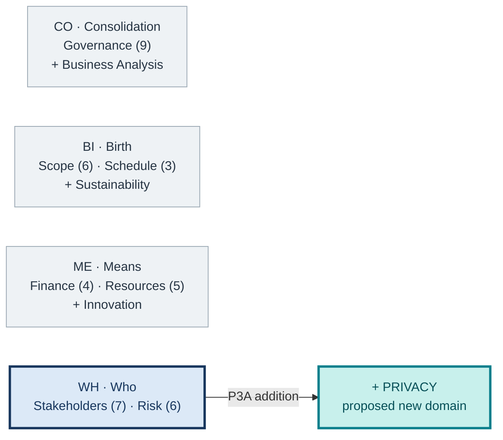
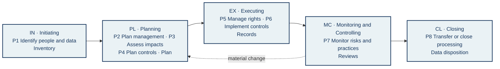

# Privacy as a proposed PMBOK 8 performance domain

**P3A · SIPA Privacy 2 group · Who (WH) concentration**  
**Academic proposal:** processes P1–P8 **are not official PMBOK 8 processes**.

## Problem and contribution

PMBOK 8 mentions data protection and privacy, but its seven domains and 40 processes do not organize personal-data processing as a separate management object. We propose **Privacy** next to **Stakeholders (7 processes)** and **Risk (6 processes)**. Our central question is: **how might project data practices affect people, and what evidence supports the project's choices?**

## Figure 1 — Where Privacy fits

<!-- Visual direction for the eventual poster:
Position: upper central band, about one third of usable space. Draw four
concentration cards. The first three are light gray; Who has a dark blue border.
Beside Who, show Privacy as an added teal card linked to the existing
Stakeholders and Risk domains. Counts 9/6/3/4/5/7/6 cover official PMBOK 8 processes only.
Do not use the PMI logo or imply that the four SIPA domains are already official.
Caption key: blue = Who's PMBOK 8 domains; teal = P3A proposal; gray = the other concentrations.
Avoid decorative photography. Alt text: four course concentrations; Privacy is
added to Who beside Stakeholders and Risk. -->

*Reading:* the four concentrations belong to the course's organization; **Privacy** is this group's contribution to **Who**.

## Figure 2 — How the domain spans the project

<!-- Visual direction for the eventual poster:
Position: central band; this is the largest figure. Five columns linked by
solid arrows represent Focus Areas IN, PL, EX, MC, and CL. Each column has
P1–P8 codes, a short action, and its principal evidence. A dashed arrow from
MC back to PL means reassessment after changes to data, purpose, or risk; it
does not make the Focus Areas a rigid sequence. Use the same codes as the report.
Smaller vector icons may distinguish inventory, plan, control, review, and data
disposition, but each icon must retain a text label. Alt text: eight proposed
processes across five Focus Areas, with monitoring feeding planning. -->

*Reading:* **P1–P8 are group proposals**. The return arrow represents reassessment; data processing may continue after project closure.

## Alignment with the 6 principles

**1AHV** end-to-end view of data flows · **2FOV** benefits weighed against potential harms · **3QPD** privacy as a verifiable quality criterion · **4BAL** accountable decisions and owners · **5SPA** lasting effects on people · **6BEC** channels for challenge and learning.

## Figure 3 — Scenario used to test the proposal

<!-- Visual direction for the eventual poster:
Position: visual footer, above references. Draw three vector blocks based on
the P2B scenario: digital mobilization, R3 recycling, and final disposal.
Arrows represent possible data sharing or transfer in the studied scenario,
not actual flows that have been audited. Above the chain, place four short
questions: whose data, for what purpose, who receives them, and what happens
to them at the end. This figure is a test case for the extension, not a legal
compliance diagram. Alt text: personal-data scenario across three solid-waste
system components. -->

*Test:* P1–P8 should identify people, purposes, sharing, risks, and data disposition without duplicating Stakeholders and Risk. **For P3C:** assess cross-links with Governance, Scope, Schedule, Finance, and Resources separately.

**Sources:** PMI, *PMBOK Guide*, 8th ed., §§2.5 and 2.7; Brazilian LGPD; ANPD impact-assessment guidance; NIST Privacy Framework and IR 8062; the group's P2B consolidation. Full references appear in the P3A report.
