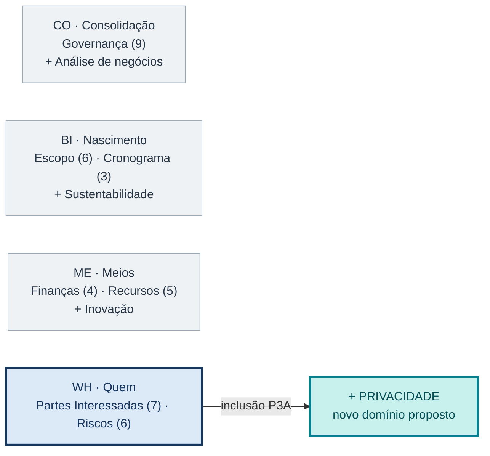
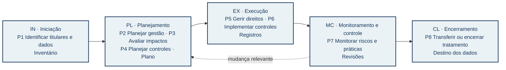
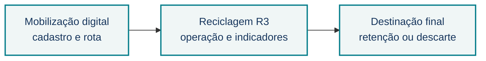

# Privacidade como domínio de desempenho proposto para o PMBOK 8

**P3A · Grupo SIPA Privacidade 2 · Concentração Quem (WH)**  
**Proposta acadêmica:** os processos P1–P8 **não integram oficialmente o PMBOK 8**.

## Problema e contribuição

O PMBOK 8 menciona proteção de dados e privacidade, mas seus sete domínios e 40 processos não organizam o tratamento de dados pessoais como objeto de gestão próprio. Propomos **Privacidade** ao lado de **Partes Interessadas (7 processos)** e **Riscos (6 processos)**. A pergunta central é: **que efeitos o projeto produz sobre as pessoas cujos dados trata, e que evidências justificam suas decisões?**

## Figura 1 — Onde entra Privacidade

<!-- Direção visual para o pôster final:
Posição: faixa superior central, ocupando cerca de um terço da área útil.
Desenhar quatro cartões de concentração. Os três primeiros ficam em cinza-claro;
Quem ganha contorno azul-escuro. Junto a Quem, mostrar Privacidade como cartão
turquesa acrescentado, ligado a Partes Interessadas e Riscos.
Os números 9/6/3/4/5/7/6 contam apenas processos oficiais do PMBOK 8.
Não usar logotipo do PMI nem sugerir que os quatro domínios SIPA já são oficiais.
Legenda sob a figura: azul = domínios PMBOK 8 de Quem; turquesa = proposta P3A;
cinza = contexto das outras concentrações. Sem fotografia decorativa.
Texto alternativo: quatro concentrações da disciplina; Privacidade entra em Quem,
ao lado de Partes Interessadas e Riscos. -->

*Leitura:* as quatro concentrações são a organização da disciplina; **Privacidade** é a contribuição deste grupo à concentração **Quem**.

## Figura 2 — Como o domínio percorre o projeto

<!-- Direção visual para o pôster final:
Posição: faixa central, a figura de maior destaque. Cinco colunas ligadas por
setas sólidas representam as áreas de foco IN, PL, EX, MC e CL. Cada coluna
contém códigos P1–P8, verbo curto e evidência produzida. Uma seta tracejada
de MC de volta a PL indica revisão quando mudam dados, finalidade ou risco;
não indica que as áreas sejam etapas rígidas. Usar os mesmos códigos do relatório.
Evidências em linha menor abaixo do processo, sem parágrafos. Ícones vetoriais
podem diferenciar inventário, plano, controle, revisão e destino dos dados;
nenhum ícone substitui o rótulo escrito. Texto alternativo: oito processos
propostos distribuídos por cinco áreas de foco, com retorno de monitoramento
para planejamento. -->

*Leitura:* os **P1–P8 são propostas do grupo**. A seta de retorno representa reavaliação; o tratamento de dados pode continuar após o encerramento do projeto.

## Aderência aos 6 princípios

**1AHV** visão integral do fluxo de dados · **2FOV** benefício comparado ao dano potencial · **3QPD** privacidade como critério verificável de qualidade · **4BAL** decisões e responsáveis registrados · **5SPA** efeitos duradouros sobre pessoas · **6BEC** canais para contestação e aprendizado.

## Figura 3 — Caso que testa a proposta

<!-- Direção visual para o pôster final:
Posição: rodapé visual, antes das fontes. Desenhar uma cadeia de três blocos
vetoriais, inspirada no percurso da P2B: mobilização digital, reciclagem R3
e destinação final. As setas representam possíveis compartilhamentos ou
transferências de dados no cenário estudado, não fluxos reais já auditados.
Sobre a cadeia, quatro perguntas curtas: quem é o titular, qual a finalidade,
quem recebe, e qual o destino do dado. A figura é exemplo de teste da extensão,
não diagrama de conformidade legal. Texto alternativo: cenário de dados pessoais
atravessando três componentes do sistema de resíduos sólidos. -->

*Teste:* P1–P8 devem identificar titulares, finalidades, compartilhamentos, riscos e destino dos registros sem duplicar Partes Interessadas e Riscos. **Para P3C:** avaliar separadamente conexões com Governança, Escopo, Cronograma, Finanças e Recursos.

**Fontes:** PMI, *PMBOK Guide*, 8ª ed., §§2.5 e 2.7; LGPD (Lei 13.709/2018); ANPD, orientações sobre RIPD; NIST, *Privacy Framework* e IR 8062; consolidação P2B do grupo. Detalhamento e referências no relatório P3A em português.
