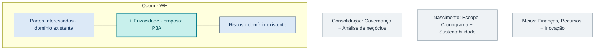
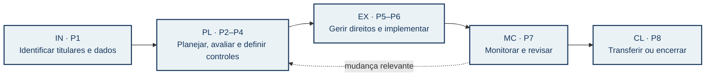
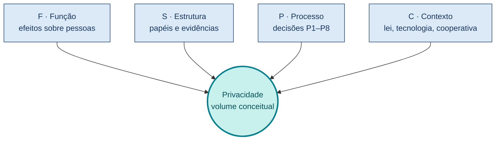
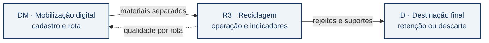

# P3A — Proposta de domínio de desempenho Privacidade para o PMBOK 8

**Grupo SIPA:** Privacidade 2  
**Concentração da disciplina:** Quem (*Who*)  
**Domínios existentes relacionados:** Partes Interessadas (*Stakeholders*) e Riscos (*Risk*)  
**Natureza:** proposta acadêmica de extensão; os processos P1–P8 abaixo **não são processos oficiais do PMI**.

## Resumo

Este relatório propõe um domínio de desempenho Privacidade para a adaptação do PMBOK 8 solicitada na entrega P3A. O método combina leitura dirigida do *Standard* e do *Guide*, análise dos domínios Partes Interessadas e Riscos, comparação com referências de proteção de dados e uso do percurso de dados pessoais no sistema de resíduos sólidos estudado pelo grupo como exemplo. A análise encontrou referências explícitas a proteção de dados, GDPR e privacidade no PMBOK 8, sobretudo em restrições legais, proteção de informações e uso de inteligência artificial. Não encontrou, entre seus sete domínios e 40 processos, um domínio cujo objeto principal sejam os efeitos do tratamento de dados sobre pessoas identificadas ou identificáveis. Essa é a lacuna de organização que a extensão procura enfrentar. Propõem-se oito processos, distribuídos pelas cinco áreas de foco, vinculados a Partes Interessadas e Riscos e avaliados frente aos seis princípios de gestão de projetos. O resultado é um modelo a testar e ajustar; sua inclusão formal dependeria de validação editorial e empírica posterior.

**Palavras-chave:** privacidade; proteção de dados; PMBOK 8; domínios de desempenho; partes interessadas; riscos; extensão de área de aplicação.

## 1. Objeto, escopo e método

A P3A pede que os quatro domínios propostos pela disciplina — Sustentabilidade, Inovação, Privacidade e Análise de Negócios com Decisões Ajustadas a Riscos — sejam situados em quatro concentrações. Como grupo SIPA de Privacidade, desenvolvemos **P → Quem**, junto aos domínios oficiais Partes Interessadas e Riscos. Apresentamos os demais domínios apenas no mapa de integração, pois o enunciado de entrega também fala em um domínio por grupo. A interpretação é explícita para permitir ajuste se a coordenação orientar de outro modo.

O corpus principal é a oitava edição de *The Standard for Project Management and A Guide to the Project Management Body of Knowledge* (PMI, 2025). Identificamos os sete domínios e 40 processos na organização do *Guide*, com atenção às seções 2.5 (Partes Interessadas), 2.7 (Riscos) e à tabela que associa processos às áreas de foco. Lemos os seis princípios no *Standard*. Fizemos uma busca textual dirigida por termos de privacidade no arquivo extraído e conferimos o sentido dos trechos relevantes no PDF. A busca textual não prova ausência conceitual em todo o livro; serve apenas para localizar linguagem explícita.

Para a dimensão de proteção de dados, tomamos a LGPD brasileira como referência normativa, o *NIST Privacy Framework* como referência de gestão de risco à pessoa e o NIST IR 8062 como referência de engenharia de privacidade. O GDPR e as FIPPs aparecem no material SIPA do curso como contrapontos conceituais, não como regras automaticamente aplicáveis a qualquer cooperativa brasileira. O exemplo do sistema de resíduos sólidos provém da consolidação P2B do grupo. Não fizemos auditoria jurídica ou medição empírica de conformidade.

### 1.1 Critério para propor um domínio próprio

Uma extensão faz sentido se acrescentar um **objeto de gestão identificável**, decisões e evidências que os domínios existentes não tornam visíveis de forma suficiente. Aqui, o objeto é o tratamento de dados pessoais e seus possíveis efeitos sobre os titulares. O projeto pode atingir prazo, custo e escopo e ainda produzir riscos indevidos às pessoas. Uma matriz genérica de riscos pode registrar esses eventos, mas não garante, por si só, inventário de dados, finalidade, hipótese legal, direitos dos titulares ou destino dos dados ao final do ciclo. A gestão de partes interessadas identifica pessoas relevantes ao projeto, mas um titular pode não participar dele, sequer saber que seus dados foram inferidos, e continuar titular de direitos.

Esse argumento é **organizacional**, não uma alegação de que o PMBOK 8 desconheça privacidade. O *Guide* menciona proteção de dados em restrições legais, GDPR em exemplo de setor regulado e privacidade no apêndice sobre IA. A proposta reúne essas preocupações em um domínio verificável, situado em Quem porque coloca pessoas afetadas e suas relações com o projeto no centro.

## 2. Diagnóstico do PMBOK 8

### 2.1 O que já existe

O domínio **Partes Interessadas** contém sete processos: identificar partes interessadas; planejar seu engajamento; planejar comunicações; gerenciar o engajamento; gerenciar comunicações; monitorar o engajamento; e monitorar comunicações (PMI, 2025, §2.5.2). A própria definição de *Manage Communications* alcança criação, distribuição, armazenamento, recuperação e disposição de informação do projeto. Esse é um ponto de contato real com governança de dados, embora não especifique todo o ciclo dos dados pessoais nem os direitos dos titulares.

O domínio **Riscos** contém seis processos: planejar gestão de riscos; identificar riscos; analisar riscos; planejar respostas; implementar respostas; monitorar riscos (PMI, 2025, §2.7.2). É uma estrutura adequada para reconhecer incertezas e acompanhar respostas. Entretanto, sua descrição geral abrange ameaças e oportunidades para os objetivos do projeto; uma avaliação de privacidade precisa considerar também problemas que o tratamento de dados pode causar às pessoas, mesmo sem falha de segurança. O NIST explicita que gestão de risco cibernético contribui para gerir privacidade, mas não cobre todos os riscos gerados pelo processamento.

Há ainda referências dispersas no PMBOK 8: leis de proteção de dados podem limitar opções de projeto; ferramentas de IA introduzem questões de privacidade; comunicações podem exigir proteção de informação sensível. Logo, a hipótese que sustentamos é mais precisa: **o tema aparece, mas não está organizado como domínio e conjunto de processos dedicados** nos sete domínios oficiais.

### 2.2 O que a nova organização precisa tornar observável

| Questão de gestão | Cobertura já disponível | Evidência adicional proposta |
| --- | --- | --- |
| Quem pode ser afetado pelo tratamento? | Identificar e engajar partes interessadas | Categorias de titulares, inclusive pessoas sem participação ativa no projeto |
| Que evento pode prejudicar alguém? | Identificar, analisar e monitorar riscos | Cenários de dano à pessoa associados a operações de dados, com critérios próprios |
| Que informação circula e por quê? | Planejar e gerenciar comunicações | Inventário de dados, finalidade, hipótese legal, necessidade, retenção e compartilhamento |
| Quando intervir no projeto? | Áreas de foco e decisões de governança | Critérios para prosseguir, modificar ou interromper um tratamento de dados |
| Como demonstrar resultado? | Relatórios, registros e lições aprendidas | Evidências de controles, solicitações de titulares, revisão de impacto e destino dos dados |

O quadro descreve **responsabilidades propostas**, sem afirmar que todos os projetos necessitem de todas as técnicas. O próprio PMBOK 8 enfatiza *tailoring*: intensidade, formalidade e artefatos devem refletir o contexto. Por exemplo, a ANPD orienta que o relatório de impacto à proteção de dados pessoais (RIPD) é especialmente relevante em operações de alto risco ou quando solicitado; não o tratamos como obrigação universal para todo projeto.

## 3. Justificativa da extensão em quatro aspectos

### 3.1 CN — Caracterização da necessidade

Projetos que constroem plataformas, gêmeos digitais ou modelos de IA podem coletar, combinar, inferir, compartilhar e descartar dados sobre pessoas. Nesse contexto, um incidente de confidencialidade é apenas uma das formas possíveis de dano. Também importam uso incompatível com a finalidade informada, inferências indevidas, exposição de localização, retenção excessiva e decisões automatizadas que afetem indivíduos. O NIST distingue riscos oriundos do processamento daqueles decorrentes de incidentes de segurança; a LGPD organiza princípios, hipóteses de tratamento, direitos e prestação de contas. A necessidade da extensão é criar uma linha de decisão visível do início ao encerramento do projeto.

### 3.2 CD — Critérios de desenvolvimento

O domínio proposto deve: (i) ter escopo próprio e não duplicar integralmente Partes Interessadas ou Riscos; (ii) usar verbos e artefatos reconhecíveis no vocabulário de processos do PMBOK 8; (iii) deixar claro onde há entrada, decisão, responsável e saída; (iv) ser adaptável conforme volume, sensibilidade, tecnologia, finalidade e contexto institucional; (v) registrar risco **para os titulares** além do risco **para a organização**; e (vi) permitir avaliação por evidências observáveis. Esses critérios são proposta editorial do grupo, inspirada no formato de extensão pedido pela disciplina.

### 3.3 PF — Publicação e formato

Propomos uma seção de domínio com propósito, resultados esperados, oito processos, entradas e saídas exemplificativas, conexões com domínios existentes, considerações de *tailoring* e um glossário mínimo. As tabelas de aderência às áreas de foco e aos princípios fariam parte do material de apoio. Na publicação, cada processo receberia exemplo de aplicação e ressalva de que as obrigações legais dependem do caso concreto e da jurisdição. Neste trabalho, o domínio é um **protótipo acadêmico**; seu número e seus nomes podem mudar após revisão.

### 3.4 DM — Desenvolvimento e manutenção

Uma versão posterior deveria passar por revisão de profissionais de projetos, privacidade, operação de sistemas e representantes de titulares; teste em casos com características diferentes; registro de decisões editoriais; e revisão quando normas, tecnologia ou evidências mudarem. As medidas de êxito incluem cobertura do fluxo de dados, qualidade dos registros de decisão, identificação de riscos a pessoas e capacidade de corrigir tratamento inadequado. Não propomos afirmar conformidade jurídica a partir da simples adoção do domínio.

## 4. O domínio Privacidade na concentração Quem

**Finalidade proposta:** fazer com que projetos que tratem dados pessoais reconheçam titulares, expliquem finalidades, avaliem impactos às pessoas e produzam evidências proporcionais de proteção ao longo do ciclo de vida. O domínio dialoga diretamente com Partes Interessadas e Riscos. Sua posição em **Quem** é uma decisão de modelagem da disciplina, não uma classificação oficial do PMI.

**Resultados esperados:** dados e titulares identificados na medida necessária; decisões sobre finalidade e hipótese legal registradas; riscos a pessoas avaliados; controles e responsáveis definidos; solicitações de titulares encaminhadas; mudanças e encerramento do tratamento documentados. Indicadores concretos dependerão do projeto. O NIST IR 8062 oferece três objetivos úteis para avaliar o desenho: previsibilidade sobre o uso dos dados, capacidade de administrá-los e limitação de associação de dados a pessoas além do necessário.

**Figura 1 — Posição do domínio proposto na arquitetura da disciplina.** Os cartões cinza situam as outras concentrações; o cartão azul delimita **Quem** e o turquesa identifica a contribuição P3A deste grupo. A figura distingue os domínios existentes do PMBOK 8 das inclusões SIPA propostas pelo curso. *Elaboração própria a partir do enunciado P3A e do resumo do Aprender3.*

<!-- Projeto da Figura 1 para eventual diagramação:
Desenhar quatro faixas de concentração, cada uma com os domínios existentes
e a inclusão SIPA correspondente. Dar maior largura visual a Quem. Dentro
de Quem, Partes Interessadas e Riscos permanecem em azul; Privacidade entra
em turquesa com um sinal de adição. As outras três inclusões ficam em cinza,
pois são apenas contexto nesta entrega. Uma linha contínua liga Privacidade
a Partes Interessadas e Riscos; futuras interfaces com as demais concentrações
devem ser tracejadas e reservadas à P3C. Não chamar os domínios SIPA de PMI.
Texto alternativo: Privacidade proposta dentro de Quem, junto aos dois domínios
oficiais, em um mapa das quatro concentrações da disciplina. -->

### 4.1 Processos propostos pelo grupo

Os códigos **P1–P8** abaixo identificam apenas esta proposta. As entradas e saídas são exemplos para orientar o *tailoring*; não reproduzem tabelas oficiais do PMBOK 8.

| Código e processo proposto | Área de foco principal | Entrada → decisão/atividade → saída | Interface com processo existente |
| --- | --- | --- | --- |
| **P1 Identificar titulares e dados pessoais** | Iniciação | Ideia de projeto, fluxos previstos → reconhecer categorias de pessoas, dados e pontos de coleta → inventário inicial | *Identify Stakeholders*; *Identify Risks* |
| **P2 Planejar a gestão de privacidade** | Planejamento | Inventário, objetivos, ambiente jurídico → definir finalidade, hipótese legal a verificar, papéis, retenção e resposta a titulares → plano de privacidade | *Plan Risk Management*; *Plan Communications Management* |
| **P3 Avaliar impactos à privacidade** | Planejamento | Operações de dados, arquitetura e riscos → avaliar possíveis efeitos sobre pessoas e necessidade de RIPD → registro de avaliação e, quando cabível, RIPD | *Perform Risk Analysis* |
| **P4 Planejar respostas e controles** | Planejamento | Avaliação de impactos → selecionar minimização, acesso, transparência, retenção e outras respostas proporcionais → plano de controles, responsáveis e critérios de aceitação | *Plan Risk Responses* |
| **P5 Gerir comunicação e direitos dos titulares** | Execução | Plano, canais e solicitações → informar, receber e encaminhar pedidos conforme a regra aplicável → registros de comunicação e resposta | *Manage Stakeholder Engagement*; *Manage Communications* |
| **P6 Implementar controles e tratar incidentes** | Execução | Plano de controles, mudanças e alertas → implementar salvaguardas, registrar ocorrência e acionar resposta → evidência de implementação e registro de incidentes | *Implement Risk Responses* |
| **P7 Monitorar riscos e práticas de privacidade** | Monitoramento e controle | Métricas, registros e mudanças → revisar eficácia, novas finalidades e riscos → recomendações, revisões de plano e evidências | *Monitor Risks*; *Monitor Stakeholder Engagement* |
| **P8 Encerrar ou transferir o tratamento sob controle** | Encerramento | Inventário atualizado, requisitos de retenção e transição → decidir conservação, transferência ou eliminação conforme o caso → registro de destino e responsabilidades futuras | *Close Project or Phase* |

**Figura 2 — Sequência e retorno dos oito processos propostos.** As setas contínuas mostram a ordem inicial sugerida; a seta tracejada representa a necessidade de voltar ao planejamento quando a observação revela nova finalidade, tecnologia ou risco. O registro e a gestão de dados podem prosseguir na operação depois de encerrado o projeto. *Elaboração própria; correspondências com áreas de foco fundamentadas no PMBOK 8 e propostas pelo grupo.*

<!-- Projeto da Figura 2:
Usar uma faixa horizontal com cinco blocos IN, PL, EX, MC e CL. Dentro deles,
mostrar P1; P2–P4; P5–P6; P7; P8, respectivamente, com uma linha de evidência:
inventário, plano e impacto, registros, revisão, destino. A seta MC→PL deve
ser tracejada e rotulada "mudança relevante". Não sugerir que o PMBOK 8 traz
esses oito processos; usar legenda "processos propostos pelo grupo".
Texto alternativo: oito processos de Privacidade distribuídos em cinco áreas
de foco, com retorno do monitoramento ao planejamento. -->

**P1** precisa ocorrer cedo para que o tratamento não seja descoberto apenas quando o sistema entra em produção. A identificação pode ser revisitada em qualquer área de foco quando houver novo dado, titular ou finalidade. O inventário deve distinguir dado pessoal de dado operacional sem pessoa identificável; não se presume que todo sensor processe dados pessoais.

**P2** registra a decisão de projeto sobre por que, por quem e por quanto tempo dados seriam tratados. A hipótese legal não é sinônimo de consentimento: ela deve ser determinada no contexto concreto por quem tem competência para isso. O processo integra planejamento de comunicação, compras, arquitetura e responsabilidade institucional.

**P3** avalia efeitos potenciais sobre pessoas, inclusive quando não existe vazamento. Conforme orientação da ANPD, um RIPD é recomendado especialmente quando o tratamento pode gerar alto risco e pode ser exigido pela autoridade. A decisão de elaborar ou não o documento precisa ser justificada; o processo não estabelece automaticamente sua obrigatoriedade para todos os casos.

**P4** transforma os riscos analisados em alternativas de desenho e operação. Exemplos são reduzir coleta, restringir acesso, separar identificadores, limitar compartilhamento e definir prazo de retenção. A escolha tem de considerar benefício, custo, viabilidade, efeitos residuais e responsabilidade por implantação.

**P5** aproxima titulares e equipe sem presumir que todo titular seja usuário do produto. O projeto deve prever informação inteligível e fluxo para pedidos de acesso, correção ou outras providências cabíveis. O atendimento efetivo depende do controlador e das regras aplicáveis; a equipe de projeto desenha e documenta o mecanismo de transição para a operação.

**P6** implementa os controles aprovados e responde a ocorrências. Incidente de segurança e evento de privacidade não são conceitos idênticos; ambos podem demandar investigação e mudança. Não se deve prometer que uma medida técnica isolada garanta conformidade.

**P7** verifica se as decisões continuam adequadas após mudanças de escopo, tecnologia, fornecedores ou finalidade. Pode produzir revisão da avaliação de impacto, plano e critérios de aceitação. A avaliação da eficácia precisa incluir efeitos sobre pessoas, não apenas continuidade do serviço.

**P8** não significa apagar todos os dados quando o projeto termina. O encerramento deve definir o destino de cada conjunto conforme obrigações de conservação, finalidade remanescente e responsabilidade operacional. A saída mínima é uma decisão rastreável de conservação, transferência ou eliminação, com responsáveis.

### 4.2 Adaptação conforme contexto

Em projeto com dados agregados e sem possibilidade razoável de identificar pessoas, o esforço pode concentrar-se na demonstração dessa condição e em sua revisão se houver cruzamentos futuros. Em projeto com cadastro, localização, identificação de trabalhadores ou decisão automatizada, o inventário, a análise de impacto, os controles e o acompanhamento precisam ser mais explícitos. Essa gradação evita tanto um ritual documental desproporcional quanto a omissão de riscos relevantes. O dono do projeto deve documentar a escolha e revisar o nível de esforço quando o contexto mudar.

### 4.3 Leitura sistêmica por função, estrutura, processo e contexto

O Aprender3 também pede que a extensão seja caracterizada como sistema. **Função:** tornar visíveis e governáveis os efeitos do tratamento de dados sobre pessoas, preservando o valor legítimo do projeto. **Estrutura:** papéis, processos P1–P8, registros, canais, critérios de decisão e interfaces com Partes Interessadas e Riscos. **Processo:** identificar, planejar, avaliar, implementar, monitorar e transferir ou encerrar o tratamento, com retorno a decisões anteriores quando o contexto mudar. **Contexto:** PMBOK 8 e sua adaptação, marco brasileiro de proteção de dados, instituições envolvidas, tecnologia e cenário de cooperativas. A dimensão Contexto impede tratar privacidade como simples configuração técnica do produto; Estrutura e Processo impedem que permaneça apenas como valor abstrato.

O modelo PISO mencionado no material do curso — Procura, Industrialização, Solução e Oferta — pode servir à leitura do valor: a procura por informação deve ser justificada antes de industrializar a coleta; a solução deve demonstrar benefício; e a oferta ao usuário ou operador precisa preservar as condições sob as quais os dados foram obtidos. Esse uso é interpretativo e não acrescenta quatro processos ao domínio.

**Figura 3 — O tetraedro F/S/P/C como instrumento de leitura.** Os quatro vértices representam as perguntas sistêmicas do curso; **Privacidade** ocupa o volume conceitual que elas delimitam. A projeção em Mermaid é um esquema de relações, não um desenho geométrico em perspectiva. *Elaboração própria com base na abordagem F/S/P/C apresentada no Aprender3.*

<!-- Projeto da Figura 3:
Na versão gráfica, desenhar um tetraedro em perspectiva com quatro vértices
F, S, P e C e faces semitransparentes. Colocar "Privacidade" no volume central.
Ao lado de cada vértice, uma pergunta e um exemplo: F—que efeito proteger;
S—quem e quais artefatos; P—que decisões no ciclo; C—em qual ambiente jurídico
e operacional. Usar cores suaves e não atribuir a geometria literal ao PMI.
Texto alternativo: tetraedro com vértices Função, Estrutura, Processo e Contexto
e Privacidade como volume interno. -->

## 5. Aderência às cinco áreas de foco

A matriz abaixo responde ao item **(a)** do enunciado. Ela indica a área **principal** de cada processo proposto, sem proibir iterações em outras áreas. As áreas de foco são categorias de atividades, não uma sequência única para todos os projetos.

| Área de foco | Pergunta de privacidade | Processos da proposta | Evidência de decisão |
| --- | --- | --- | --- |
| **IN — Iniciação** | Quem pode ser afetado e que tratamento é previsto? | P1 | Inventário inicial de dados e categorias de titulares; premissas e incertezas |
| **PL — Planejamento** | Por que tratar os dados, quais os riscos e quais respostas são proporcionais? | P2, P3, P4 | Plano de privacidade; avaliação de impacto; critérios de controle e aceitação |
| **EX — Execução** | As comunicações, direitos e salvaguardas planejados funcionam na prática? | P5, P6 | Registros de implementação, solicitações e ocorrências |
| **MC — Monitoramento e controle** | Mudanças alteraram finalidade, exposição ou eficácia das respostas? | P7 | Indicadores, revisão de risco, decisões corretivas e trilha de auditoria |
| **CL — Encerramento** | Quem passa a responder pelos dados e qual será seu destino? | P8 | Registro de transição, conservação ou eliminação e responsáveis |

**Iniciação.** Identificar pessoas afetadas no termo inicial do projeto ajuda a revelar uma externalidade que poderia ficar escondida em requisitos técnicos. O grupo não propõe avaliar definitivamente toda a licitude nessa fase: o resultado é um mapa inicial que orienta o planejamento. Se o projeto ainda não sabe quais dados coletará, essa incerteza deve constar do registro.

**Planejamento.** O plano de privacidade conecta propósito do tratamento, responsáveis, riscos e controle. A análise deve distinguir risco à entrega do projeto e risco à pessoa. Uma ação pode melhorar a eficiência da operação e, ao mesmo tempo, ampliar exposição individual. A decisão exige comparação documentada entre alternativas, incluindo a de não coletar ou reduzir granularidade.

**Execução.** A conformidade não decorre apenas de um texto aprovado. É preciso verificar implementação de canais, políticas de acesso, avisos e resposta a eventos. Quando a operação passa a uma cooperativa ou a outro responsável, a interface entre equipe de projeto e operação precisa estar clara. O processo P5 não transforma o gerente do projeto automaticamente em controlador ou encarregado.

**Monitoramento e controle.** Mudanças de arquitetura, contratos, sensores, modelos de IA ou públicos atendidos podem criar tratamento novo sem uma alteração visível no escopo físico. Por isso, o monitoramento compara operação real, plano e efeitos observados. Uma mudança relevante deve reabrir avaliação e decisão, inclusive quando o projeto está perto do encerramento.

**Encerramento.** A área de foco de encerramento exige uma transição auditável: que dados e registros ficam com a operação, sob qual justificativa, e quais devem ser eliminados ou ter sua retenção revista. Encerrar o projeto não encerra necessariamente o tratamento. A saída de P8 é a atribuição de responsabilidade e a documentação do destino dos dados.

## 6. Aderência aos seis princípios

O item **(b)** pede examinar os seis princípios do PMBOK 8. Esta é uma **análise de aderência** do domínio Privacidade. A eventual incorporação editorial dos princípios à extensão completa pode ser detalhada na P3C, conforme o texto de apoio do curso.

| Princípio do PMBOK 8 | Como o domínio proposto o sustenta | Teste de aderência |
| --- | --- | --- |
| **1AHV — Adopt a Holistic View** | Segue os dados do planejamento ao encerramento, entre equipe, fornecedores, operação e pessoas afetadas. | O mapa de fluxos inclui compartilhamentos e transições entre sistemas? |
| **2FOV — Focus on Value** | Compara benefício do uso de dados com possíveis danos às pessoas e à confiança no serviço. | A decisão explicita benefício, finalidade e custo social da alternativa? |
| **3QPD — Embed Quality into Processes and Deliverables** | Inclui minimização, transparência e controles como critérios verificáveis de entregas. | Os critérios são testáveis antes da aceitação do produto? |
| **4BAL — Be an Accountable Leader** | Registra quem decidiu, quem implementa, quem supervisiona e como questões são escaladas. | Há responsável e evidência para cada decisão relevante? |
| **5SPA — Integrate Sustainability Within All Project Areas** | Considera efeitos duradouros do tratamento sobre pessoas, relações de confiança e continuidade do serviço. | O projeto avalia consequências além da entrega imediata? |
| **6BEC — Build an Empowered Culture** | Dá à equipe e aos afetados canais para sinalizar problemas e melhorar práticas sem ocultar falhas. | O fluxo permite contestação, aprendizado e correção? |

Aderência não significa equivalência: um princípio orienta julgamento, enquanto o domínio e seus processos organizam trabalho específico. A relação com **5SPA** é particularmente importante para este grupo, pois a proposta SIPA associa sustentabilidade e privacidade sem fundi-las. Um projeto ambientalmente benéfico ainda pode produzir dano informacional; tratar ambos melhora a avaliação global de valor.

## 7. Conexões internas e insumos separados para a P3C

Na P3A, detalhamos apenas a concentração **Quem**. As conexões diretas são com os sete processos de Partes Interessadas e os seis de Riscos. O domínio Privacidade não os substitui: utiliza seus registros e acrescenta uma pergunta específica sobre tratamento de dados e efeitos sobre titulares. Por exemplo, *Identify Stakeholders* pode alimentar P1; *Perform Risk Analysis* pode receber de P3 cenários de dano às pessoas; *Monitor Communications* pode verificar se informação e canais de titulares funcionam; e *Monitor Risks* pode incorporar os riscos residuais de privacidade.

Para a **consolidação geral P3C**, deixamos as seguintes interfaces como hipóteses a validar com os outros grupos:

| Concentração externa | Interface a avaliar na P3C | Decisão potencial |
| --- | --- | --- |
| **Consolidação / Governança** | Critérios de aprovação, atribuição de responsabilidade, escalonamento e prestação de contas | Quem aceita risco residual e com que evidência? |
| **Nascimento / Escopo** | Requisitos e limites do produto, inclusive necessidade de dados e transparência | É possível cumprir a função com menos identificação? |
| **Nascimento / Cronograma** | Momento da avaliação de impacto e da verificação dos controles | Um marco deve impedir implantação antes da análise necessária? |
| **Meios / Finanças** | Recursos para controle, atendimento a titulares e revisão independente | O orçamento reflete o risco e o ciclo completo dos dados? |
| **Meios / Recursos** | Competências, fornecedores, treinamento e operação | Quem executa e mantém controles após a transição? |

Essas relações **não** foram tratadas como alterações já aceitas aos processos de outras concentrações. Constituem material para debate interdisciplinar na P3C.

## 8. Exemplo: reciclagem por cooperativas e gêmeos digitais

A consolidação [P2B do grupo](<../../P2B/Projeto_GPTI_Entrega_P2B_PT-BR.tex>) descreve um percurso de dados entre mobilização digital, reciclagem em cooperativas e destinação final. Ela menciona cadastro e localização na origem, retorno de informação sobre a separação por rota, dados de trabalhadores no galpão e descarte de suportes físicos na etapa final. Trata-se de **cenário de projeto**, não de constatação de que tais dados já estejam sendo tratados por uma cooperativa específica.

**Figura 4 — Percurso usado como teste da extensão.** Setas contínuas representam movimento de materiais; a seta tracejada indica retorno de informação por rota. Em cada componente, P1–P8 fazem as mesmas perguntas: **de quem são os dados, para qual finalidade, quem os recebe e qual seu destino?** A figura resume o cenário desenvolvido na [P2B](<../../P2B/figuras/Figura_1_Percurso_Dado_Pessoal.png>); não representa fluxo real auditado. *Adaptação conceitual da figura P2B do grupo.*

<!-- Projeto da Figura 4:
Três blocos de mesma altura: Mobilizador Digital (DM), Reciclagem (R3) e
Destinação Final (D). Setas sólidas cinza levam materiais separados e depois
rejeitos/suportes; uma seta azul tracejada retorna de R3 a DM com indicador
de qualidade por rota. Sobre os três blocos, colocar uma régua turquesa com
quatro perguntas de privacidade. A legenda separa fluxos físicos de informação.
O texto da figura deve dizer "cenário P2B" e não "operação comprovada".
Texto alternativo: cadeia DM→R3→D de materiais, com retorno informacional R3→DM
e perguntas de privacidade válidas nos três componentes. -->

O cenário ajuda a testar P1–P8. Na iniciação, P1 pergunta quais dados do cadastro e dos trabalhadores são indispensáveis para a finalidade do gêmeo. No planejamento, P2 fixa papéis e condições de compartilhamento entre componentes; P3 compara riscos de inferir comportamento de domicílios ou de ranquear pessoas; P4 considera agregação de indicadores e restrição de acesso. Na execução, P5 torna os canais inteligíveis e P6 verifica controles. No monitoramento, P7 detecta nova finalidade quando um modelo passa a cruzar dados antes separados. No encerramento, P8 decide sobre conservação e descarte de registros digitais e suportes físicos.

Esse exemplo explica por que a concentração **Quem** é apropriada: moradores, catadores, representantes de cooperativas e outras pessoas afetadas não têm a mesma posição no projeto. A identificação de stakeholders deve ser complementada pela análise de titulares e operações de dados. Também explica por que **Riscos** permanece interface indispensável: há incertezas técnicas e organizacionais, mas o critério de dano precisa incluir o efeito sobre as pessoas. O exemplo não prova que os oito processos sejam o único desenho possível; oferece um caso para testar cobertura e redundância.

## 9. Limites, validação e conclusão

Este é um projeto de extensão acadêmica, não uma publicação do PMI nem uma declaração de conformidade com a LGPD. Sua evidência principal é documental. Oito processos podem ser muitos ou poucos; alguns podem ser reunidos depois de testes. O mapa das cinco áreas de foco atribui uma localização principal a cada processo, mas a prática pode exigir retorno a etapas anteriores. A discussão sobre os três outros domínios SIPA permanece em nível de integração, pois cabe aos respectivos grupos desenvolvê-los.

Para validar a proposta, recomendamos uma matriz de revisão por três perfis: gestão de projetos, proteção de dados e operação de cooperativas. Cada perfil deve verificar se os processos têm objeto claro, entradas obtíveis, decisões reais e saídas que possam ser auditadas sem burocracia excessiva. Testes em casos com poucos dados pessoais e casos com alta granularidade ajudariam a calibrar o *tailoring*. A versão da P3C pode incorporar sugestões sobre interfaces com outras concentrações e resolver duplicidades.

Concluímos que o PMBOK 8 oferece instrumentos de gestão úteis para privacidade, mas a organização proposta pela disciplina pode tornar esse objeto mais explícito e contínuo. O domínio **Privacidade → Quem** acrescenta o ciclo dos dados pessoais e a avaliação dos efeitos sobre titulares ao diálogo com **Partes Interessadas** e **Riscos**. A contribuição é uma estrutura de perguntas, processos e evidências a ser avaliada, não uma promessa de conformidade automática.

## 10. Correspondência com o formato de Relatório Final

O Aprender3 remete ao *Final report* de *Close Project or Phase*. Como este texto propõe um domínio e **não relata um projeto concluído**, usamos os itens do modelo como guia de prestação de contas e marcamos o que ainda não pode ser declarado:

| Item do modelo | Correspondência neste trabalho |
| --- | --- |
| Descrição resumida | Resumo, objeto e escopo da seção 1 |
| Objetivos de escopo e evidência de conclusão | Domínio proposto, matrizes e interfaces produzidas nas seções 4–7; publicação formal não realizada |
| Objetivos e verificação de qualidade | Critérios de desenvolvimento e proposta de validação; testes externos ainda não realizados |
| Objetivos de custo e variações | Não se aplica como desempenho medido nesta fase; custo de adoção é critério futuro de *tailoring* |
| Validação do resultado final | Revisão documental apresentada; validação por professor, pares e stakeholders ainda pendente |
| Cronograma e benefícios | Entrega acadêmica com prazo definido; benefícios de adoção ainda são hipóteses |
| Necessidade do negócio | Necessidade de gerir efeitos de dados pessoais em projetos descrita na seção 3 |
| Riscos e questões | Ambiguidade de escopo, redundância com domínios existentes e aplicação jurídica variável descritas na seção 9 |

## Referências

- PROJECT MANAGEMENT INSTITUTE (PMI). *The Standard for Project Management and A Guide to the Project Management Body of Knowledge (PMBOK Guide)*. 8. ed., 2025. [PDF disponível no repositório](<../../../documentos/PMBOK8/PMBOK® Guide 8th Edition (Project Management Institute).pdf>). Seções 2.5, 2.7 e 3; *Final report* em *Close Project or Phase*.
- BRASIL. [Lei nº 13.709, de 14 de agosto de 2018, texto atualizado](https://www2.camara.leg.br/legin/fed/lei/2018/lei-13709-14-agosto-2018-787077-normaatualizada-pl.html). Lei Geral de Proteção de Dados Pessoais.
- AUTORIDADE NACIONAL DE PROTEÇÃO DE DADOS (ANPD). [Relatório de Impacto à Proteção de Dados Pessoais: perguntas e respostas](https://www.gov.br/anpd/pt-br/canais_atendimento/agente-de-tratamento/relatorio-de-impacto-a-protecao-de-dados-pessoais-ripd). Consulta em 04/11/2026.
- NATIONAL INSTITUTE OF STANDARDS AND TECHNOLOGY (NIST). [Privacy Framework](https://www.nist.gov/privacy-framework). Referência de gestão de risco à privacidade.
- NIST, NATIONAL CYBERSECURITY CENTER OF EXCELLENCE. [Relationship Between Cybersecurity and Privacy](https://www.nccoe.nist.gov/relationship-between-cybersecurity-and-privacy). Referência para a distinção entre riscos cibernéticos e riscos do processamento.
- BROOKS, S. et al. [*An Introduction to Privacy Engineering and Risk Management in Federal Systems*](https://csrc.nist.gov/pubs/ir/8062/final). NIST IR 8062, 2017.
- PARLAMENTO EUROPEU; CONSELHO DA UNIÃO EUROPEIA. [Regulamento (UE) 2016/679](https://eur-lex.europa.eu/legal-content/EN/TXT/?uri=CELEX%3A32016R0679). Referência comparativa, sem presunção de aplicação ao cenário brasileiro.
- GRUPO GPTI. [Consolidação P2B sobre gêmeos digitais do sistema de resíduos sólidos](<../../P2B/Projeto_GPTI_Entrega_P2B_PT-BR.tex>). Material acadêmico do projeto, 2026.
- DISCIPLINA GPTI. [Resumo do Aprender3](<../../_aprender3/md/resumo-aprender3.md>) e [enunciado P3A](../enunciado.md). Orientações da atividade, cópia local.
