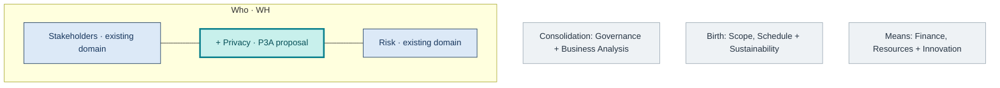
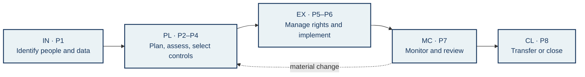
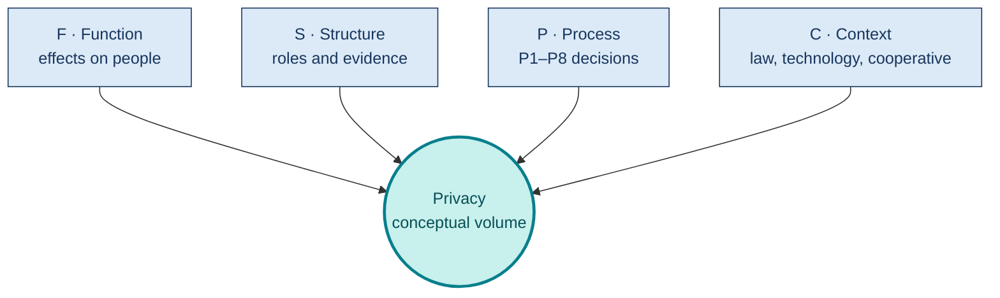
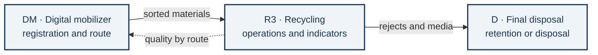

# P3A — Proposed Privacy Performance Domain for PMBOK 8

**SIPA group:** Privacy 2  
**Course concentration:** Who  
**Related existing domains:** Stakeholders and Risk  
**Status:** academic extension proposal; processes P1–P8 below **are not official PMI processes**.

## Abstract

This report proposes a Privacy performance domain for the PMBOK 8 adaptation requested in assignment P3A. Its method combines a focused reading of the *Standard* and *Guide*, an examination of the Stakeholders and Risk domains, comparison with data protection references, and a waste management digital twin scenario developed by the group. PMBOK 8 explicitly mentions data protection, the GDPR, and privacy in several places, particularly under legal restrictions, information protection, and AI. However, none of its seven existing domains and 40 processes has the effects of personal data processing on individuals as its primary object. This organizational gap motivates the proposal. We define eight candidate processes across the five Focus Areas, link them to Stakeholders and Risk, and assess their alignment with the six project management principles. The result is a model for testing and revision, not an official PMI extension or a legal compliance certification.

**Keywords:** privacy; data protection; PMBOK 8; performance domains; stakeholders; risk; application area extension.

## 1. Object, scope, and method

P3A asks the course groups to place four proposed domains—Sustainability, Innovation, Privacy, and Business Analysis with Decisions Adjusted to Risk—within four concentrations. As the Privacy SIPA group, we develop **Privacy → Who**, alongside the official Stakeholders and Risk domains. The other three domains appear only in the integration map. This is our explicit interpretation of an assignment whose general description mentions four domains while its submission paragraph mentions one domain per group.

The main source is PMI's eighth edition of *The Standard for Project Management and A Guide to the Project Management Body of Knowledge* (2025). We inspect the seven domains and 40 processes in the *Guide*, especially §§2.5 (Stakeholders), 2.7 (Risk), and the process-to-Focus-Area mapping. We inspect the six principles in the *Standard*. Text searches help locate explicit privacy language; relevant passages are checked against the PDF. A text search cannot establish that an idea is absent from an entire book.

For data protection, we use Brazil's LGPD as the legal reference, the NIST Privacy Framework for risks to individuals, and NIST IR 8062 for privacy engineering. The GDPR and the Fair Information Practice Principles (FIPPs) appear in the course's SIPA materials as conceptual comparisons; we do not assume that they automatically govern any Brazilian cooperative. The solid waste scenario comes from the group's P2B consolidation. This report performs neither a legal audit nor an empirical compliance measurement.

### 1.1 Criterion for a separate domain

An extension is useful if it adds a **distinct management object**, decisions, and evidence that the existing domains do not make sufficiently visible. Here, the object is personal data processing and its potential effects on identifiable individuals. A project may meet its schedule, cost, and scope targets while still creating undue risks for those individuals. A general risk register can record such events, but by itself does not ensure an inventory of data, purposes, a legal basis, data subject rights, or end-of-life decisions. Stakeholder management identifies people relevant to a project; a data subject may be unaware of, and uninvolved in, the project while still having rights concerning the processing.

This is an **organizational argument**, not a claim that PMBOK 8 ignores privacy. The *Guide* mentions data protection in legal constraints, GDPR as an example in a regulated context, and privacy in its AI appendix. Our proposal brings these concerns together in a traceable domain. It sits in **Who** because affected people and their relationship to the project are central.

## 2. PMBOK 8 diagnosis

### 2.1 Existing coverage

The **Stakeholders** domain has seven processes: Identify Stakeholders; Plan Stakeholder Engagement; Plan Communications Management; Manage Stakeholder Engagement; Manage Communications; Monitor Stakeholder Engagement; and Monitor Communications (PMI, 2025, §2.5.2). The definition of Manage Communications already concerns the creation, distribution, storage, retrieval, and eventual disposition of project information. This overlaps with data governance, although it does not specify the full personal data life cycle or data subject rights.

The **Risk** domain has six processes: Plan Risk Management; Identify Risks; Perform Risk Analysis; Plan Risk Responses; Implement Risk Responses; and Monitor Risks (PMI, 2025, §2.7.2). They provide a useful structure for uncertainty and responses. Their general description, however, addresses threats and opportunities for project objectives; a privacy assessment must also examine problems that data processing may cause to individuals even without a security breach. NIST explains that cybersecurity risk management contributes to, but does not exhaust, privacy risk management.

PMBOK 8 also contains dispersed references: data protection laws may constrain project choices; AI tools raise privacy questions; communications may require protection of sensitive information. Thus, our narrower hypothesis is that **privacy is present but not organized as a dedicated domain and process set** among the seven official domains.

### 2.2 What the extension should make observable

| Management question | Existing coverage | Proposed additional evidence |
| --- | --- | --- |
| Who might be affected? | Identify and engage stakeholders | Categories of data subjects, including people who never engage with the project |
| What could harm them? | Identify, analyze, and monitor risks | Scenarios of harm to people arising from data operations |
| What information flows, and why? | Plan and manage communications | Data inventory, purpose, legal-basis assessment, necessity, retention, and sharing |
| When must a decision change? | Focus Areas and governance | Criteria for proceeding, modifying, or stopping a data operation |
| What evidence demonstrates performance? | Reports and registers | Control evidence, data subject requests, impact review, and data disposition |

These are **proposed responsibilities**, not a universal checklist of techniques. PMBOK 8 calls for *tailoring*: the formality and effort should match the context. The Brazilian Data Protection Authority (ANPD), for instance, recommends a Data Protection Impact Assessment (RIPD) particularly when processing may pose high risk or when the authority requests it. We do not describe such a report as mandatory for every project.

## 3. Four aspects of the extension rationale

### 3.1 CN — Characterizing the need

Projects that build platforms, digital twins, or AI models may collect, combine, infer, share, and dispose of information about people. A confidentiality incident is only one possible harm. Other concerns include uses incompatible with a stated purpose, undue inference, location exposure, excessive retention, and automated decisions affecting individuals. NIST distinguishes risks arising from processing from those arising from cybersecurity incidents. The LGPD provides principles, legal grounds, rights, and accountability requirements. The need for an extension is therefore to make the decision chain visible from project start to close.

### 3.2 CD — Development criteria

The proposed domain should: (i) have its own scope without completely duplicating Stakeholders or Risk; (ii) use process verbs and artifacts recognizable within PMBOK 8; (iii) state inputs, decisions, owners, and outputs; (iv) be tailored to scale, sensitivity, technology, purpose, and institutional setting; (v) distinguish **risk to people** from **risk to the organization**; and (vi) permit evidence-based review. These are the group's editorial criteria, inspired by the extension format requested by the course.

### 3.3 PF — Publication and format

We propose a domain section with purpose, expected outcomes, eight processes, example inputs and outputs, links to existing domains, tailoring considerations, and a short glossary. Focus-Area and principle alignment tables support the section. Each process should later receive a use case and a reminder that legal obligations depend on jurisdiction and facts. At this stage the domain is an **academic prototype**; its number and process names can change after review.

### 3.4 DM — Development and maintenance

A later version should be reviewed by project managers, privacy specialists, system operators, and representatives of affected individuals; tested in settings with different data needs; supported by an editorial decision log; and revised when rules, technologies, or evidence change. Success measures include coverage of data flows, quality of decision records, identification of risks to people, and the ability to correct inadequate processing. Simply adopting the domain must not be presented as proof of legal compliance.

## 4. Privacy within the Who concentration

**Proposed purpose:** enable projects that process personal data to identify data subjects, explain purposes, assess impacts on people, and produce proportionate evidence of protection throughout the life cycle. The domain interfaces directly with Stakeholders and Risk. Its placement in **Who** is a course modeling choice, not an official PMI classification.

**Expected outcomes:** relevant data and data subjects identified; decisions on purpose and legal basis documented; risks to individuals assessed; controls and owners assigned; data subject requests routed; changes and closure documented. Project-specific metrics still need to be chosen. NIST IR 8062 suggests three useful design objectives: predictability of processing, manageability of personal information, and disassociability beyond operational need.

**Figure 1 — Placement of the proposed domain within the course architecture.** Gray cards provide context for the other concentrations; the blue card marks **Who**, and the teal card identifies this group's P3A contribution. The figure separates existing PMBOK 8 domains from the SIPA additions proposed by the course. *Original diagram based on the P3A assignment and Aprender3 summary.*

<!-- Figure 1 design for a possible typeset version:
Draw four concentration bands with their existing domains and associated SIPA
addition. Give Who more visual weight. Stakeholders and Risk remain blue;
Privacy enters in teal with a plus sign. The other three additions are gray
because they are context only in this submission. Use solid lines for direct
Privacy links to Stakeholders and Risk; reserve dashed lines to other
concentrations for P3C. Do not label SIPA domains as official PMI content.
Alt text: proposed Privacy domain within Who beside two official domains,
shown in a map of the four course concentrations. -->

### 4.1 Candidate processes proposed by the group

Codes **P1–P8** refer only to our proposal. Inputs and outputs are tailoring examples, not PMI process tables.

| Code and candidate process | Primary Focus Area | Input → activity/decision → output | Existing-process interface |
| --- | --- | --- | --- |
| **P1 Identify Data Subjects and Personal Data** | Initiating | Project concept and expected flows → identify people, data, and collection points → initial inventory | Identify Stakeholders; Identify Risks |
| **P2 Plan Privacy Management** | Planning | Inventory, objectives, legal environment → plan purpose, assessment of legal grounds, roles, retention, and subject requests → privacy plan | Plan Risk Management; Plan Communications Management |
| **P3 Assess Privacy Impacts** | Planning | Data operations, architecture, risks → assess effects on people and whether an impact report is warranted → assessment record and report where applicable | Perform Risk Analysis |
| **P4 Plan Privacy Responses and Controls** | Planning | Impact assessment → choose proportional minimization, access, transparency, and retention measures → control plan and owners | Plan Risk Responses |
| **P5 Manage Data Subject Communication and Rights** | Executing | Plan, channels, requests → inform, receive, and route requests under applicable rules → communication and response records | Manage Stakeholder Engagement; Manage Communications |
| **P6 Implement Controls and Address Data Incidents** | Executing | Control plan, changes, alerts → implement safeguards and response → implementation evidence and incident log | Implement Risk Responses |
| **P7 Monitor Privacy Risk and Practice** | Monitoring and Controlling | Measures, records, changes → reassess effectiveness, purposes, and risks → corrective decisions and updated plans | Monitor Risks; Monitor Stakeholder Engagement |
| **P8 Close or Transfer Processing Under Control** | Closing | Updated inventory and retention requirements → decide what to retain, transfer, or delete → disposition and future-owner record | Close Project or Phase |

**Figure 2 — Sequence and feedback among the eight candidate processes.** Solid arrows show the proposed initial path; the dashed arrow calls for a return to planning when observation reveals a new purpose, technology, or risk. Data governance may continue in operations after the project closes. *Original diagram; the group proposes the Focus Area mapping using PMBOK 8 as a reference.*

<!-- Figure 2 design:
Use a horizontal strip with five blocks: IN, PL, EX, MC, and CL. Within them,
show P1; P2–P4; P5–P6; P7; P8, plus a short evidence line: inventory, plan and
impact, records, review, disposition. Dashed MC→PL arrow reads "material change".
Legend must state that the eight processes are proposed by this group, not PMI.
Alt text: eight proposed Privacy processes across five Focus Areas with a
feedback arrow from monitoring to planning. -->

**P1** takes place early so that personal data processing is not discovered only at deployment. Identification should recur whenever new data, data subjects, or purposes emerge. The inventory distinguishes personal data from operational information that cannot reasonably identify a person; not every sensor necessarily processes personal data.

**P2** records why, by whom, and for how long data would be processed. A legal basis is not synonymous with consent: the appropriate ground depends on the actual case and competent assessment. The process interfaces with communications, procurement, architecture, and institutional accountability.

**P3** evaluates possible effects on individuals, including effects without any data breach. ANPD guidance recommends an impact report especially for potentially high-risk processing and notes that the authority may require one. The decision to prepare the report should be documented; we do not impose it universally.

**P4** converts assessed risks into design and operational alternatives. Examples include collecting less data, restricting access, separating identifiers, limiting sharing, and setting retention periods. Choices should address benefit, cost, feasibility, residual effects, and implementation ownership.

**P5** connects people and the project without assuming that every data subject is a product user. The project should design intelligible information and a route for requests such as access or correction, where applicable. The actual response remains the responsibility of the appropriate controller or organization; a project manager does not automatically become a controller or data protection officer.

**P6** implements approved controls and responds to events. A cybersecurity incident and a privacy event are not identical, although both can trigger investigation and change. No single technical measure guarantees compliance.

**P7** checks whether choices remain appropriate after changes to scope, technology, suppliers, or purposes. It may trigger a new impact assessment, plan update, or acceptance decision. Effectiveness must consider effects on people as well as service continuity.

**P8** does not mean deleting all data at project close. Closure must define each data set's disposition in light of retention duties, ongoing purposes, and operational ownership. Its minimum output is a traceable decision to retain, transfer, or delete data, with assigned owners.

### 4.2 Contextual tailoring

Where a project uses aggregated data with no reasonable way to identify individuals, the main task may be to document and periodically revisit that condition. A project involving registration, location, worker identification, or automated decisions warrants a more explicit inventory, impact analysis, controls, and monitoring. This gradient avoids both disproportionate paperwork and omission of meaningful risk. Project leadership should record the choice and reconsider it when conditions change.

### 4.3 Systems view: function, structure, process, and context

Aprender3 also asks the group to characterize the extension as a system. **Function:** make the effects of data processing on people visible and governable while preserving legitimate project value. **Structure:** roles, processes P1–P8, records, channels, decision criteria, and interfaces with Stakeholders and Risk. **Process:** identify, plan, assess, implement, monitor, and transfer or close processing, returning to earlier decisions when conditions change. **Context:** PMBOK 8 and its tailoring, Brazil's data protection framework, relevant institutions, technology, and the cooperative scenario. Context prevents privacy from becoming a mere product setting; Structure and Process prevent it from remaining only an abstract value.

The course's PISO model—Demand, Industrialization, Solution, and Offer—can inform the value argument: demand for information should be justified before collection is scaled; the solution should show a benefit; and the offer to users or operators should respect the conditions under which data were obtained. This is an interpretation, not four additional domain processes.

**Figure 3 — The F/S/P/C tetrahedron as an analytical device.** The four vertices represent the course's systems questions; **Privacy** occupies the conceptual volume that they bound. The Mermaid drawing is a relationship sketch, not a literal three-dimensional projection. *Original diagram based on the F/S/P/C approach in Aprender3.*

<!-- Figure 3 design:
For a final graphic, draw a tetrahedron in perspective with four vertices
F, S, P, and C and translucent faces. Place "Privacy" in the central volume.
Each vertex has a question and example: F—what effect is protected;
S—who and which artifacts; P—which life-cycle decisions; C—which legal and
operational environment. Keep the geometry distinct from official PMI models.
Alt text: tetrahedron with Function, Structure, Process, and Context at its
vertices and Privacy as its internal volume. -->

## 5. Alignment with the five Focus Areas

The following matrix responds to item **(a)** of the assignment. It assigns a **primary** Focus Area to each candidate process while allowing iteration elsewhere. Focus Areas categorize work; they do not force every project into one rigid sequence.

| Focus Area | Privacy question | Candidate processes | Decision evidence |
| --- | --- | --- | --- |
| **IN — Initiating** | Who could be affected, and what processing is envisaged? | P1 | Initial data and subject inventory; assumptions and uncertainties |
| **PL — Planning** | Why process data, what could happen to people, and what responses are proportionate? | P2, P3, P4 | Privacy plan, impact assessment, controls, acceptance criteria |
| **EX — Executing** | Do the planned communications, rights mechanisms, and safeguards work? | P5, P6 | Implementation, request, and event records |
| **MC — Monitoring and Controlling** | Have changes altered purpose, exposure, or effectiveness? | P7 | Measures, reassessment, corrective decisions, audit trail |
| **CL — Closing** | Who will own the data after the project, and what happens to it? | P8 | Transfer, retention, or deletion record and named owner |

**Initiating.** Recording affected people in the project charter or initial documents exposes an externality that technical requirements might miss. This phase need not settle every legal question; it should produce an early map and record uncertainty.

**Planning.** The privacy plan connects the purpose of processing, roles, risks, and controls. It distinguishes risk to project delivery from risk to an individual. An operation can improve efficiency and still increase exposure of a person. Alternatives should include non-collection or lower data granularity when feasible.

**Executing.** An approved document does not itself make a system protective. Teams must test channels, access policies, notices, and event responses. If a cooperative or supplier will operate the system, the transition from project to operations needs clear ownership. P5 does not make the project manager the legal controller by default.

**Monitoring and Controlling.** Changes in architecture, contracts, sensors, AI models, or the population served can introduce new processing without an obvious physical-scope change. Monitoring compares operation with the plan and observed effects. A material change should reopen assessment and decision even near closure.

**Closing.** A traceable transition specifies which data remain with operations, why, and what should be deleted or have its retention reviewed. Closing a project does not necessarily end the processing. P8 records ownership and disposition.

## 6. Alignment with the six principles

Item **(b)** asks for alignment with the six PMBOK 8 principles. The table is a **Privacy-domain alignment analysis**. Editorial integration of the principles into the course-wide extension can be developed further in P3C, as the supporting course text suggests.

| PMBOK 8 principle | Contribution of the proposed domain | Review question |
| --- | --- | --- |
| **1AHV — Adopt a Holistic View** | Follows data from planning to closure across teams, suppliers, operations, and affected people. | Does the flow map cover transfers between systems? |
| **2FOV — Focus on Value** | Weighs the benefit of using data against potential harms to people and trust. | Are purpose, benefit, and social cost explicit? |
| **3QPD — Embed Quality into Processes and Deliverables** | Makes minimization, transparency, and safeguards verifiable acceptance criteria. | Can they be tested before acceptance? |
| **4BAL — Be an Accountable Leader** | Records decision makers, implementers, reviewers, and escalation routes. | Is each material choice owned and evidenced? |
| **5SPA — Integrate Sustainability Within All Project Areas** | Examines lasting effects of processing on people, trust, and service continuity. | Does assessment look beyond immediate delivery? |
| **6BEC — Build an Empowered Culture** | Gives team members and affected people ways to raise concerns and improve practice. | Can concerns be contested, learned from, and corrected? |

Alignment is not identity: a principle guides judgment, whereas a domain and its processes structure specific work. **5SPA** matters here because SIPA connects sustainability and privacy without collapsing one into the other. A project with environmental benefits may still create informational harm.

## 7. Internal links and separate inputs to P3C

P3A develops only the **Who** concentration in detail. Its direct links are to the seven Stakeholders processes and six Risk processes. Privacy does not replace them; it consumes their records and adds specific questions about processing and effects on data subjects. For example, Identify Stakeholders can inform P1; Perform Risk Analysis can receive P3 scenarios of harm to people; Monitor Communications can test whether information and subject channels work; and Monitor Risks can incorporate residual privacy risk.

We reserve the following cross-concentration links as hypotheses for the **P3C integration**:

| Other concentration | Interface to assess in P3C | Potential decision |
| --- | --- | --- |
| **Consolidation / Governance** | Approval criteria, accountability, escalation, reporting | Who accepts residual risk, and on what evidence? |
| **Birth / Scope** | Product requirements, necessary data, transparency | Can the function work with less identification? |
| **Birth / Schedule** | Timing of impact assessment and control verification | Should a gate prevent deployment before a needed assessment? |
| **Means / Finance** | Budget for controls, requests, independent review | Does funding cover the full data life cycle? |
| **Means / Resources** | Skills, suppliers, training, operations | Who maintains controls after transfer? |

These links are **not** presented as approved changes to processes in other concentrations. They are inputs for discussion with the other groups.

## 8. Example: cooperative recycling and digital twins

The group's [P2B consolidation](<../../P2B/Projeto_GPTI_Entrega_P2B_PT-BR.tex>) describes a data path across digital mobilization, cooperative recycling, and final disposal. It mentions registration and location at the source, feedback on sorting quality by route, worker-related data at a facility, and physical-media disposal at the final stage. This is a **project scenario**, not evidence that a particular cooperative already processes all these data.

**Figure 4 — The pathway used to test the extension.** Solid arrows show material flows; the dashed arrow shows route-level information returning upstream. At each component, P1–P8 ask: **whose data, for what purpose, received by whom, and kept for how long?** The diagram abstracts the [P2B figure](<../../P2B/figuras/Figura_1_Percurso_Dado_Pessoal.png>); it is not an audited live workflow. *Conceptual adaptation of the group's P2B figure.*

<!-- Figure 4 design:
Draw three equal-height blocks: Digital Mobilizer (DM), Recycling (R3), and
Final Disposal (D). Solid gray arrows carry sorted materials and then rejects
or physical media; a dashed blue arrow returns sorting-quality information
by route from R3 to DM. Above the chain, place a teal rail with four privacy
questions. A legend separates material from information flows. Caption must
state "P2B scenario", never "verified operation".
Alt text: DM→R3→D material chain with an R3→DM information return and privacy
questions spanning all three components. -->

The scenario tests P1–P8. At initiation, P1 asks which household and worker data are needed for the twin's purpose. During planning, P2 records roles and sharing conditions across components; P3 compares the risks of inferring household behavior or ranking workers; P4 considers aggregate indicators and restricted access. During execution, P5 establishes understandable channels and P6 tests safeguards. During monitoring, P7 catches a new purpose if a model begins joining previously separate data. At closure, P8 determines retention and disposal of digital records and physical media.

This example supports the **Who** placement: residents, waste pickers, cooperative representatives, and other affected people occupy different positions. Stakeholder identification should be complemented by an analysis of data subjects and operations. It also shows why **Risk** remains indispensable: uncertainty may be technical or organizational, but evaluation must include consequences for people. The case does not prove that eight processes are the only valid design; it tests coverage and duplication.

## 9. Limits, validation, and conclusion

This is an academic extension proposal, not a PMI publication or a declaration of LGPD compliance. Its main evidence is documentary. Eight processes may be too many or too few, and tests may show that some should be merged. The Focus Area map assigns a primary location but allows iteration. The other three SIPA domains remain at integration-map level because their groups should develop them.

We recommend review by three groups: project managers, privacy specialists, and cooperative operators or representatives of affected individuals. Reviewers should ask whether each process has a clear object, available inputs, a real decision, and outputs that can be checked without excessive bureaucracy. Cases with little personal data and cases with detailed personal data would help calibrate tailoring. P3C can absorb cross-concentration suggestions and resolve overlaps.

PMBOK 8 already offers useful management instruments for privacy. The course's proposed organization can nevertheless make this object more explicit and continuous. **Privacy → Who** adds a personal-data life cycle and attention to affected people to the existing dialogue with **Stakeholders** and **Risk**. The contribution is a structure of questions, processes, and evidence to evaluate, not a promise of automatic compliance.

## 10. Mapping to the Final Report format

The course refers to the *Final report* output of *Close Project or Phase*. This report proposes a domain; it **does not describe a completed implementation project**. We therefore use the final-report items as a transparency guide and indicate what cannot yet be claimed:

| Final-report item | Correspondence here |
| --- | --- |
| Summary description | Abstract, object, and scope in §1 |
| Scope objectives and completion evidence | Domain, matrices, and interfaces in §§4–7; formal publication has not occurred |
| Quality objectives and verification | Development criteria and validation proposal; external tests remain outstanding |
| Cost objectives and variances | Not measured at this proposal stage; adoption cost is a future tailoring consideration |
| Final-result validation | Document review reported; professor, peer, and stakeholder validation remains outstanding |
| Schedule and benefits | Assignment has a deadline; benefits of adoption remain hypotheses |
| Business need | Need to manage personal-data effects in projects described in §3 |
| Risks and issues | Scope ambiguity, possible duplication, and variable legal application in §9 |

## References

- PROJECT MANAGEMENT INSTITUTE (PMI). *The Standard for Project Management and A Guide to the Project Management Body of Knowledge (PMBOK Guide)*. 8th ed., 2025. [Repository PDF](<../../../documentos/PMBOK8/PMBOK® Guide 8th Edition (Project Management Institute).pdf>). §§2.5, 2.7, and 3; *Final report* in *Close Project or Phase*.
- BRAZIL. [Law No. 13,709 of 14 August 2018, updated text](https://www2.camara.leg.br/legin/fed/lei/2018/lei-13709-14-agosto-2018-787077-normaatualizada-pl.html). General Personal Data Protection Law (LGPD).
- BRAZILIAN DATA PROTECTION AUTHORITY (ANPD). [Data Protection Impact Assessment: questions and answers](https://www.gov.br/anpd/pt-br/canais_atendimento/agente-de-tratamento/relatorio-de-impacto-a-protecao-de-dados-pessoais-ripd). Accessed 4 November 2026.
- NATIONAL INSTITUTE OF STANDARDS AND TECHNOLOGY (NIST). [Privacy Framework](https://www.nist.gov/privacy-framework).
- NIST, NATIONAL CYBERSECURITY CENTER OF EXCELLENCE. [Relationship Between Cybersecurity and Privacy](https://www.nccoe.nist.gov/relationship-between-cybersecurity-and-privacy).
- BROOKS, S. et al. [*An Introduction to Privacy Engineering and Risk Management in Federal Systems*](https://csrc.nist.gov/pubs/ir/8062/final). NIST IR 8062, 2017.
- EUROPEAN PARLIAMENT; COUNCIL OF THE EUROPEAN UNION. [Regulation (EU) 2016/679](https://eur-lex.europa.eu/legal-content/EN/TXT/?uri=CELEX%3A32016R0679). Comparative reference only.
- GPTI GROUP. [P2B consolidation on solid waste system digital twins](<../../P2B/Projeto_GPTI_Entrega_P2B_PT-BR.tex>). Course material, 2026.
- GPTI COURSE. [Aprender3 summary](<../../_aprender3/md/resumo-aprender3.md>) and [P3A assignment](../enunciado.md). Local copies.
