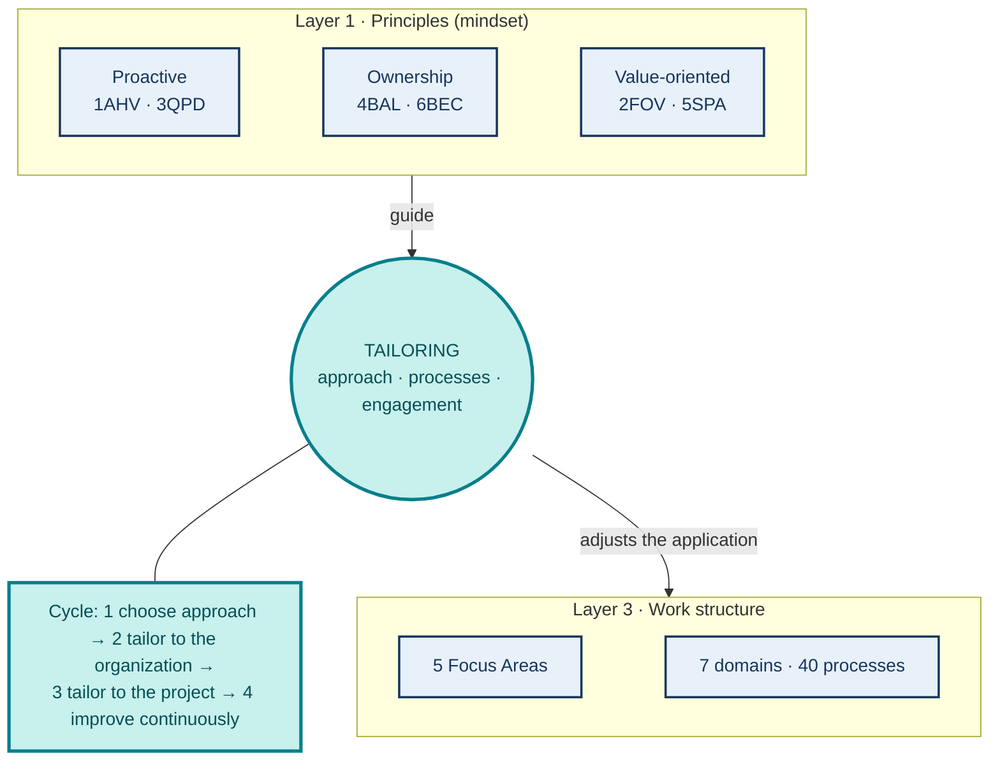
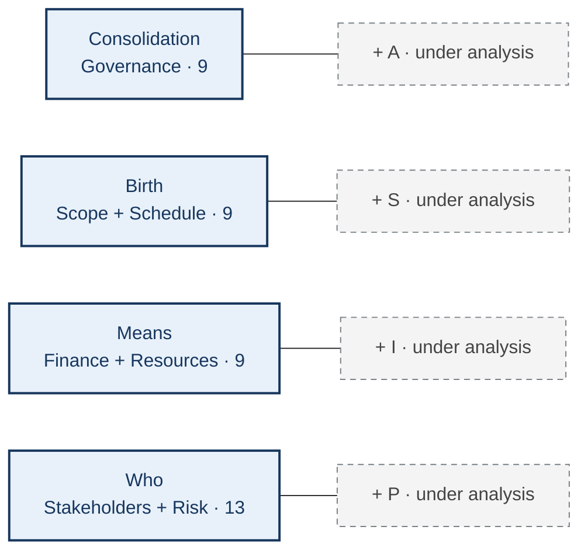

# PMBOK 8 on one page: principles, processes and tailoring

**SIPA Privacy 2 group · PMBOK 8 synthesis**  
**Central idea:** principles guide decisions; domains and Focus Areas help locate the work; *tailoring* adjusts how it is carried out [5].

## Figure P1 — How the pieces relate

<!-- Future composition: upper band, three labeled layers. Layer 1: the six
principles grouped into three pairs of the mindset (proactive: 1AHV and 3QPD;
ownership: 4BAL and 6BEC; value-oriented: 2FOV and 5SPA). In the center, a
teal card "Tailoring" with the phrase "approach · processes · engagement" and,
beside it, the four-step cycle (choose approach → tailor to the organization →
tailor to the project → improve continuously). Layer 3: five Focus Areas and
seven domains with 40 processes. Arrows with different verbs ("guide",
"adjusts the application"); no arrow links a principle to a single area or to a
single process. Dark blue = PMBOK 8 content; teal = tailoring. No decorative
icons. Alt text: principles guide tailoring, which adjusts the application of
Focus Areas and domains. Source: [5], Standard chs. 3 and 4;
Guide chs. 2 and 3. -->

**Five operations on processes:** add · modify · remove · combine · align. **Three objects of tailoring:** life cycle and development approach · processes · engagement [5].

## Figure P2 — 40 processes in 7 domains × 5 Focus Areas

<!-- Future composition: central and largest figure. 7×5 heat map with numbers
in all cells, row total on the right and column total below. More
intense color indicates more processes, never greater importance. The ST/IN cell
contains Identify Stakeholders (Guide, Figure 2-32). Keep letters and numbers
legible at a distance and in printing without color. Alt text: distribution of the
40 processes across seven domains and five Focus Areas. Source: [5], Guide,
Table 2-1 and domain overview figures. -->

| Domain | IN | PL | EX | MC | CL | Total |
| --- | ---: | ---: | ---: | ---: | ---: | ---: |
| Governance | 1 | 2 | 3 | 2 | 1 | 9 |
| Scope | 0 | 4 | 0 | 2 | 0 | 6 |
| Schedule | 0 | 2 | 0 | 1 | 0 | 3 |
| Finance | 0 | 3 | 0 | 1 | 0 | 4 |
| Stakeholders | 1 | 2 | 2 | 2 | 0 | 7 |
| Resources | 0 | 2 | 2 | 1 | 0 | 5 |
| Risk | 0 | 4 | 1 | 1 | 0 | 6 |
| **Total** | **2** | **19** | **8** | **10** | **1** | **40** |

**Legend:** IN Initiating · PL Planning · EX Executing · MC Monitoring and Controlling · CL Closing. Number of processes ≠ duration or importance of an area.

## Figure P3 — Four concentrations to read the seven domains

<!-- Future composition: visual footer with four equal cards. Solid part
of each card = official PMBOK 8 domains and number of processes. Dashed
gray label with + sign = theme under analysis, outside PMI. Explicit header:
"analytical grouping of this work; not an official PMI classification".
Give Who the same size as the other cards, since this synthesis covers the entire
guide. Alt text: seven domains grouped into four concentrations,
with four themes kept apart from the official count. -->

**Reading note:** the four concentrations and the labels A, S, I, and P are an **analytical grouping of this work**; the seven domains and their 40 processes belong to PMBOK 8 [5]. *Identify Stakeholders* is in Initiating (Figure 2-32 of the *Guide*). PMBOK 8 does not mention the digital twin; hybrid approaches are frequent in practice [4, 6].

**References** (numbering of the full report, in alphabetical order):
[4] NOLL; BEECHAM. *How agile is hybrid agile?*, PROFES 2019. ·
[5] PMI. *PMBOK Guide*, 8th ed., 2025 (*Standard* chs. 2 to 4; *Guide* chs. 2 and 3; restricted-access document). ·
[6] REED et al. *Communications of the AIS*, 2024.
Full references, with DOI, in the report.
