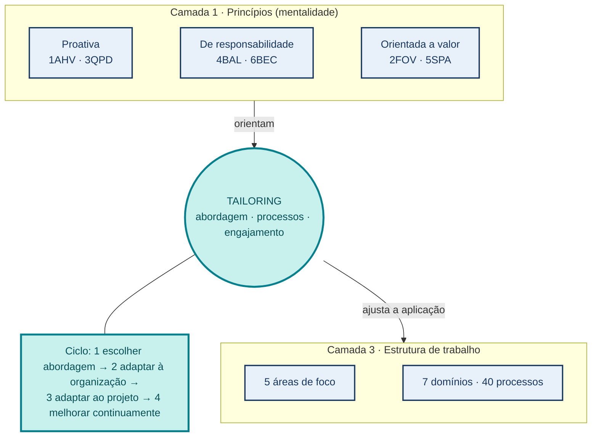
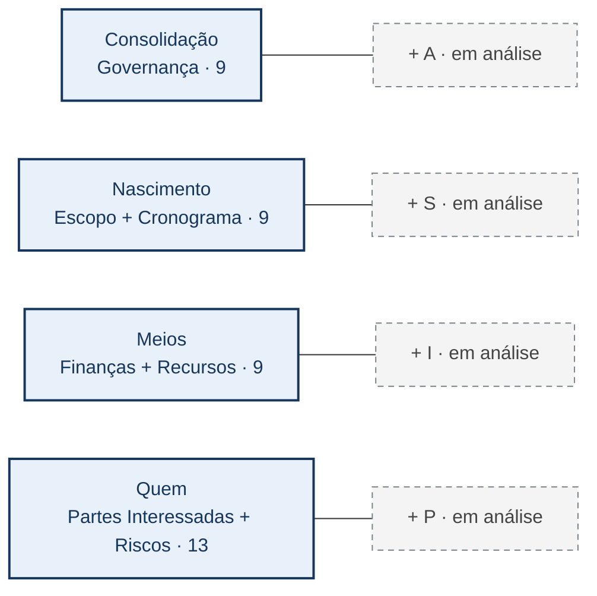

# PMBOK 8 em uma página: princípios, processos e adaptação

**Grupo SIPA Privacidade 2 · Síntese do PMBOK 8**  
**Ideia central:** princípios orientam decisões; domínios e áreas de foco ajudam a localizar o trabalho; *tailoring* ajusta a forma de executá-lo [4].

## Figura P1 — Como as peças se relacionam

<!-- Composição futura: faixa superior, três camadas rotuladas. Camada 1: os seis
princípios agrupados em três pares da mentalidade (proativa: 1AHV e 3QPD; de
responsabilidade: 4BAL e 6BEC; orientada a valor: 2FOV e 5SPA). No centro, um
cartão turquesa "Tailoring" com a frase "abordagem · processos · engajamento" e,
ao lado, o ciclo de quatro passos (escolher abordagem → adaptar à organização →
adaptar ao projeto → melhorar continuamente). Camada 3: cinco áreas de foco e
sete domínios com 40 processos. Setas com verbos diferentes ("orientam",
"ajusta a aplicação"); nenhuma seta liga um princípio a uma única área ou a um
único processo. Azul escuro = conteúdo do PMBOK 8; turquesa = tailoring. Sem
ícones decorativos. Texto alternativo: princípios orientam o tailoring, que
ajusta a aplicação de áreas de foco e domínios. Fonte: [4], Standard caps. 3 e 4;
Guide caps. 2 e 3. -->

**Cinco operações sobre processos:** adicionar · modificar · remover · combinar · alinhar. **Três objetos da adaptação:** ciclo de vida e abordagem de desenvolvimento · processos · engajamento [4].

## Figura P2 — 40 processos em 7 domínios × 5 áreas de foco

<!-- Composição futura: figura central e maior. Mapa de calor 7×5 com números
em todas as células, total de linha à direita e total de coluna abaixo. Cor
mais intensa indica mais processos, nunca maior importância. A célula ST/IN
contém Identify Stakeholders (Guide, Figura 2-32). Manter letras e números
legíveis à distância e em impressão sem cor. Texto alternativo: distribuição dos
40 processos entre sete domínios e cinco áreas de foco. Fonte: [4], Guide,
Tabela 2-1 e figuras de visão geral dos domínios. -->

| Domínio | IN | PL | EX | MC | CL | Total |
| --- | ---: | ---: | ---: | ---: | ---: | ---: |
| Governança | 1 | 2 | 3 | 2 | 1 | 9 |
| Escopo | 0 | 4 | 0 | 2 | 0 | 6 |
| Cronograma | 0 | 2 | 0 | 1 | 0 | 3 |
| Finanças | 0 | 3 | 0 | 1 | 0 | 4 |
| Partes Interessadas | 1 | 2 | 2 | 2 | 0 | 7 |
| Recursos | 0 | 2 | 2 | 1 | 0 | 5 |
| Riscos | 0 | 4 | 1 | 1 | 0 | 6 |
| **Total** | **2** | **19** | **8** | **10** | **1** | **40** |

**Legenda:** IN Iniciação · PL Planejamento · EX Execução · MC Monitoramento e Controle · CL Encerramento. Contagem de processos ≠ duração ou importância de uma área.

## Figura P3 — Quatro concentrações para ler os sete domínios

<!-- Composição futura: rodapé visual com quatro cartões iguais. Parte sólida
de cada cartão = domínios oficiais do PMBOK 8 e quantidade de processos. Etiqueta
cinza tracejada com sinal + = tema em análise, fora do PMI. Cabeçalho explícito:
"agrupamento analítico deste trabalho; não é classificação oficial do PMI".
Dar a Quem o mesmo tamanho dos outros cartões, pois esta síntese cobre o guia
inteiro. Texto alternativo: sete domínios agrupados em quatro concentrações,
com quatro temas separados da contagem oficial. -->

**Aviso de leitura:** as quatro concentrações e as etiquetas A, S, I e P são **agrupamento analítico deste trabalho**; os sete domínios e seus 40 processos são do PMBOK 8 [4]. *Identify Stakeholders* está em Iniciação (Figura 2-32 do *Guide*). O PMBOK 8 não menciona gêmeo digital; abordagens híbridas são frequentes na prática [3, 5].

**Referências** (numeração do relatório completo, em ordem alfabética):
[3] NOLL; BEECHAM. *How agile is hybrid agile?*, PROFES 2019. ·
[4] PMI. *PMBOK Guide*, 8. ed., 2025 (*Standard* caps. 2 a 4; *Guide* caps. 2 e 3; documento de acesso restrito). ·
[5] REED et al. *Communications of the AIS*, 2024.
Referências completas, com DOI, no relatório.
