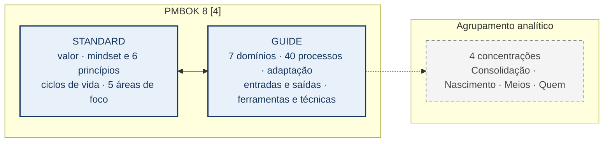
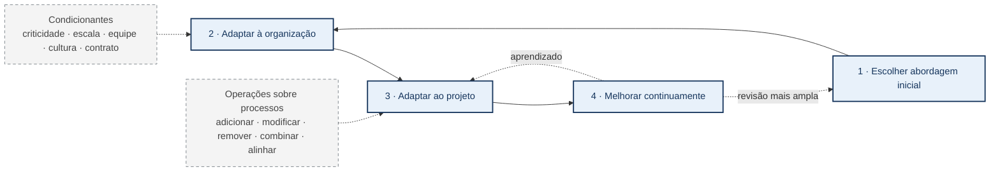
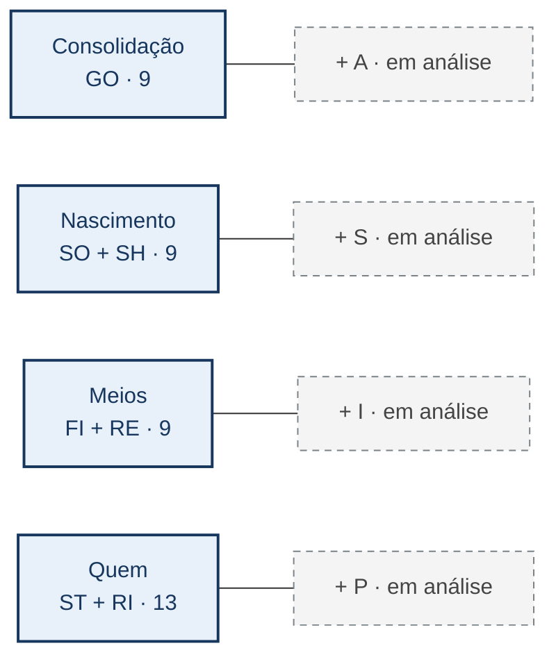

# PMBOK 8: princípios, áreas de foco, domínios e adaptação sob medida

**Grupo SIPA:** Privacidade 2  
**Integrantes:** Filipe Alves de Sousa, Emanuel Brandão de Galvão Correia, Ruben Isaac Dias da Silva e Carlos Eduardo da Silva Papa  
**Professores:** Dr. João Mello da Silva e Dr. Edison Ishikawa  
**Natureza:** síntese técnica do PMBOK 8, com um agrupamento analítico dos domínios apresentado separadamente da estrutura oficial do PMI.

## Resumo

Este relatório sintetiza *The Standard for Project Management* e *A Guide to the Project Management Body of Knowledge*, ambos da oitava edição do PMBOK. O objetivo é explicar como seis princípios orientam decisões, cinco áreas de foco organizam atividades e sete domínios de desempenho reúnem 40 processos. A leitura enfatiza a adaptação sob medida (*tailoring*): escolher abordagem de desenvolvimento, processos e formas de engajamento que façam sentido para a organização e o projeto, revendo as escolhas conforme os resultados. O texto cobre o sistema de entrega de valor, os ciclos de vida e a escolha da abordagem, as cinco ações sobre processos, os quatro passos do processo de adaptação e os diagnósticos do capítulo de adaptação. Uma tabela relaciona cada um dos 40 processos ao domínio, à área de foco e a um agrupamento analítico; um mapa 7 × 5 mostra a distribuição dos processos; uma matriz 6 × 7 resume as conexões entre princípios e domínios que o *Standard* descreve. Quatro concentrações — Consolidação, Nascimento, Meios e Quem — são usadas como **agrupamento analítico adotado na disciplina GPTI/PPCA**, sem atribuí-las ao PMI. Estudos recentes sobre abordagens híbridas e uma norma internacional de gestão de projetos situam a síntese. Um quadro final mostra onde o PMBOK 8 já toca dados pessoais; não se propõe aqui um novo processo.

**Palavras-chave:** PMBOK 8; gerenciamento de projetos; princípios; áreas de foco; domínios de desempenho; processos; adaptação sob medida; abordagens híbridas.

## 1. Objetivo, fonte e método

O PMBOK 8 reúne um *Standard*, que apresenta fundamentos para a gestão de projetos, e um *Guide*, que organiza domínios de desempenho, processos, entradas, saídas, ferramentas e técnicas e critérios de adaptação. O objetivo deste relatório é oferecer uma síntese das duas obras que permita entender **como a edição se organiza e como pode ser adaptada a um projeto concreto**, com ênfase no *tailoring*.

**Fonte.** A fonte primária é a edição integral publicada pelo PMI em 2025 [4]. Trata-se de um **documento de acesso restrito**: a edição integral é obtida mediante aquisição ou associação ao PMI. Por isso, o texto cita seções, tabelas e figuras e evita reproduzir trechos extensos; as descrições são paráfrases de trabalho. O *Guide* indica, em sua introdução, quatro seções principais: domínios de desempenho (seção 2), adaptação (3), entradas e saídas (4) e ferramentas e técnicas (5) [4, *Guide* §1.1].

**Método.** Para cada elemento, perguntamos **que decisão ele orienta**, **onde se manifesta** e **que resultado se espera**. Identificamos os nomes e a contagem dos processos nas seções 2.1 a 2.7 do *Guide*, na Tabela 2-1 e nas figuras de visão geral de cada domínio. Os seis princípios e suas conexões com os domínios foram lidos no capítulo 3 do *Standard*, os ciclos de vida e as áreas de foco no capítulo 4 do *Standard* e o *tailoring* no capítulo 3 do *Guide*. Termos originais em inglês aparecem na primeira ocorrência de cada conceito; as traduções são de trabalho e não são traduções autorizadas pelo PMI.

**Literatura complementar.** Para situar a síntese, usamos três estudos recentes sobre abordagens híbridas e adaptação [3, 5, 6], uma revisão sobre gêmeos digitais em projetos de construção [2] e a norma ISO 21502:2020, de orientações para gestão de projetos [1]. Esses trabalhos não substituem o PMBOK 8; servem para comparar a leitura do PMI com o que a literatura observa na prática.

**Limites do método.** A lista dos 40 processos é completa para permitir auditoria da contagem, mas o relatório não reproduz o livro. O PMBOK 8 afirma que as entradas e saídas do capítulo 4 do *Guide* não pretendem ser abrangentes nem obrigatórias em qualquer projeto: são seleções comuns entre muitas opções [4, *Guide* §1.1]. O número de processos apresentados não equivale, portanto, ao número de processos a executar em um projeto.

**Figura 1 — Estrutura das duas obras e agrupamento analítico.** O *Standard* fornece a orientação de valor, os princípios, o ciclo de vida e as áreas de foco; o *Guide* oferece o detalhamento dos domínios, dos processos e das decisões de adaptação. Uma terceira moldura, tracejada, identifica o agrupamento analítico em quatro concentrações, que não pertence ao PMI. *Elaboração própria com base em [4].*

<!-- Desenho futuro: duas molduras de mesmo tamanho, Standard e Guide, ligadas por
seta dupla. No Standard: sistema de entrega de valor, seis princípios, ciclos de
vida e cinco áreas de foco. No Guide: sete domínios, 40 processos, adaptação,
entradas e saídas, ferramentas e técnicas. À parte, uma terceira moldura
tracejada, cinza, rotulada "agrupamento analítico".
Azul escuro identifica conteúdo oficial. Texto alternativo: as duas partes do
PMBOK 8 se complementam; um agrupamento analítico fica fora da estrutura oficial. -->

Esta separação facilita a leitura, mas não isola conceitos. O sistema de entrega de valor afeta escolhas em todos os domínios; os processos do *Guide* podem ser configurados para diferentes abordagens de desenvolvimento. Também não há equivalência entre princípio, área de foco, domínio e processo: cada termo responde a uma pergunta distinta.

## 2. Estrutura da edição e o que mudou

A edição de 2025 reúne dois volumes com funções diferentes. A tabela resume o que cada parte contém e onde está, com os números de página da edição impressa [4].

| Obra e parte | Conteúdo | Onde |
| --- | --- | --- |
| *Standard* — 1 Introdução | Finalidade, características de um projeto, governança organizacional e de projeto, operações e gestão de projetos, relação entre portfólio, programa, projeto e operações | cap. 1 |
| *Standard* — 2 Sistema de entrega de valor | Criação de valor, ambiente do projeto, gestão de produto, funções e papéis | cap. 2 |
| *Standard* — 3 Princípios | Mentalidade e seis princípios, com impacto, aplicação e domínios conectados | cap. 3, p. 35 |
| *Standard* — 4 Ciclos de vida | Fases, abordagens de desenvolvimento, critérios de escolha, cadência de entrega e cinco áreas de foco | cap. 4, p. 57 |
| *Guide* — 1 Introdução | Estrutura do *Guide*, relação com o *Standard* e mudanças da edição | cap. 1 |
| *Guide* — 2 Domínios de desempenho | Sete domínios, cada um com conceitos-chave, processos, adaptação, interações e verificação de resultados | cap. 2, p. 7 |
| *Guide* — 3 Adaptação | O que é *tailoring*, por que e como adaptar, diagnósticos | cap. 3, p. 103 |
| *Guide* — 4 Entradas e saídas | Catálogo de ativos e artefatos de exemplo | cap. 4, p. 113 |
| *Guide* — 5 Ferramentas e técnicas | Catálogo de ferramentas e técnicas de exemplo | cap. 5, p. 145 |

O prefácio agrupa as mudanças da edição em quatro categorias: atualização de termos e conceitos-chave, refinamento dos princípios, reintrodução dos grupos de processos como **áreas de foco** e atualização dos domínios de desempenho [4, prefácio]. A edição apresenta seis princípios acionáveis, cinco áreas de foco e sete domínios que reúnem 40 processos reformulados. O *Guide* sintetiza as antigas áreas de conhecimento com outros conceitos aceitos em sete domínios e insere considerações de adaptação e exemplos em cada um.

O PMBOK 8 **não menciona gêmeo digital**: o termo não aparece no texto da edição. Isso importa para o uso deste relatório em projetos de TIC, porque a edição fornece a estrutura de gestão, não orientação específica sobre essa tecnologia. A literatura sobre gêmeos digitais em gestão de projetos concentra-se hoje em construção civil, como mostra a revisão sistemática e bibliométrica de Manzoor et al. [2], que analisa fatores críticos de sucesso para sua implantação.

## 3. Sistema de entrega de valor, ambiente e funções

O capítulo 2 do *Standard* descreve onde o projeto opera. **Criação de valor:** as organizações criam valor para as partes interessadas, e o valor esperado de qualquer investimento em projeto deve igualar ou superar um limiar de retorno, financeiro ou não, tangível ou intangível. O valor de negócio é o benefício líquido quantificável, em qualquer forma tangível ou intangível, e a entrega de valor hoje inclui impacto social e metas de sustentabilidade [4, *Standard* §2.1]. A avaliação do sucesso de um projeto considera duas dimensões: o sucesso dos **resultados** do projeto, isto é, a realização do valor pretendido, e o sucesso dos **processos** de gestão [4, *Standard* §2.1.2].

**Ambiente do projeto.** Duas categorias de influência atuam sobre o projeto: os **fatores ambientais da empresa** (*enterprise environmental factors*), internos e externos à organização, e os **ativos de processos organizacionais** (*organizational process assets*), que incluem processos, políticas e procedimentos e o repositório de conhecimento. Entre os fatores externos aparecem restrições legais, como leis e regulamentos sobre segurança, proteção de dados, conduta empresarial, emprego e aquisições. O *Standard* trata também das estruturas organizacionais e de seus efeitos sobre o gerente de projeto e a disponibilidade de recursos, e das considerações de gestão de produto ao longo do ciclo de vida do produto [4, *Standard* §§2.2–2.3].

**Funções e papéis.** As pessoas conduzem a entrega ao exercer sete funções: oferecer supervisão e coordenação; solicitar e gerir *feedback*; facilitar e apoiar; executar o trabalho; aplicar conhecimento especializado; oferecer direção e visão organizacional; e fornecer recursos. Elas podem ser exercidas por uma pessoa, uma equipe ou uma combinação de papéis, e a forma de coordenação varia: descentralizada, em projetos que se autoorganizam, ou centralizada, com um gerente designado. Os papéis tratados são a equipe de gestão do projeto, o patrocinador, o cliente ou dono do produto, a equipe do projeto e os usuários finais e demais partes interessadas [4, *Standard* §§2.4–2.5].

## 4. Os seis princípios e a mentalidade do *Standard*

O *Standard* organiza uma mentalidade de gestão em três dimensões: **proativa**, de **responsabilidade** (*ownership*) e **orientada a valor**. Cada dimensão integra dois princípios [4, *Standard* §3.1].

| Dimensão | Princípios |
| --- | --- |
| Proativa | **1AHV** *Adopt a Holistic View* e **3QPD** *Embed Quality Into Processes and Deliverables* |
| De responsabilidade (*ownership*) | **4BAL** *Be an Accountable Leader* e **6BEC** *Build an Empowered Culture* |
| Orientada a valor | **2FOV** *Focus on Value* e **5SPA** *Integrate Sustainability Within All Project Areas* |

A tabela formula, em linguagem de trabalho, uma pergunta útil para aplicar cada princípio e uma consequência para uma decisão; não substitui a definição do PMI [4, *Standard* §§3.3–3.8].

| Princípio oficial (código usado na disciplina) | Pergunta prática | Consequência para uma decisão |
| --- | --- | --- |
| **1AHV — Adopt a Holistic View** | Que relações e efeitos fora da entrega imediata influenciam o resultado? | Examinar dependências entre domínios, organização, pessoas e ambiente. |
| **2FOV — Focus on Value** | Que resultado justifica o trabalho e como saber se continua valioso? | Comparar alternativas pelo benefício esperado, não só pela quantidade de atividades. |
| **3QPD — Embed Quality Into Processes and Deliverables** | Como a qualidade será construída e verificada durante o trabalho? | Definir critérios, revisões e correções cedo, evitando inspeção apenas no fim. |
| **4BAL — Be an Accountable Leader** | Quem assume e explica as decisões difíceis? | Tornar responsabilidades, critérios e escalonamento visíveis. |
| **5SPA — Integrate Sustainability Within All Project Areas** | Quais efeitos persistem para pessoas, ambiente e organização? | Incluir consequências de longo prazo nas escolhas de escopo, recursos e risco. |
| **6BEC — Build an Empowered Culture** | A equipe consegue agir, aprender e levantar problemas? | Criar confiança, autonomia responsável e canais de retorno. |

Os princípios atravessam os sete domínios; não há relação exclusiva de um princípio com um único domínio. O *Standard* afirma que todos os princípios se relacionam com todos os domínios, e a seção 8 explicita essas interfaces. Os princípios orientam julgamentos: não são processos adicionais.

## 5. Ciclos de vida, abordagens de desenvolvimento e cadência

O capítulo 4 do *Standard* trata de como o trabalho se organiza no tempo. Um projeto se decompõe em **fases**, que podem ser sequenciais, de transição ou sobrepostas. Cada fase tem atributos, como nome, duração, necessidade de recursos e critérios de entrada e de saída, e pode terminar em um ponto de decisão (*phase gate*), no fim da fase ou, como alternativa, no início (*pre-phase gate*). O ciclo de vida do projeto é independente do ciclo de vida do produto. Adaptar o ciclo de vida envolve selecionar a abordagem ou a mistura de abordagens, os tipos de processos e atividades e os atributos de uma fase [4, *Standard* §4.1].

### 5.1 Preditiva, adaptativa e híbrida

A **abordagem de desenvolvimento** é o meio usado para criar e evoluir o produto, serviço ou resultado ao longo do ciclo de vida. As três abordagens usuais formam um espectro, da preditiva à adaptativa, com a híbrida como combinação das duas [4, *Standard* §4.2].

| Abordagem | Quando tende a servir | Características |
| --- | --- | --- |
| **Preditiva** | Escopo estável cedo; grandes investimentos; supervisão regulatória; custo de iterar maior que o valor | Planejamento antecipado, linhas de base de escopo, cronograma e custo; controle de mudanças robusto; pode entregar de modo incremental |
| **Adaptativa** | Requisitos e solução técnica com alta incerteza e volatilidade | Visão clara no início; requisitos elaborados progressivamente com *feedback*; revisões periódicas em ciclos curtos; alguns métodos usam iterações de 1 a 4 semanas |
| **Híbrida** | Incerteza apenas em parte do escopo; entregas modularizáveis; vários fluxos de trabalho | Elementos preditivos e adaptativos combinados; o *Standard* descreve quatro padrões comuns, como desenvolvimento adaptativo seguido de implantação preditiva ou uso simultâneo das duas |

O *Standard* observa que, na prática, a maioria dos projetos pode se beneficiar de uma abordagem híbrida e que focar exclusivamente em uma das duas deixa de tratar parte dos desafios dos projetos modernos. Esse achado é coerente com a literatura. Uma pesquisa com 400 profissionais mostrou que poucos gerentes usam métodos ágeis sem técnicas preditivas, que o setor e o tipo de projeto influenciam a escolha e que não há uma melhor abordagem em absoluto [5]. Na análise dos dados do estudo HELENA, cerca de dois terços dos projetos pesquisados combinavam métodos ágeis e tradicionais em algum grau [3]. Uma abordagem baseada em contingência identifica seis formas de combinar as abordagens conforme critérios de adequação e trata a adaptação como núcleo do tema [6].

### 5.2 Como escolher e com que cadência entregar

A escolha da abordagem depende de variáveis do **produto**, do **projeto** e da **organização**. O quadro resume os fatores que o *Standard* lista [4, *Standard* §4.3].

| Categoria | Fatores |
| --- | --- |
| Entregas | Grau de inovação; certeza dos requisitos; estabilidade do escopo; facilidade de mudança; opções de entrega; risco; requisitos de segurança; *feedback*; regulamentação |
| Projeto | Partes interessadas; restrições de cronograma; incerteza de financiamento; tamanho e complexidade; experiência e habilidades da equipe; interdependências |
| Organização | Estrutura organizacional; cultura; capacidade organizacional; tamanho e localização da equipe |

A abordagem escolhida condiciona a **cadência de entrega**: entrega única, múltiplas entregas, entregas periódicas (comuns em abordagens adaptativas, em calendário regular) ou entrega contínua, em que incrementos testados e validados chegam à produção de forma permanente [4, *Standard* §4.4]. A norma ISO 21502:2020 trata o assunto de modo próximo: aplica-se a qualquer tipo de projeto, independentemente da abordagem de entrega e do modelo de ciclo de vida, e passou de um formato baseado em processos para um formato baseado em práticas, ao substituir a ISO 21500:2012 [1]. O PMBOK 8 combina os dois enfoques: princípios, áreas de foco e domínios, de um lado, e 40 processos com entradas e saídas de exemplo, de outro.

## 6. Cinco áreas de foco e a distribuição dos processos

As *Project Management Focus Areas* são **Iniciação (IN), Planejamento (PL), Execução (EX), Monitoramento e Controle (MC) e Encerramento (CL)**. Elas agrupam práticas de gestão e são aplicáveis independentemente da área de aplicação, do setor e da abordagem de desenvolvimento. Não impõem sequência rígida nem se confundem com as fases do ciclo de vida. Os processos, práticas ou ações de cada área costumam ser iterados antes de concluir uma fase ou o projeto [4, *Standard* §4.5].

| Área | O que reúne | Pergunta orientadora |
| --- | --- | --- |
| **IN** Iniciação | Ações para definir um novo projeto ou fase, com autorização formal; escopo inicial, recursos financeiros iniciais, partes interessadas e papéis | Que trabalho deve ser autorizado e quem está envolvido? |
| **PL** Planejamento | Ações que estabelecem o escopo pretendido, refinam objetivos e desenvolvem o curso de ação; laços repetidos de *feedback* | Como integrar planos, requisitos, recursos, custos, comunicação e respostas a risco? |
| **EX** Execução | Ações para concluir o trabalho conforme o curso de ação acordado; é onde a escolha da abordagem fica mais evidente | Como conduzir o trabalho, engajar pessoas e implementar respostas? |
| **MC** Monitoramento e controle | Ações para acompanhar, medir, revisar e regular o progresso, identificar mudanças necessárias e iniciá-las | Como comparar resultado com objetivos e corrigir desvios? |
| **CL** Encerramento | Ações para concluir formalmente fase, projeto ou contrato, ou encerrá-lo antes do fim; verificação de saídas, resultados e benefícios | Como encerrar e transferir resultados à operação? |

A distribuição dos 40 processos pelas áreas aparece na Tabela 2-1 do *Guide* e nas figuras de visão geral de cada domínio. *Identify Stakeholders* é o único processo de Partes Interessadas na Iniciação, como mostra a Figura 2-32 do *Guide* [4, *Guide* §2.5.2]; com ele, os totais por área fecham em 2 + 19 + 8 + 10 + 1 = 40.

| Área | Processos no quadro do PMBOK 8 |
| --- | ---: |
| IN | **2** |
| PL | **19** |
| EX | **8** |
| MC | **10** |
| CL | **1** |

**Figura 2 — Mapa 7 × 5 dos 40 processos.** As células são **contagens**, não intensidade de importância. *Fonte: [4, Guide, Tabela 2-1 e figuras de visão geral dos domínios]; cálculo e apresentação próprios.*

<!-- Desenho futuro: mapa de calor com linhas GO, SO, SH, FI, ST, RE, RI;
colunas IN, PL, EX, MC, CL. Cada célula exibe número e cor proporcional à
contagem; zero fica branco. Coluna de total à direita e linha de total embaixo.
A legenda diz "quantidade de processos", jamais "qualidade do domínio".
Texto alternativo: matriz de 7 domínios por 5 áreas, com 40 processos no total. -->

| Domínio | IN | PL | EX | MC | CL | Total |
| --- | ---: | ---: | ---: | ---: | ---: | ---: |
| Governança (GO) | 1 | 2 | 3 | 2 | 1 | 9 |
| Escopo (SO) | 0 | 4 | 0 | 2 | 0 | 6 |
| Cronograma (SH) | 0 | 2 | 0 | 1 | 0 | 3 |
| Finanças (FI) | 0 | 3 | 0 | 1 | 0 | 4 |
| Partes Interessadas (ST) | 1 | 2 | 2 | 2 | 0 | 7 |
| Recursos (RE) | 0 | 2 | 2 | 1 | 0 | 5 |
| Riscos (RI) | 0 | 4 | 1 | 1 | 0 | 6 |
| **Total** | **2** | **19** | **8** | **10** | **1** | **40** |

Planejamento concentra 19 processos, mas esse número não significa que ocupe quase metade do tempo de um projeto. A tabela classifica processos, não duração, custo ou relevância. Governança aparece nas cinco áreas, enquanto os demais domínios têm distribuições mais concentradas. O controle pode atualizar decisões de qualquer domínio; uma linha com zero em determinada área não significa que o tema desapareça dela.

## 7. Os sete domínios de desempenho do *Guide*

Um domínio de desempenho é um grupo de processos relacionados e essenciais para a entrega efetiva de valor. Os sete domínios são interativos, inter-relacionados e interdependentes, e operam como sistema integrado, **sem ordem nem ponderação específicas** [4, *Guide* §2]. Para cada um, o *Guide* apresenta conceitos-chave, processos, considerações de adaptação, interações com outros domínios e verificação de resultados (Tabelas 2-5 a 2-11 do *Guide*). Eles não são departamentos isolados.

**Governança (GO, 9 processos)** é a estrutura, as funções e os processos que orientam as decisões e atividades de gestão para otimizar a entrega de valor. É holística e integradora, considera todos os outros domínios, inclui elementos de gestão da integração (alinhamento estratégico, decisão e mudança, critérios de sucesso) e **integra a gestão de riscos e oportunidades**. Também assegura o alinhamento do projeto com o portfólio e a estratégia da organização [4, *Guide* §2.1].

**Escopo (SO, 6)** garante que o projeto contenha todo o trabalho necessário, e somente ele, para maximizar valor. O domínio **inclui a qualidade**: quanto às entregas, trata dos critérios de aceitação e do atendimento às expectativas das partes interessadas e aos requisitos do projeto e do produto [4, *Guide* §2.2; *Standard* §3.2].

**Cronograma (SH, 3)** estabelece um plano de como e quando o projeto entregará produtos, serviços e resultados. Serve como ferramenta de comunicação, gestão de expectativas e base para relatórios de desempenho, e facilita a identificação antecipada de atrasos e riscos [4, *Guide* §2.3].

**Finanças (FI, 4)** abrange custos, financiamento e, em alguns casos, a proposta de valor do projeto: planejar, estimar, orçar, financiar, gerir, medir e controlar custos para otimizar o valor para a organização [4, *Guide* §2.4].

**Partes Interessadas (ST, 7)** trata do engajamento, da identificação das partes interessadas ao monitoramento do engajamento durante todo o ciclo de vida, e está ligado à gestão das comunicações. As partes interessadas incluem o patrocinador, a equipe e todas as pessoas afetadas, ou que sintam que podem ser afetadas, pelo projeto; podem ser de poucas a milhões [4, *Guide* §2.5].

**Recursos (RE, 5)** refere-se a como a equipe planeja e utiliza os recursos disponíveis: pessoas, equipamentos, materiais, instalações, infraestrutura, software, ambientes de teste, licenças, serviços e informação. Cobre também disponibilidade, utilização e manutenção [4, *Guide* §2.6].

**Riscos (RI, 6)** é uma abordagem abrangente para criar resiliência do projeto, com capacidade de antecipar, preparar, responder e se adaptar a riscos e interrupções, de modo proativo e com respostas flexíveis [4, *Guide* §2.7].

### 7.1 Inventário auditável dos 40 processos

A tabela mantém os **nomes oficiais em inglês**. A coluna em português serve à leitura e não é tradução autorizada pelo PMI. A coluna **concentração** traz o agrupamento analítico (seção 10), que **não** pertence ao PMI. A presença de um processo no inventário não obriga sua execução formal em todos os projetos; sua aplicação depende de *tailoring* [4, *Guide* Tabela 2-1 e §§2.1–2.7].

| # | Domínio | Área | Concentração | Processo oficial — tradução de trabalho |
| ---: | --- | --- | --- | --- |
| 1 | GO | IN | Consolidação | *Initiate Project or Phase* — iniciar projeto ou fase |
| 2 | GO | PL | Consolidação | *Integrate and Align Project Plans* — integrar e alinhar planos do projeto |
| 3 | GO | PL | Consolidação | *Plan Sourcing Strategy* — planejar estratégia de suprimento |
| 4 | GO | EX | Consolidação | *Manage Project Execution* — gerenciar execução do projeto |
| 5 | GO | EX | Consolidação | *Manage Quality Assurance* — gerenciar garantia da qualidade |
| 6 | GO | EX | Consolidação | *Manage Project Knowledge* — gerenciar conhecimento do projeto |
| 7 | GO | MC | Consolidação | *Monitor and Control Project Performance* — monitorar e controlar desempenho |
| 8 | GO | MC | Consolidação | *Assess and Implement Changes* — avaliar e implementar mudanças |
| 9 | GO | CL | Consolidação | *Close Project or Phase* — encerrar projeto ou fase |
| 10 | SO | PL | Nascimento | *Plan Scope Management* — planejar gestão do escopo |
| 11 | SO | PL | Nascimento | *Elicit and Analyze Requirements* — elicitar e analisar requisitos |
| 12 | SO | PL | Nascimento | *Define Scope* — definir escopo |
| 13 | SO | PL | Nascimento | *Develop Scope Structure* — desenvolver estrutura do escopo |
| 14 | SO | MC | Nascimento | *Monitor and Control Scope* — monitorar e controlar escopo |
| 15 | SO | MC | Nascimento | *Validate Scope* — validar escopo |
| 16 | SH | PL | Nascimento | *Plan Schedule Management* — planejar gestão do cronograma |
| 17 | SH | PL | Nascimento | *Develop Schedule* — desenvolver cronograma |
| 18 | SH | MC | Nascimento | *Monitor and Control Schedule* — monitorar e controlar cronograma |
| 19 | FI | PL | Meios | *Plan Financial Management* — planejar gestão financeira |
| 20 | FI | PL | Meios | *Estimate Costs* — estimar custos |
| 21 | FI | PL | Meios | *Develop Budget* — desenvolver orçamento |
| 22 | FI | MC | Meios | *Monitor and Control Finances* — monitorar e controlar finanças |
| 23 | ST | IN | Quem | *Identify Stakeholders* — identificar partes interessadas |
| 24 | ST | PL | Quem | *Plan Stakeholder Engagement* — planejar engajamento das partes interessadas |
| 25 | ST | PL | Quem | *Plan Communications Management* — planejar gestão das comunicações |
| 26 | ST | EX | Quem | *Manage Stakeholder Engagement* — gerenciar engajamento das partes interessadas |
| 27 | ST | EX | Quem | *Manage Communications* — gerenciar comunicações |
| 28 | ST | MC | Quem | *Monitor Stakeholder Engagement* — monitorar engajamento das partes interessadas |
| 29 | ST | MC | Quem | *Monitor Communications* — monitorar comunicações |
| 30 | RE | PL | Meios | *Plan Resource Management* — planejar gestão dos recursos |
| 31 | RE | PL | Meios | *Estimate Resources* — estimar recursos |
| 32 | RE | EX | Meios | *Acquire Resources* — adquirir recursos |
| 33 | RE | EX | Meios | *Lead the Team* — liderar a equipe |
| 34 | RE | MC | Meios | *Monitor and Control Resourcing* — monitorar e controlar disponibilização de recursos |
| 35 | RI | PL | Quem | *Plan Risk Management* — planejar gestão dos riscos |
| 36 | RI | PL | Quem | *Identify Risks* — identificar riscos |
| 37 | RI | PL | Quem | *Perform Risk Analysis* — realizar análise de riscos |
| 38 | RI | PL | Quem | *Plan Risk Responses* — planejar respostas a riscos |
| 39 | RI | EX | Quem | *Implement Risk Responses* — implementar respostas a riscos |
| 40 | RI | MC | Quem | *Monitor Risks* — monitorar riscos |

O inventário revela dependências concretas. Um requisito do Escopo pode exigir recurso, orçamento e decisão de Governança; mudanças no cronograma podem alterar riscos e expectativas de partes interessadas. O fato de um processo estar sob um domínio e uma área de foco facilita localizá-lo, mas não limita suas interações.

### 7.2 Considerações de adaptação por domínio

Cada domínio traz uma seção de considerações de adaptação (seção 2.x.3 do *Guide*, exceto Governança, que é a 2.1.7). A tabela resume uma consideração característica de cada um; as listas completas estão no livro [4, *Guide* §§2.1.7, 2.2.3, 2.3.3, 2.4.3, 2.5.3, 2.6.3 e 2.7.3].

| Domínio | Consideração de adaptação característica |
| --- | --- |
| Governança | Adaptar ao setor, às considerações regulatórias, à organização e ao contexto do projeto; identificar comitês e requisitos de relato de situação |
| Escopo | Dependência de parceiros externos (como integrar o escopo a acordos contratuais) e dinamismo do ambiente, que pede flexibilidade na gestão do escopo |
| Cronograma | Ciclo de vida e abordagem escolhidos: no preditivo, cronograma definido cedo e linha de base aprovada; atributos do produto, da equipe e da cultura |
| Finanças | Produto em setor regulado pode exigir controles formais, como conformidade com SOX ou GDPR; abordagem iterativa achata a curva de gastos |
| Partes Interessadas | A cultura organizacional é o principal fator: organizações planas usam canais abertos e informais; hierárquicas, abordagens mais formais |
| Recursos | Estilos de liderança conforme o projeto; no preditivo, recursos planejados cedo; no adaptativo, equipes autoorganizadas |
| Riscos | Tamanho e complexidade definem se é preciso uma abordagem detalhada ou se um processo simplificado basta |

## 8. Como os princípios atravessam os domínios

As subseções *Connected Performance Domains* do *Standard* (§§3.3.3 a 3.8.3) descrevem, para cada princípio, como ele se conecta a cada um dos sete domínios. Em cada uma das seis seções o texto trata dos sete domínios, o que dá **42 conexões expressas**. O *Standard* acrescenta que a visão holística é apoiada por todos os domínios; que qualidade e foco em valor são tratados sobretudo em Governança, Escopo, Riscos, Cronograma, Finanças e Partes Interessadas; e que o líder responsável cruza Governança, Partes Interessadas e Riscos [4, *Standard* §3.2].

A matriz da Figura 3 resume **uma contribuição característica por célula**. É paráfrase analítica dos trechos do PMBOK 8, não uma escala de força, prioridade ou conformidade. **Legenda:** todas as células têm base expressa no texto do *Standard*; a redação curta é do grupo.

| Princípio | GO | SO | SH | FI | ST | RE | RI |
| --- | --- | --- | --- | --- | --- | --- | --- |
| **1AHV** Visão holística | decisão transparente e baseada em dados | alinha as atividades ao escopo | considera interdependências | alinha orçamento às prioridades | engajamento inclusivo | integra os componentes para maximizar valor | riscos em todos os domínios e suas interdependências |
| **2FOV** Valor | governança dimensionada ao valor, sem burocracia | todo trabalho contribui ao valor; evita excesso | prazo ligado ao valor esperado | recursos financeiros para maximizar valor | valor na perspectiva das partes interessadas | decisões guiadas pela proposta de valor | respostas pragmáticas e eficazes |
| **3QPD** Qualidade | estruturas que asseguram padrões de qualidade | conexão especialmente forte com as entregas | revisões de qualidade no cronograma | evita retrabalho e desperdício | feedback integrado às decisões | recursos certos mantêm os limiares | riscos de qualidade antecipados |
| **4BAL** Liderança responsável | decisões transparentes e éticas | resolver desacordos sobre incluir ou excluir | discussões com as partes certas | pressões financeiras tratadas com responsabilidade | obter e manter apoio | gerir com responsabilidade e integridade | agir com integridade diante de ameaças e oportunidades |
| **5SPA** Sustentabilidade | metas de sustentabilidade na governança | requisitos sustentáveis no escopo | decisões consideram impacto ambiental | custos e benefícios de longo prazo | educação e colaboração em sustentabilidade | acesso a recursos alinhado aos requisitos | ameaças ambientais e sociais identificadas e mitigadas |
| **6BEC** Cultura empoderada | canal transparente entre equipe e governança | ajustar requisitos com comunicação aberta | equipe sugere acelerar, desacelerar ou parar | menos gasto não planejado, foco em valor | equipe define o nível de engajamento | acesso a recursos conforme os requisitos | equipe define limites de risco e participa |

**Figura 3 — Matriz de relações dos princípios.** Na figura, a cor de fundo distingue os três pares da mentalidade do *Standard*, e o texto curto mantém a leitura acessível sem cor. A matriz não cria índice numérico de desempenho. *Elaboração própria a partir de [4, Standard, §§3.2 a 3.8].*

<!-- Desenho futuro: manter 6 linhas × 7 colunas, com legenda para GO/SO/SH/FI/
ST/RE/RI. Usar três cores discretas nas faixas de linhas, uma por dimensão da
mentalidade (proativa, de responsabilidade, orientada a valor), e não pintar
intensidade nas células. Texto alternativo: todos os seis princípios influenciam
os sete domínios, por mecanismos distintos. -->

Esta leitura evita dois erros. O primeiro seria transformar princípios em processos adicionais. O segundo seria tomar os domínios como silos: uma escolha de qualidade em Escopo pode requerer orçamento, competência e resposta a risco.

## 9. Adaptação sob medida (*tailoring*)

O capítulo 3 do *Guide* define *tailoring* como a adaptação deliberada da abordagem de gestão, da governança e dos processos para alinhá-los ao ambiente e aos objetivos do projeto. A adaptação considera a abordagem de desenvolvimento, os processos, o ciclo de vida, as entregas e a forma de envolver partes interessadas e equipe. Ela é guiada pelos princípios do *Standard*: organizações com baixa tolerância a risco costumam adotar processos estruturados e mecanismos de supervisão, enquanto as de maior tolerância podem priorizar agilidade e autonomia de decisão [4, *Guide* §3.1].

### 9.1 Por que adaptar

Não existe uma forma única de gerir todos os projetos. Poucos processos podem deixar decisões críticas sem tratamento; processos em excesso custam caro e desperdiçam esforço. A adaptação traz três benefícios apontados pelo *Guide*: maior compromisso dos membros da equipe que ajudaram a adaptar a abordagem; foco no cliente, porque suas necessidades influenciam a construção; e uso mais eficiente dos recursos do projeto. Criticidade, escala, duração, complexidade, padrões do setor, cultura, quantidade de partes interessadas e maturidade organizacional influenciam a escolha. Há situações em que a adaptação é limitada, por exemplo quando a política organizacional ou um contrato impõe uma abordagem [4, *Guide* §§3.1–3.2].

### 9.2 O que adaptar

Três objetos podem ser adaptados [4, *Guide* §3.3]:

- **Ciclo de vida e abordagem de desenvolvimento.** Escolher fases, cadência e combinação preditiva, adaptativa ou híbrida. Um projeto pode ter, por exemplo, abordagem preditiva para a construção de um prédio e adaptativa para definir as capacidades de computação; do ponto de vista do projeto, trata-se de uma abordagem híbrida.
- **Processos.** Cinco operações podem ser aplicadas aos elementos de um processo: **adicionar**, para tratar condições próprias ou aumentar o rigor; **modificar**, para ajustar entradas, saídas e ferramentas; **remover**, para reduzir custo ou esforço desnecessário; **combinar**, para somar valor; e **alinhar**, para garantir consistência de definição e aplicação.
- **Engajamento.** Pessoas (avaliar competências da liderança e da equipe), empoderamento (que responsabilidades e decisões locais ficam com a equipe) e integração (como formar uma equipe a partir de contribuintes diversos, internos e externos).

Essas operações não autorizam omitir uma exigência legal ou contratual; ajudam a configurar a prática de gestão sob restrições reais.

**Exemplos hipotéticos das cinco operações.** A tabela ilustra, em um projeto de TIC com gêmeo digital, como as operações poderiam ser usadas. São exemplos de trabalho, **não prescrições do PMBOK 8**.

| Operação | Processo | Exemplo hipotético |
| --- | --- | --- |
| Adicionar | *Identify Risks* | Acrescentar categorias de risco de dados e de integração entre sistemas de informação e de operação |
| Modificar | *Plan Communications Management* | Ajustar canais e frequência para operadores de campo com conectividade limitada |
| Remover | *Plan Sourcing Strategy* | Dispensar a formalização se não houver aquisição externa relevante, mantendo as exigências contratuais aplicáveis |
| Combinar | *Plan Scope Management* e *Plan Schedule Management* | Reunir em um plano integrado, em um projeto pequeno, sem perder a rastreabilidade de cada um |
| Alinhar | *Manage Communications* | Unificar termos e registros entre organizações parceiras |

### 9.3 O processo de adaptação em quatro passos

O processo começa com a análise do ambiente e segue quatro passos, com realimentação [4, *Guide* §3.4]: (1) **escolher a abordagem inicial de desenvolvimento**; (2) **adaptar para a organização**; (3) **adaptar para o projeto**; e (4) **implementar a melhoria contínua**, com inspeção e adaptação.

**Figura 4 — Ciclo de adaptação.** O caminho inicia na escolha da abordagem de desenvolvimento, passa pelo ajuste à organização e ao projeto e volta às decisões anteriores por melhoria contínua. Condicionantes como criticidade, escala, equipe, cultura e contrato influenciam o ajuste; as cinco operações sobre processos aplicam-se ao ajuste ao projeto. *Elaboração própria com base em [4, Guide, §3.4 e Figura 3-1].*

<!-- Desenho futuro: quatro blocos numerados, conectados por setas sólidas;
duas setas tracejadas retornam da melhoria contínua ao ajuste ao projeto e à
escolha da abordagem. À margem, uma caixa de condicionantes (criticidade, escala,
equipe, cultura, contrato) liga-se ao passo 2. Na base, a caixa das cinco
operações liga-se ao passo 3. Texto alternativo: quatro passos do tailoring com
revisão e condicionantes. -->

**Passo 1.** A escolha considera o produto, a cadência de entrega e a consciência das opções disponíveis. Um **filtro de adequação** (*suitability filter*) é uma ferramenta de decisão, não um método rígido: avalia critérios de cultura, dinâmica da equipe e fatores do projeto para discutir a abordagem inicial entre preditiva, adaptativa e híbrida. Silvius-Zuchi e Silvius propõem critérios de adequação para projetar abordagens híbridas [6].

**Passo 2.** As organizações podem oferecer metodologias e abordagens como ponto de partida, e as que têm governança de processos devem garantir que a adaptação esteja alinhada à política. O escritório de projetos (PMO), quando existe, tem papel em revisar e aprovar abordagens adaptadas: a adaptação que afeta só a equipe exige menos supervisão do que a que afeta grupos externos. Em projetos com várias organizações, a adaptação deve usar uma abordagem multiorganizacional, harmonizando processos, governança e abordagens de cada participante.

**Passo 3.** Três grupos de atributos orientam o ajuste ao projeto, cada um com perguntas-guia: o **produto ou entrega** (oito atributos, entre eles conformidade com normas, tipo de produto, mercado do setor, tecnologia, prazo, estabilidade dos requisitos, segurança e possibilidade de entrega incremental), a **equipe** (seis, entre eles tamanho, geografia, distribuição organizacional, experiência, acesso ao cliente e diversidade) e a **cultura** (adesão, confiança, empoderamento e cultura organizacional).

**Passo 4.** Resultados, retrospectivas e outras informações mantêm ou revisam as escolhas; a figura do *Guide* usa os rótulos "inspecionar e adaptar" e "melhoria".

### 9.4 Adaptar os domínios e fazer diagnósticos

O trabalho de cada domínio também pode ser adaptado conforme a singularidade do projeto; os princípios orientam o comportamento dos profissionais ao fazê-lo, e os exemplos de cada domínio estão na seção 2 do *Guide* [4, *Guide* §3.5; Figura 3-4]. Os **diagnósticos** usam retrospectivas ou lições aprendidas para avaliar a eficácia das abordagens atuais; equipes que não usam retrospectivas podem recorrer a problemas, ameaças, métricas de qualidade e *feedback* das partes interessadas. A Tabela 3-1 do *Guide* relaciona oito situações comuns a sugestões de adaptação [4, *Guide* §3.6]. O quadro resume os gatilhos e a resposta sugerida.

| Situação | Sugestão de adaptação |
| --- | --- |
| Entregas de baixa qualidade | Analisar causas e aplicar medidas direcionadas de *feedback* e garantia da qualidade, com foco em melhorar processos e não só em aumentar verificações |
| Equipe insegura sobre como trabalhar | Avaliar necessidades da equipe e oferecer orientação, mentoria, treinamento e compartilhamento de conhecimento |
| Equipe pouco cooperativa e em silos | Atividades de integração e conversas individuais; fortalecer vínculos e a coordenação |
| Longas esperas por aprovações | Simplificar a aprovação, designando pessoas autorizadas a decidir até certos limites de valor |
| Excesso de trabalho em andamento ou desperdício | Mapeamento de fluxo de valor e quadros *kanban* para visualizar o trabalho e achar soluções |
| Partes interessadas pouco engajadas ou com *feedback* negativo | Verificar se recebem informação oportuna e relevante e adaptar os métodos de comunicação |
| Falta de transparência sobre o progresso | Conferir se os dados certos são coletados, analisados, compartilhados e discutidos, e validar as medidas com equipe e partes interessadas |
| Problemas e riscos para os quais a equipe não está preparada continuam surgindo | Investigar as causas para identificar lacunas nos processos ou atividades |

Em síntese, o capítulo 3 do *Guide* descreve a adaptação como análise e modificação de pessoas, processos e ferramentas ao ambiente e aos objetivos do projeto [4, *Guide* §3.7].

## 10. Quatro concentrações como agrupamento analítico

Para apresentar os sete domínios em blocos, este relatório utiliza as **quatro concentrações analíticas adotadas na disciplina GPTI/PPCA**: **Consolidação** reúne Governança; **Nascimento** reúne Escopo e Cronograma; **Meios** reúne Finanças e Recursos; **Quem** reúne Partes Interessadas e Riscos. Esse agrupamento **não é um componente oficial do PMBOK 8**: corresponde à organização didática da disciplina, utilizada aqui como referência de leitura. Os rótulos A, S, I e P indicam, respectivamente, propostas de extensão em análise de negócios, sustentabilidade, inovação e privacidade; não entram na soma dos 40 processos nem são descritos aqui como novos processos do PMI.

| Concentração | Domínios | Processos | Extensão em análise (fora do PMI) |
| --- | --- | ---: | --- |
| Consolidação | Governança | 9 | A |
| Nascimento | Escopo e Cronograma | 9 | S |
| Meios | Finanças e Recursos | 9 | I |
| Quem | Partes Interessadas e Riscos | 13 | P |

**Figura 5 — Agrupamento dos sete domínios em quatro concentrações.** Os números 9, 9, 9 e 13 somam apenas processos existentes. Cartões de contorno tracejado marcam temas de extensão e impedem que sejam confundidos com domínios oficiais. *Fonte dos domínios e contagens: [4, Guide, Tabela 2-1]. Agrupamento e rótulos: organização didática da disciplina GPTI/PPCA.*

<!-- Desenho futuro: quatro cartões com título, siglas dos domínios e total de
processos. Faixa azul sólida para domínios PMBOK 8; pequeno cartão cinza
tracejado com +A, +S, +I, +P. Não criar setas causais entre concentrações.
Texto alternativo: 7 domínios e 40 processos agrupados em 4 blocos analíticos. -->

O agrupamento facilita a conversa e a distribuição de trabalho, mas não altera a forma como o *Guide* apresenta os domínios. Governança continua interagindo com todos os outros; uma decisão sobre pessoas pode envolver escopo, tempo, finanças e recursos. Para que o mapa analítico não vire barreira artificial, as conexões entre os sete domínios devem ser lidas junto das tabelas de processos e princípios.

## 11. Onde o PMBOK 8 já toca dados pessoais e privacidade

Como o relatório será lido também por quem trabalha com projetos que tratam dados pessoais, este quadro registra, **sem propor processo novo**, os pontos em que a edição já menciona o tema. As referências são paráfrases de trabalho [4].

| Onde | O que a edição diz | Seção |
| --- | --- | --- |
| Fatores ambientais da empresa | Restrições legais incluem leis e regulamentos sobre segurança, proteção de dados, conduta empresarial, emprego e aquisições | *Standard* §2.2.1 |
| Atributos do produto na adaptação | O atributo "segurança" pergunta se elementos do produto são confidenciais ou classificados | *Guide* §3.4.3.1 |
| Adaptação de Finanças | Setores regulados podem exigir controles formais de conformidade, como SOX ou GDPR [7], para a integridade e a segurança de dados financeiros | *Guide* §2.4.3 |
| Gerenciar comunicações | O processo cobre coleta, criação, distribuição, armazenamento, recuperação, monitoramento e destino final da informação do projeto | *Guide* §2.5.2 |
| IA no gerenciamento de projetos | Sistemas de IA usam grandes conjuntos de dados que podem ser sensíveis e regulados por políticas e leis de privacidade; é preciso proteger os dados e coletá-los com política de privacidade | *Guide*, anexo X3.3 |

A edição **não** define titular de dados, base legal, avaliação de impacto à privacidade nem eliminação de dados pessoais como objetos de gestão; o termo "gêmeo digital" também não aparece. Esse registro delimita o que a síntese afirma: o PMBOK 8 oferece a estrutura de gestão e menciona o tema em pontos dispersos, e uma proposta de organização específica para privacidade seria um trabalho distinto deste.

## 12. Conclusão

A oitava edição combina **orientação por princípios** com **detalhamento técnico** e insiste na adaptação. Essa combinação evita dois extremos: usar uma lista de processos como receita universal ou invocar princípios sem explicar como as decisões serão acompanhadas. O *Standard* oferece o sistema de entrega de valor, os seis princípios, o ciclo de vida, as abordagens de desenvolvimento e as cinco áreas de foco; o *Guide* distribui 40 processos em sete domínios e descreve como adaptá-los. A tabela de 40 processos mostra possibilidades de ação; o ciclo de adaptação explica por que sua forma, intensidade e combinação variam. A literatura consultada converge com essa visão: abordagens híbridas são frequentes, a escolha depende do contexto e a adaptação é o núcleo do tema [3, 5, 6].

As quatro concentrações adotadas na disciplina GPTI/PPCA são um modo de leitura, não substituem o índice oficial do PMI. Os exemplos de adaptação são hipotéticos e não demonstram benefício realizado. Esta síntese tampouco valida uma extensão ou mede desempenho de projeto. Uma aplicação concreta precisaria escolher indicadores, responsabilidades, artefatos e frequência de revisão, além de verificar restrições próprias da organização e do contrato. Como o PMBOK 8 não trata de gêmeos digitais, um projeto dessa natureza deve completar a estrutura de gestão com referências técnicas específicas.

<!-- AVISO-IA:INICIO (subseção final; apagar tudo entre os marcadores a remove) -->
### 12.1 Uso de inteligência artificial

Este trabalho usou IA generativa (ChatGPT Astral 6 Sol e Sonnet 5.5, ambos no modo alto) como apoio à revisão de texto, à formatação, à criação de figuras e à formulação de tabelas. Seguimos a posição do COPE sobre autoria e ferramentas de IA (COPE, 2023), que pede declarar o uso e manter a responsabilidade com os autores. Três pontos orientam a leitura desta declaração.

**A IA não é autora nem fonte.** Nenhuma afirmação sobre o PMBOK 8, a LGPD ou a literatura deve ser aceita porque um modelo de linguagem a produziu. Cada uma indica a sua fonte (seção, tabela, norma ou referência) para que quem lê possa conferi-la.

**Riscos conhecidos desse uso.** Modelos de linguagem podem inventar referências, trocar números e suavizar ressalvas, e a tradução entre português e inglês pode deslocar sentidos técnicos. Por isso, referências, contagens e nomes de processos são os pontos que mais merecem conferência contra as fontes, e este relatório não substitui a leitura da edição do PMBOK 8.

**Responsabilidade.** O grupo responde pelo conteúdo, inclusive pelas partes produzidas com apoio de IA. A declaração descreve categorias de uso, não registra cada interação, e o esforço da equipe não foi medido.

**Relação com o tema.** O PMBOK 8 não organiza o uso de IA como domínio, mas dedica a ela um apêndice (X3) [4]. Um projeto que a adote deve tratá-la como qualquer outro elemento a adaptar (*tailoring*), e não como exceção ao método.

COMMITTEE ON PUBLICATION ETHICS (COPE). *Authorship and AI tools: COPE position statement*. 13 fev. 2023. Disponível em: <https://publicationethics.org/guidance/cope-position/authorship-and-ai-tools>.
<!-- AVISO-IA:FIM -->

## 13. Relatório final do trabalho

Seguindo o formato do *Final report*, saída do processo *Close Project or Phase* [4, *Guide* §2.1.6.9], este item resume o desempenho do trabalho de elaboração desta síntese, tomado como o projeto relatado.

| Item do relatório final | Situação do trabalho |
| --- | --- |
| **Descrição resumida** | Elaboração de uma síntese do *Standard* e do *Guide* do PMBOK 8: estrutura da edição, sistema de entrega de valor, seis princípios, ciclos de vida e abordagens, cinco áreas de foco, sete domínios e 40 processos, adaptação sob medida, agrupamento analítico em concentrações e pontos de contato com dados pessoais. |
| **Objetivos de escopo e evidência de conclusão** | Escopo: cobrir os elementos do PMBOK 8 acima, com ênfase em *tailoring*. Critério de conclusão: seções 2 a 11 produzidas. Evidência: tabela-mestra dos 40 processos, mapa 7 × 5, matriz 6 × 7, ciclo de adaptação e quadro de diagnósticos. Limite: o relatório não reproduz os capítulos 4 e 5 do *Guide*, que são catálogos de consulta. |
| **Objetivos de qualidade e verificação** | O documento apresenta os nomes e as contagens dos 40 processos, com indicação das seções 2.1 a 2.7, da Tabela 2-1 e das figuras de visão geral dos domínios do *Guide*, além das 42 conexões princípio-domínio associadas às seções 3.3.3 a 3.8.3 do *Standard*. A conferência final dessas correspondências e da equivalência entre as versões em português e em inglês deve ser confirmada pelos autores. Não há registro de revisão externa. |
| **Objetivos de custo e variações** | O trabalho não teve orçamento financeiro. O esforço da equipe não é reportado aqui. |
| **Validação do resultado final** | Síntese documental produzida; revisão final coletiva e confirmação das verificações documentais ainda a registrar. Validação por especialistas em gestão de projetos, ainda pendente. |
| **Cronograma e realização de benefícios** | Trabalho realizado em ciclo curto de elaboração, revisão e conferência, com entrega prevista para 06/11/2026. Os benefícios de aplicação da síntese são hipóteses a testar. |
| **Necessidades de negócio atendidas** | A necessidade de uma síntese adaptável do PMBOK 8 como base para guias de gestão de projetos recebeu uma resposta estruturada; sua efetividade depende de validação. |
| **Riscos e questões encontrados** | (i) Confusão entre estrutura oficial e agrupamento analítico: tratada com rótulos e figuras separadas. (ii) Tradução e simplificação excessiva: tratada com nomes oficiais em inglês e ressalvas. (iii) Fonte de acesso restrito: tratada citando seções, tabelas e figuras. (iv) Risco de manter alegações ou referências sem verificação final: mitigação proposta por conferência das fontes, das contagens e da equivalência PT/EN antes da submissão. |

## Referências

Numeradas em ordem alfabética do primeiro autor (ou da entidade responsável). No texto, a numeração aparece entre colchetes, com a seção quando pertinente.

[1] ISO — INTERNATIONAL ORGANIZATION FOR STANDARDIZATION. *ISO 21502:2020: Project, programme and portfolio management — Guidance on project management*. Genebra: ISO, 2020.

[2] MANZOOR, B.; ANTWI-AFARI, M. F.; ALOTAIBI, K. S.; EDWARDS, D. J.; POSILLICO, J. J. Critical success factors for implementing digital twin technology in construction projects: a systematic and bibliometric approach. *Journal of Construction Engineering and Management*, v. 151, art. 031250, 2025. DOI: 10.1061/JCEMD4.COENG-17248.

[3] NOLL, J.; BEECHAM, S. How agile is hybrid agile? An analysis of the HELENA data. In: FRANCH, X.; MÄNNISTÖ, T.; MARTÍNEZ-FERNÁNDEZ, S. (ed.). *Product-Focused Software Process Improvement: 20th International Conference, PROFES 2019*. Cham: Springer, 2019. p. 341-349. (Lecture Notes in Computer Science, v. 11915). DOI: 10.1007/978-3-030-35333-9_25.

[4] PMI — PROJECT MANAGEMENT INSTITUTE. *The Standard for Project Management and A Guide to the Project Management Body of Knowledge (PMBOK Guide)*. 8. ed. Newtown Square: PMI, 2025. Documento de acesso restrito, obtido mediante aquisição ou associação ao PMI.

[5] REED, A.; ANGOLIA, M.; BAHAM, C.; IGAH, R. Usage of hybrid project management approaches and influences on approach selection. *Communications of the Association for Information Systems*, v. 54, p. 402-427, 2024. DOI: 10.17705/1CAIS.05415.

[6] SILVIUS-ZUCHI, D.; SILVIUS, G. Designing a fitting hybrid project management approach: a contingency perspective. *International Journal of Information Systems and Project Management*, v. 14, n. 1, art. 4, 2026.

[7] UNIÃO EUROPEIA. *Regulamento (UE) 2016/679 do Parlamento Europeu e do Conselho, de 27 de abril de 2016* (Regulamento Geral sobre a Proteção de Dados). *Jornal Oficial da União Europeia*, L 119, 4 maio 2016.
