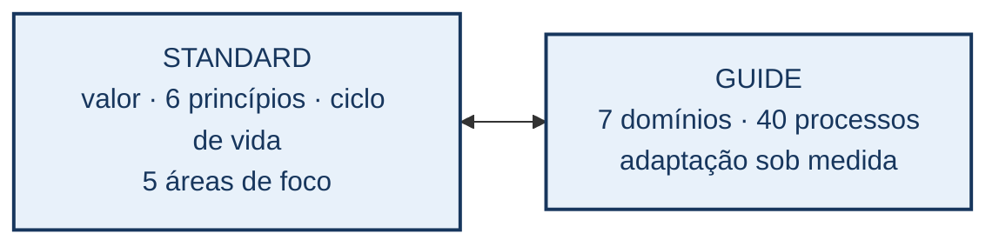
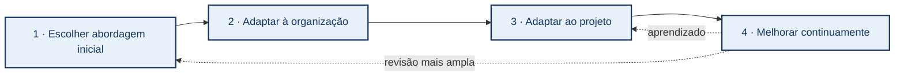
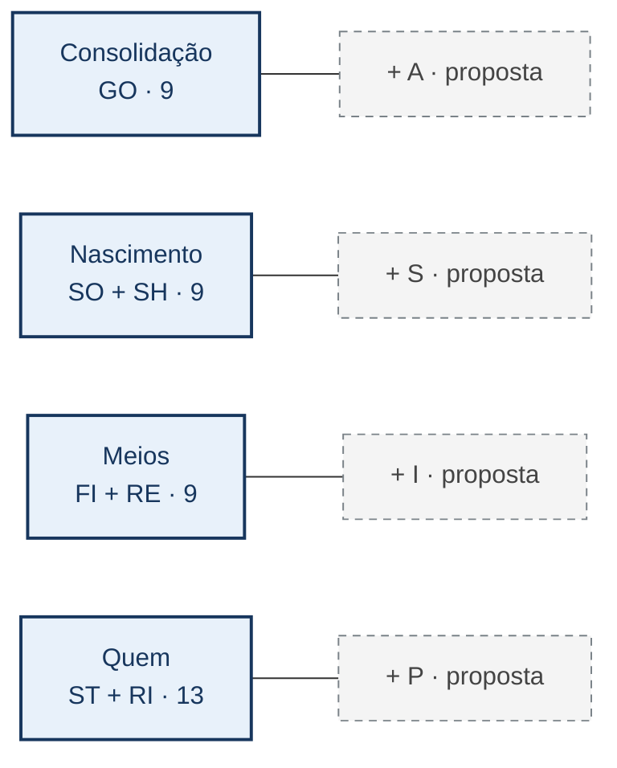

# PMBOK 8: princípios, áreas de foco, domínios e adaptação sob medida

**Entrega P3D · Grupo SIPA Privacidade 2**  
**Natureza:** síntese técnica do PMBOK 8, com um agrupamento analítico dos domínios apresentado separadamente da estrutura oficial do PMI.

## Resumo

Este relatório sintetiza *The Standard for Project Management* e *A Guide to the Project Management Body of Knowledge*, ambos da oitava edição do PMBOK. O objetivo é explicar como seis princípios orientam decisões, cinco áreas de foco organizam atividades e sete domínios de desempenho reúnem 40 processos ilustrativos. A leitura enfatiza *tailoring*: escolher abordagem de desenvolvimento, práticas, processos e formas de engajamento que façam sentido para a organização e o projeto, revendo escolhas conforme os resultados. Uma tabela relaciona cada processo ao domínio e à área de foco; uma matriz apresenta a distribuição 7 × 5 e outra sintetiza a conexão dos princípios com os domínios. Quatro concentrações — Consolidação, Nascimento, Meios e Quem — são empregadas como **agrupamento analítico deste trabalho**, sem atribuí-las à estrutura oficial do PMI. O tema Privacidade é usado apenas em um exemplo de adaptação para projeto de gêmeo digital; não se propõe aqui um novo processo do PMBOK 8.

**Palavras-chave:** PMBOK 8; gerenciamento de projetos; princípios; áreas de foco; domínios de desempenho; processos; adaptação sob medida.

## 1. Objetivo, fonte e método

O PMBOK 8 reúne um *Standard*, que apresenta fundamentos para a gestão de projetos, e um *Guide*, que organiza domínios de desempenho, processos, entradas, saídas, ferramentas e critérios de adaptação. A síntese usa a edição integral do PMI como **única referência bibliográfica**. Termos originais em inglês aparecem na primeira ocorrência de cada conceito; as traduções são de trabalho. Contagens e nomes foram conferidos na Tabela 2-1 e nas seções 2.1 a 2.7 do *Guide*. Os seis princípios e suas conexões com os domínios foram conferidos no capítulo 3 do *Standard*; *tailoring*, no capítulo 3 do *Guide* (PMI, 2025).

O critério de síntese é funcional: para cada elemento, perguntar **que decisão ele orienta**, **onde se manifesta** e **que resultado se espera**. A lista dos 40 processos é completa para permitir auditoria da contagem, mas as descrições não reproduzem o livro. O PMBOK 8 afirma que os processos e suas entradas e saídas são exemplos técnicos, não uma metodologia prescritiva a executar por inteiro. Por isso, número de processos apresentados não equivale a número obrigatório de processos em todo projeto (PMI, 2025, *Guide*, §2).

**Figura 1 — Duas funções complementares da edição.** O *Standard* fornece a orientação de valor, princípios e ciclo de vida; o *Guide* oferece o detalhamento dos domínios e das decisões de adaptação. As setas indicam leitura conjunta, não hierarquia entre livros. *Fonte: elaboração própria com base em PMI (2025), organização dos dois volumes.*

<!-- Desenho futuro: dois blocos de mesmo tamanho, Standard e Guide. No primeiro,
mostrar sistema de entrega de valor, seis princípios e cinco áreas de foco; no
segundo, sete domínios, 40 processos e tailoring. Uma seta dupla sugere consulta
recíproca. Azul escuro identifica conteúdo oficial; não inserir concentrações
SIPA nesta figura. Texto alternativo: as duas partes do PMBOK 8 se complementam. -->

Esta separação facilita a leitura, mas não isola conceitos. O sistema de entrega de valor afeta escolhas em todos os domínios; os processos do *Guide* podem ser configurados para diferentes abordagens de desenvolvimento. Também não há equivalência entre princípio, área de foco, domínio e processo: cada termo responde a uma pergunta distinta.

## 2. Fundamentos e os seis princípios do *Standard*

### 2.1 Valor, governança e ciclo de vida

O projeto é um esforço temporário para gerar resultado singular, situado em uma organização e em um sistema de entrega de valor. Portfólios, programas, projetos e operações podem se relacionar, mas têm finalidades e horizontes distintos. A governança orienta a tomada de decisão e a prestação de contas; a gestão do projeto traduz essas decisões em trabalho coordenado. O valor não se reduz à entrega física ou digital: depende de resultados e benefícios percebidos pelas partes interessadas e pela organização (PMI, 2025, *Standard*, §§1–2).

O ciclo de vida de um projeto divide seu percurso em fases. A abordagem de desenvolvimento pode ser **preditiva**, **adaptativa** ou **híbrida**, conforme o grau de conhecimento do trabalho, possibilidade de mudança, cadência de entregas e condições da organização. A escolha pode variar entre componentes do mesmo projeto. As áreas de foco não substituem as fases: atividades de planejamento, execução e controle podem reaparecer em várias fases (PMI, 2025, *Standard*, §4).

### 2.2 Os princípios como critérios de julgamento

O *Standard* organiza uma mentalidade de gestão em três pares: **proatividade** (visão holística e qualidade), **orientação a valor** (foco em valor e sustentabilidade) e **responsabilidade/atuação** (liderança responsável e cultura empoderada). A tabela formula, em linguagem de trabalho, uma pergunta útil para aplicar cada princípio; não pretende substituir a definição do PMI (PMI, 2025, *Standard*, §§3.2–3.8).

| Código e princípio oficial | Pergunta prática | Consequência para uma decisão |
| --- | --- | --- |
| **1AHV — Adopt a Holistic View** | Que relações e efeitos fora da entrega imediata influenciam o resultado? | Examinar dependências entre domínios, organização, pessoas e ambiente. |
| **2FOV — Focus on Value** | Que resultado justifica o trabalho e como saber se continua valioso? | Comparar alternativas pelo benefício esperado, não só pela quantidade de atividades. |
| **3QPD — Embed Quality Into Processes and Deliverables** | Como a qualidade será construída e verificada durante o trabalho? | Definir critérios, revisões e correções cedo, evitando inspeção apenas no fim. |
| **4BAL — Be an Accountable Leader** | Quem assume e explica as decisões difíceis? | Tornar responsabilidades, critérios e escalonamento visíveis. |
| **5SPA — Integrate Sustainability Within All Project Areas** | Quais efeitos persistem para pessoas, ambiente e organização? | Incluir consequências de longo prazo nas escolhas de escopo, recursos e risco. |
| **6BEC — Build an Empowered Culture** | A equipe consegue agir, aprender e levantar problemas? | Criar confiança, autonomia responsável e canais de retorno. |

Os princípios atravessam os sete domínios. Por exemplo, foco em valor pode orientar uma decisão financeira, uma escolha de escopo ou uma resposta a risco; qualidade pode aparecer em requisitos, marcos de cronograma e competência da equipe. Não há uma relação exclusiva de um princípio para um único domínio. A matriz da seção 6 explicita essas interfaces sem criar pontuações artificiais.

## 3. Cinco áreas de foco e a distribuição dos processos

As *Project Management Focus Areas* são **Iniciação (IN), Planejamento (PL), Execução (EX), Monitoramento e Controle (MC) e Encerramento (CL)**. Elas agrupam práticas de gestão; não impõem sequência rígida nem se confundem com as fases do ciclo de vida. O projeto pode iniciar uma fase, planejar um incremento, executar, verificar desempenho e replanejar, mesmo que a abordagem geral seja adaptativa (PMI, 2025, *Standard*, §4.5; *Guide*, Tabela 2-1).

| Área | Pergunta orientadora | Processos no quadro do PMBOK 8 |
| --- | --- | ---: |
| IN | Que trabalho deve ser autorizado e quem está envolvido? | **2** |
| PL | Como integrar planos, requisitos, recursos, custos, comunicação e respostas a risco? | **19** |
| EX | Como conduzir o trabalho, engajar pessoas e implementar respostas? | **8** |
| MC | Como comparar resultado com objetivos e corrigir desvios? | **10** |
| CL | Como encerrar formalmente uma fase ou projeto e transferir resultados? | **1** |

**Figura 2 — Mapa 7 × 5 dos 40 processos.** As células são **contagens**, não intensidade de importância. *Identify Stakeholders* está em Iniciação na Tabela 2-1 do PDF; com ele, os totais por área fecham em 2 + 19 + 8 + 10 + 1 = 40. *Fonte: PMI (2025),* Guide, *Tabela 2-1; cálculo e apresentação próprios.*

<!-- Desenho futuro: mapa de calor com linhas GO, SO, SH, FI, ST, RE, RI;
colunas IN, PL, EX, MC, CL. Cada célula exibe número e cor proporcional à
contagem; zero fica branco. Coluna de total à direita e linha de total embaixo.
A legenda diz "quantidade de processos", jamais "qualidade do domínio".
Texto alternativo: matriz de 7 domínios por 5 áreas, com 40 processos no total. -->

| Domínio | IN | PL | EX | MC | CL | Total |
| --- | ---: | ---: | ---: | ---: | ---: | ---: |
| Governança (GO) | 1 | 2 | 3 | 2 | 1 | 9 |
| Escopo (SO) | 0 | 4 | 0 | 2 | 0 | 6 |
| Cronograma (SH) | 0 | 2 | 0 | 1 | 0 | 3 |
| Finanças (FI) | 0 | 3 | 0 | 1 | 0 | 4 |
| Partes Interessadas (ST) | 1 | 2 | 2 | 2 | 0 | 7 |
| Recursos (RE) | 0 | 2 | 2 | 1 | 0 | 5 |
| Riscos (RI) | 0 | 4 | 1 | 1 | 0 | 6 |
| **Total** | **2** | **19** | **8** | **10** | **1** | **40** |

Planejamento concentra 19 processos, mas esse número não significa que ocupe quase metade do tempo de um projeto. A tabela classifica processos, não duração, custo ou relevância. Governança aparece nas cinco áreas, enquanto os demais domínios têm distribuições mais concentradas. O controle pode atualizar decisões de qualquer domínio; assim, uma linha com zero em determinada área não significa que o tema desapareça dela (PMI, 2025, *Guide*, §2).

## 4. Os sete domínios de desempenho do *Guide*

Um domínio reúne preocupações e práticas que se manifestam ao longo do projeto. O *Guide* apresenta, para cada um, conceitos-chave, processos, considerações de adaptação, interações com outros domínios e verificação de resultados. Eles operam simultaneamente e não são departamentos isolados (PMI, 2025, *Guide*, §2).

**Governança (GO, 9 processos)** integra decisões, execução, qualidade, conhecimento, mudanças, desempenho e encerramento para manter o projeto alinhado ao valor pretendido. Seu *tailoring* ajusta autoridade, fóruns de decisão, rigor de aprovação e cadência de informação à escala e à criticidade do trabalho (PMI, 2025, *Guide*, §2.1).

**Escopo (SO, 6)** transforma necessidades em requisitos, limites e estrutura do trabalho, além de monitorar e validar o que foi entregue. A forma de detalhar requisitos pode variar: definição mais antecipada quando há estabilidade, evolução gradual quando se aprende com entregas sucessivas (PMI, 2025, *Guide*, §2.2).

**Cronograma (SH, 3)** estabelece como o tempo será planejado, representado e controlado. A granularidade do cronograma e a frequência de revisão devem acompanhar a incerteza, as dependências e a cadência de entregas (PMI, 2025, *Guide*, §2.3).

**Finanças (FI, 4)** organiza planejamento financeiro, estimativas, orçamento e controle. Adaptar o domínio implica calibrar unidades de custo, reservas, previsões e nível de controle conforme o valor e a exposição financeira do projeto (PMI, 2025, *Guide*, §2.4).

**Partes Interessadas (ST, 7)** identifica pessoas e organizações relevantes, planeja seu engajamento e as comunicações, conduz interações e verifica sua eficácia. A escolha de canais, frequência e profundidade de participação depende do contexto e das necessidades de informação (PMI, 2025, *Guide*, §2.5).

**Recursos (RE, 5)** planeja, estima, obtém e coordena pessoas e meios físicos, além de controlar sua utilização. A adaptação considera disponibilidade de competências, fornecedores, trabalho distribuído e forma de liderar a equipe (PMI, 2025, *Guide*, §2.6).

**Riscos (RI, 6)** planeja a gestão de incertezas, identifica e analisa riscos, prepara e implementa respostas e monitora sua eficácia. O rigor analítico deve corresponder à criticidade das decisões e às oportunidades e ameaças enfrentadas (PMI, 2025, *Guide*, §2.7).

### 4.1 Inventário auditável dos 40 processos

A tabela mantém os **nomes oficiais em inglês**. A coluna em português serve à leitura e não constitui tradução autorizada pelo PMI. O código da área usa IN, PL, EX, MC e CL conforme a seção 3. A presença de um processo no inventário não obriga sua execução formal em todos os projetos; sua aplicação depende de *tailoring* (PMI, 2025, *Guide*, Tabela 2-1 e §§2.1–2.7).

| # | Domínio | Área | Processo oficial — tradução de trabalho |
| ---: | --- | --- | --- |
| 1 | GO | IN | *Initiate Project or Phase* — iniciar projeto ou fase |
| 2 | GO | PL | *Integrate and Align Project Plans* — integrar e alinhar planos do projeto |
| 3 | GO | PL | *Plan Sourcing Strategy* — planejar estratégia de suprimento |
| 4 | GO | EX | *Manage Project Execution* — gerenciar execução do projeto |
| 5 | GO | EX | *Manage Quality Assurance* — gerenciar garantia da qualidade |
| 6 | GO | EX | *Manage Project Knowledge* — gerenciar conhecimento do projeto |
| 7 | GO | MC | *Monitor and Control Project Performance* — monitorar e controlar desempenho |
| 8 | GO | MC | *Assess and Implement Changes* — avaliar e implementar mudanças |
| 9 | GO | CL | *Close Project or Phase* — encerrar projeto ou fase |
| 10 | SO | PL | *Plan Scope Management* — planejar gestão do escopo |
| 11 | SO | PL | *Elicit and Analyze Requirements* — elicitar e analisar requisitos |
| 12 | SO | PL | *Define Scope* — definir escopo |
| 13 | SO | PL | *Develop Scope Structure* — desenvolver estrutura do escopo |
| 14 | SO | MC | *Monitor and Control Scope* — monitorar e controlar escopo |
| 15 | SO | MC | *Validate Scope* — validar escopo |
| 16 | SH | PL | *Plan Schedule Management* — planejar gestão do cronograma |
| 17 | SH | PL | *Develop Schedule* — desenvolver cronograma |
| 18 | SH | MC | *Monitor and Control Schedule* — monitorar e controlar cronograma |
| 19 | FI | PL | *Plan Financial Management* — planejar gestão financeira |
| 20 | FI | PL | *Estimate Costs* — estimar custos |
| 21 | FI | PL | *Develop Budget* — desenvolver orçamento |
| 22 | FI | MC | *Monitor and Control Finances* — monitorar e controlar finanças |
| 23 | ST | IN | *Identify Stakeholders* — identificar partes interessadas |
| 24 | ST | PL | *Plan Stakeholder Engagement* — planejar engajamento das partes interessadas |
| 25 | ST | PL | *Plan Communications Management* — planejar gestão das comunicações |
| 26 | ST | EX | *Manage Stakeholder Engagement* — gerenciar engajamento das partes interessadas |
| 27 | ST | EX | *Manage Communications* — gerenciar comunicações |
| 28 | ST | MC | *Monitor Stakeholder Engagement* — monitorar engajamento das partes interessadas |
| 29 | ST | MC | *Monitor Communications* — monitorar comunicações |
| 30 | RE | PL | *Plan Resource Management* — planejar gestão dos recursos |
| 31 | RE | PL | *Estimate Resources* — estimar recursos |
| 32 | RE | EX | *Acquire Resources* — adquirir recursos |
| 33 | RE | EX | *Lead the Team* — liderar a equipe |
| 34 | RE | MC | *Monitor and Control Resourcing* — monitorar e controlar disponibilização de recursos |
| 35 | RI | PL | *Plan Risk Management* — planejar gestão dos riscos |
| 36 | RI | PL | *Identify Risks* — identificar riscos |
| 37 | RI | PL | *Perform Risk Analysis* — realizar análise de riscos |
| 38 | RI | PL | *Plan Risk Responses* — planejar respostas a riscos |
| 39 | RI | EX | *Implement Risk Responses* — implementar respostas a riscos |
| 40 | RI | MC | *Monitor Risks* — monitorar riscos |

O inventário revela dependências concretas. Um requisito do Escopo pode exigir recurso, orçamento e decisão de Governança; mudanças no cronograma podem alterar riscos e expectativas de partes interessadas. O fato de um processo estar sob um domínio e uma área de foco facilita localizá-lo, mas não limita suas interações. O *Guide* acrescenta considerações de adaptação e de verificação de resultados justamente para evitar o uso mecânico da lista (PMI, 2025, *Guide*, §2).

## 5. Adaptação sob medida (*tailoring*)

### 5.1 Por que e o que adaptar

O capítulo 3 do *Guide* sustenta que não existe uma forma única de gerir todos os projetos. Poucos processos podem deixar decisões críticas sem tratamento; práticas em excesso podem consumir esforço sem criar valor. A adaptação procura um conjunto suficiente para o contexto, sujeito a limites organizacionais e contratuais. Criticidade, escala, duração, complexidade, padrões do setor, cultura, quantidade de partes interessadas e maturidade organizacional influenciam a escolha (PMI, 2025, *Guide*, §§3.1–3.2).

Três objetos podem ser adaptados. **Ciclo de vida e abordagem de desenvolvimento:** escolher fases, cadência e combinação preditiva, adaptativa ou híbrida. **Processos:** definir que práticas terão forma explícita e qual rigor usar. **Engajamento:** ajustar participação, autoridade, colaboração e comunicação das pessoas envolvidas. A adaptação atravessa os sete domínios; não é uma decisão tomada uma única vez antes da execução (PMI, 2025, *Guide*, §3.3).

Para um processo, o guia enumera cinco operações: **adicionar** um elemento diante de condição própria, **modificar** entradas/saídas/ferramentas, **remover** o que não agrega valor, **combinar** elementos para produzir benefício e **alinhar** definições e aplicação. Essas operações não autorizam omitir uma exigência legal ou contratual; ajudam a configurar a prática de gestão sob restrições reais (PMI, 2025, *Guide*, §3.3.2).

### 5.2 Quatro passos e realimentação

**Figura 3 — Ciclo de adaptação.** O caminho inicia na escolha da abordagem de desenvolvimento, passa pelo ajuste à organização e ao projeto e volta às decisões anteriores por melhoria contínua. A seta de retorno indica diagnóstico e aprendizado. *Fonte: adaptação descritiva de PMI (2025),* Guide, *§3.4 e Figura 3-1.*

<!-- Desenho futuro: quatro blocos numerados, conectados por setas sólidas;
uma seta tracejada retorna da melhoria contínua à escolha ou ajuste anterior.
À margem, fatores como criticidade, escala, equipe, cultura e contrato entram
como condicionantes, não como etapas adicionais. Na base, listar as cinco ações
sobre processos. Texto alternativo: quatro passos do tailoring com revisão. -->

O primeiro passo escolhe abordagem adequada ao produto, à cadência e à incerteza. O segundo verifica políticas e modelos existentes na organização e no portfólio ou programa. O terceiro ajusta o método às condições do projeto concreto. O quarto usa resultados, retrospectivas e outras informações para manter ou rever escolhas. A verificação dos resultados dos domínios e os diagnósticos de adaptação fazem a ponte entre monitoramento e melhoria (PMI, 2025, *Guide*, §§3.4–3.6).

**Exemplo hipotético de TIC.** Um projeto de gêmeo digital para apoiar decisões numa cooperativa poderia usar marcos preditivos para aquisição de equipamentos e ciclos adaptativos para experimentar painéis de dados. A equipe teria de calibrar comunicação com operadores, regras de acesso e frequência de revisão de riscos segundo o contexto. A preocupação com Privacidade pode influenciar requisitos e decisões existentes sem supor que já seja um oitavo domínio oficial. O exemplo ilustra *tailoring*; não descreve um projeto implantado nem acrescenta processos à lista dos 40.

## 6. Como os princípios atravessam os domínios

As subseções *Connected Performance Domains* do *Standard* descrevem conexões dos seis princípios com os sete domínios. A matriz abaixo resume **uma contribuição característica por célula**; é paráfrase analítica dos §§3.3.3–3.8.3, não uma escala de força, prioridade ou conformidade (PMI, 2025). Todas as 42 células têm relação: a ausência de destaque visual em uma delas não significaria ausência do princípio.

| Princípio | GO | SO | SH | FI | ST | RE | RI |
| --- | --- | --- | --- | --- | --- | --- | --- |
| **1AHV** Visão holística | decisão integrada | alinhamento | dependências | prioridades | inclusão | integração | riscos cruzados |
| **2FOV** Valor | critérios de valor | evitar excesso | prazo do benefício | viabilidade | valor percebido | alternativas | resposta pragmática |
| **3QPD** Qualidade | responsabilidade | requisitos | marcos de revisão | menos retrabalho | retorno das pessoas | competência | prevenir defeitos |
| **4BAL** Liderança responsável | decisão transparente | resolver conflitos | acordos de prazo | integridade financeira | obter apoio | uso responsável | assumir risco |
| **5SPA** Sustentabilidade | efeito duradouro | requisitos sustentáveis | impacto temporal | investimento | confiança | materiais e pessoas | riscos sociais |
| **6BEC** Cultura empoderada | diálogo | ajustar requisitos | ideias da equipe | reduzir desperdício | participação | aprendizagem | discutir limites |

**Figura 4 — Matriz de relações dos princípios.** Na futura figura, a cor distingue os três pares da mentalidade do *Standard*, enquanto texto curto mantém a leitura acessível sem cor. A matriz não cria índice numérico de desempenho. *Fonte: elaboração própria a partir de PMI (2025),* Standard, *§§3.2–3.8.*

<!-- Desenho futuro: manter 6 linhas × 7 colunas, com legenda para GO/SO/SH/FI/
ST/RE/RI. Usar três cores discretas nas faixas de linhas, uma por par de
mentalidade, e não pintar intensidade nas células. Texto alternativo: todos
os seis princípios influenciam os sete domínios, por mecanismos distintos. -->

Esta leitura evita dois erros. O primeiro seria transformar princípios em processos adicionais; princípios orientam julgamentos. O segundo seria tomar os domínios como silos: uma escolha de qualidade em Escopo pode requerer orçamento, competência e resposta a risco. O gerenciamento do projeto precisa manter a coerência entre essas decisões.

## 7. Quatro concentrações como agrupamento analítico

Para apresentar os sete domínios em blocos, este relatório usa **quatro concentrações analíticas**: **Consolidação** reúne Governança; **Nascimento** reúne Escopo e Cronograma; **Meios** reúne Finanças e Recursos; **Quem** reúne Partes Interessadas e Riscos. Esse agrupamento **não é um componente oficial do PMBOK 8**. Os rótulos A, S, I e P indicam, respectivamente, possíveis extensões em análise de negócios, sustentabilidade, inovação e privacidade; não entram na soma dos 40 processos nem são descritos aqui como novos processos do PMI.

**Figura 5 — Agrupamento dos sete domínios em quatro concentrações.** Os números 9, 9, 9 e 13 somam apenas processos existentes. Cartões de contorno tracejado marcam temas de extensão e impedem que sejam confundidos com domínios oficiais. *Fonte dos sete domínios e contagens: PMI (2025),* Guide, *Tabela 2-1. Agrupamento e rótulos SIPA: organização analítica deste relatório.*

<!-- Desenho futuro: quatro cartões com título, siglas dos domínios e total de
processos. Faixa azul sólida para domínios PMBOK 8; pequeno cartão cinza
tracejado com +A, +S, +I, +P. Não criar setas causais entre concentrações.
Texto alternativo: 7 domínios e 40 processos agrupados em 4 blocos analíticos. -->

O agrupamento facilita conversa e distribuição de trabalho, mas não altera a forma como o *Guide* apresenta os domínios. Governança continua interagindo com todos os outros; uma decisão sobre pessoas pode envolver escopo, tempo, finanças e recursos. Para que o mapa analítico não vire uma barreira artificial, as conexões entre os sete domínios devem ser lidas junto das tabelas de processos e princípios.

## 8. Síntese crítica e limites

A oitava edição combina **orientação por princípios** com **detalhamento técnico** e insiste na adaptação. Essa combinação evita dois extremos: usar uma lista de processos como receita universal ou invocar princípios sem explicar como as decisões serão acompanhadas. A tabela de 40 processos mostra possibilidades de ação; o ciclo de *tailoring* explica por que sua forma, intensidade e combinação variam. A leitura conjunta do *Standard* e do *Guide* torna essa escolha verificável (PMI, 2025).

As quatro concentrações apresentadas aqui são um modo de leitura, não substituem o índice oficial do PMI. O exemplo do gêmeo digital é hipotético e não demonstra benefício realizado. Esta síntese tampouco valida uma extensão SIPA ou mede desempenho de projeto. Uma aplicação concreta precisaria escolher indicadores, responsabilidades, artefatos e frequência de revisão, além de verificar restrições próprias da organização e do contrato.

## 9. Correspondência com a saída *Final report*

O *Guide* descreve o *Final report* em *Close Project or Phase* como síntese de desempenho de um projeto ou fase (PMI, 2025, §2.1.6.9). Este texto é uma **síntese bibliográfica**, não o relato de um projeto concluído; a correspondência abaixo deixa isso explícito.

| Item do *Final report* | Aplicação nesta síntese |
| --- | --- |
| Descrição do projeto ou fase | Objetivo e método de leitura do PMBOK 8 (§1) |
| Escopo e critérios de conclusão | Cobertura de princípios, áreas, domínios, processos e *tailoring*; não há implantação concluída |
| Qualidade | Conferência dos nomes e totais no PDF; revisão das relações e traduções |
| Custos e variações | Não são medidos nesta atividade bibliográfica |
| Validação do produto final | Documento disponível para revisão; aceitação externa ainda não demonstrada |
| Cronograma e benefícios | Prazo de entrega é acadêmico; benefício de aplicação ainda é hipótese |
| Necessidade de negócio | Necessidade de um guia adaptável de gestão de projetos |
| Riscos e questões | Confusão entre estrutura oficial e agrupamento analítico; tradução e simplificação excessiva |

## Referência

PROJECT MANAGEMENT INSTITUTE (PMI). *The Standard for Project Management and A Guide to the Project Management Body of Knowledge (PMBOK Guide)*. 8. ed. 2025. [PDF da edição consultada](<../../../documentos/PMBOK8/PMBOK® Guide 8th Edition (Project Management Institute).pdf>).
