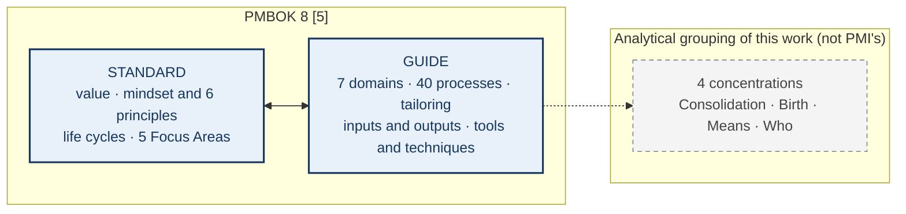
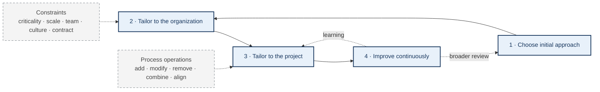
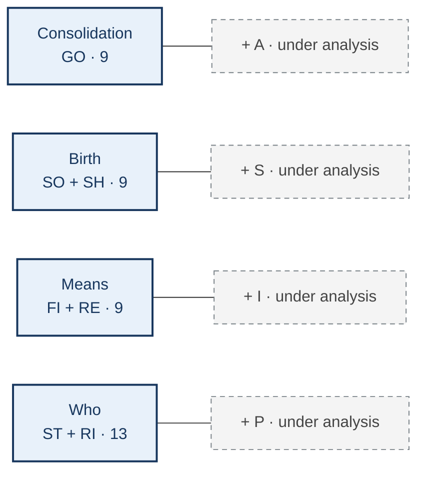

# PMBOK 8: principles, Focus Areas, performance domains and tailoring

**SIPA group:** Privacy 2  
**Nature:** technical synthesis of PMBOK 8, with an analytical grouping of the domains presented separately from PMI's official structure.

## Abstract

This report synthesizes *The Standard for Project Management* and *A Guide to the Project Management Body of Knowledge*, both from the eighth edition of the PMBOK. Its aim is to explain how six principles guide decisions, five Focus Areas organize activities, and seven performance domains group 40 processes. The reading emphasizes tailoring: choosing the development approach, processes, and forms of engagement that make sense for the organization and the project, and reviewing those choices as results come in. The text covers the value delivery system, life cycles and the choice of approach, the five actions on processes, the four steps of the tailoring process, and the diagnostics in the tailoring chapter. A table relates each of the 40 processes to its domain, Focus Area, and an analytical grouping; a 7 × 5 map shows the distribution of the processes; a 6 × 7 matrix summarizes the connections between principles and domains that the *Standard* describes. Four concentrations — Consolidation, Birth, Means, and Who — are used as an **analytical grouping of this work**, without attributing them to PMI. Recent studies on hybrid approaches and an international project management standard situate the synthesis. A final table shows where PMBOK 8 already touches personal data; no new process is proposed here.

**Keywords:** PMBOK 8; project management; principles; Focus Areas; performance domains; processes; tailoring; hybrid approaches.

## 1. Purpose, source, and method

PMBOK 8 brings together a *Standard*, which presents foundations for project management, and a *Guide*, which organizes performance domains, processes, inputs, outputs, tools and techniques, and tailoring criteria. The purpose of this report is to offer a synthesis of the two works that makes it possible to understand **how the edition is organized and how it can be tailored to a specific project**, with an emphasis on *tailoring*.

**Source.** The primary source is the complete edition published by PMI in 2025 [5]. It is a **restricted-access document**: the complete edition is obtained through purchase or PMI membership. For this reason, the text cites sections, tables, and figures and avoids reproducing long passages; the descriptions are working paraphrases. The *Guide* indicates, in its introduction, four main sections: performance domains (section 2), tailoring (3), inputs and outputs (4), and tools and techniques (5) [5, Guide §1.1].

**Method.** For each element, we asked **what decision it guides**, **where it appears**, and **what result is expected**. We identified the names and the count of the processes in sections 2.1 to 2.7 of the *Guide*, in Table 2-1, and in the overview figures of each domain. The six principles and their connections with the domains were read in chapter 3 of the *Standard*, the life cycles and Focus Areas in chapter 4 of the *Standard*, and *tailoring* in chapter 3 of the *Guide*. Official terms are given in English; the Portuguese renderings that appear next to the official process names in section 7.1 are working translations and are not translations authorized by PMI.

**Complementary literature.** To situate the synthesis, we used three recent studies on hybrid approaches and tailoring [4, 6, 7], a review on digital twins in construction projects [3], and the ISO 21502:2020 standard, with guidance on project management [2]. These works do not replace PMBOK 8; they serve to compare PMI's reading with what the literature observes in practice.

**Limits of the method.** The list of the 40 processes is complete to allow the count to be audited, but the report does not reproduce the book. PMBOK 8 states that the inputs and outputs in chapter 4 of the *Guide* are not intended to be comprehensive or mandatory in every project: they are common selections among many options [5, Guide §1.1]. The number of processes presented is therefore not equivalent to the number of processes to be performed in a project.

**Figure 1 — Structure of the two works and analytical grouping of this work.** The *Standard* provides the value orientation, the principles, the life cycle, and the Focus Areas; the *Guide* offers the detail on the domains, the processes, and the tailoring decisions. A third, dashed frame identifies the analytical grouping into four concentrations, which does not belong to PMI. *Authors' own elaboration based on [5].*

<!-- Future design: two frames of the same size, Standard and Guide, linked by
a double arrow. In the Standard: value delivery system, six principles, life
cycles, and five Focus Areas. In the Guide: seven domains, 40 processes, tailoring,
inputs and outputs, tools and techniques. Apart, a third dashed gray
frame, labeled "analytical grouping of this work (not PMI's)".
Dark blue identifies official content. Alt text: the two parts of
PMBOK 8 complement each other; an analytical grouping lies outside the official structure. -->

This separation eases reading but does not isolate concepts. The value delivery system affects choices in all domains; the processes of the *Guide* can be configured for different development approaches. Nor is there equivalence among principle, Focus Area, domain, and process: each term answers a distinct question.

## 2. Structure of the edition and what changed

The 2025 edition brings together two volumes with different functions. The table summarizes what each part contains and where it is, with the page numbers of the printed edition [5].

| Work and part | Content | Where |
| --- | --- | --- |
| *Standard* — 1 Introduction | Purpose, characteristics of a project, organizational and project governance, operations and project management, relationship among portfolio, program, project, and operations | Ch. 1 |
| *Standard* — 2 Value delivery system | Value creation, project environment, product management, functions and roles | Ch. 2 |
| *Standard* — 3 Principles | Mindset and six principles, with impact, application, and connected domains | Ch. 3, p. 35 |
| *Standard* — 4 Life cycles | Phases, development approaches, selection criteria, delivery cadence, and five Focus Areas | Ch. 4, p. 57 |
| *Guide* — 1 Introduction | Structure of the *Guide*, relationship with the *Standard*, and changes in the edition | Ch. 1 |
| *Guide* — 2 Performance domains | Seven domains, each with key concepts, processes, tailoring, interactions, and verification of results | Ch. 2, p. 7 |
| *Guide* — 3 Tailoring | What *tailoring* is, why and how to tailor, diagnostics | Ch. 3, p. 103 |
| *Guide* — 4 Inputs and outputs | Catalog of example assets and artifacts | Ch. 4, p. 113 |
| *Guide* — 5 Tools and techniques | Catalog of example tools and techniques | Ch. 5, p. 145 |

The preface groups the changes in the edition into four categories: updating of terms and key concepts, refinement of the principles, reintroduction of the process groups as **Focus Areas**, and updating of the performance domains [5, Preface]. The edition presents six actionable principles, five Focus Areas, and seven domains that group 40 reformulated processes. The *Guide* synthesizes the former Knowledge Areas with other accepted concepts into seven domains and inserts tailoring considerations and examples in each one.

PMBOK 8 **does not mention the digital twin**: the term does not appear in the text of the edition. This matters for the use of this report in ICT projects, because the edition provides the management structure, not guidance specific to that technology. The literature on digital twins in project management is concentrated today in civil construction, as shown by the systematic and bibliometric review by Manzoor et al. [3], which analyzes critical success factors for their implementation.

## 3. Value delivery system, environment, and functions

Chapter 2 of the *Standard* describes where the project operates. **Value creation:** organizations create value for stakeholders, and the value expected from any project investment must equal or exceed a return threshold, financial or not, tangible or intangible. Business value is the quantifiable net benefit, in any tangible or intangible form, and value delivery today includes social impact and sustainability goals [5, Standard §2.1]. The assessment of a project's success considers two dimensions: the success of the project **outcomes**, that is, the realization of the intended value, and the success of the management **processes** [5, Standard §2.1.2].

**Project environment.** Two categories of influence act on the project: **enterprise environmental factors**, internal and external to the organization, and **organizational process assets**, which include processes, policies and procedures, and the knowledge repository. Among the external factors are legal constraints, such as laws and regulations on security, data protection, business conduct, employment, and procurement. The *Standard* also addresses organizational structures and their effects on the project manager and on resource availability, and product management considerations throughout the product life cycle [5, Standard §§2.2–2.3].

**Functions and roles.** People drive delivery by performing seven functions: providing oversight and coordination; requesting and managing *feedback*; facilitating and supporting; performing the work; applying specialized knowledge; providing organizational direction and vision; and supplying resources. They may be performed by one person, a team, or a combination of roles, and the form of coordination varies: decentralized, in self-organizing projects, or centralized, with a designated manager. The roles addressed are the project management team, the sponsor, the customer or product owner, the project team, and end users and other stakeholders [5, Standard §§2.4–2.5].

## 4. The six principles and the mindset of the *Standard*

The *Standard* organizes a management mindset in three dimensions: **proactive**, **ownership**, and **value-oriented**. Each dimension integrates two principles [5, Standard §3.1].

| Dimension | Principles |
| --- | --- |
| Proactive | **1AHV** *Adopt a Holistic View* and **3QPD** *Embed Quality Into Processes and Deliverables* |
| Ownership | **4BAL** *Be an Accountable Leader* and **6BEC** *Build an Empowered Culture* |
| Value-oriented | **2FOV** *Focus on Value* and **5SPA** *Integrate Sustainability Within All Project Areas* |

The table formulates, in working language, a useful question for applying each principle and a consequence for a decision; it does not replace PMI's definition [5, Standard §§3.3–3.8].

| Code and official principle | Practical question | Consequence for a decision |
| --- | --- | --- |
| **1AHV — Adopt a Holistic View** | What relationships and effects beyond the immediate deliverable influence the result? | Examine dependencies among domains, organization, people, and environment. |
| **2FOV — Focus on Value** | What result justifies the work, and how do we know it remains valuable? | Compare alternatives by expected benefit, not only by the quantity of activities. |
| **3QPD — Embed Quality Into Processes and Deliverables** | How will quality be built and verified during the work? | Define criteria, reviews, and corrections early, avoiding inspection only at the end. |
| **4BAL — Be an Accountable Leader** | Who takes on and explains the difficult decisions? | Make responsibilities, criteria, and escalation visible. |
| **5SPA — Integrate Sustainability Within All Project Areas** | What effects persist for people, the environment, and the organization? | Include long-term consequences in choices about scope, resources, and risk. |
| **6BEC — Build an Empowered Culture** | Can the team act, learn, and raise problems? | Create trust, responsible autonomy, and feedback channels. |

The principles cut across the seven domains; there is no exclusive relationship between a principle and a single domain. The *Standard* states that all principles relate to all domains, and section 8 makes these interfaces explicit. The principles guide judgment: they are not additional processes.

## 5. Life cycles, development approaches, and cadence

Chapter 4 of the *Standard* addresses how work is organized over time. A project is decomposed into **phases**, which may be sequential, transitional, or overlapping. Each phase has attributes, such as name, duration, resource needs, and entry and exit criteria, and may end in a decision point (*phase gate*), at the end of the phase or, alternatively, at the beginning (*pre-phase gate*). The project life cycle is independent of the product life cycle. Tailoring the life cycle involves selecting the approach or mix of approaches, the types of processes and activities, and the attributes of a phase [5, Standard §4.1].

### 5.1 Predictive, adaptive, and hybrid

The **development approach** is the means used to create and evolve the product, service, or result over the life cycle. The three usual approaches form a spectrum, from predictive to adaptive, with hybrid as a combination of the two [5, Standard §4.2].

| Approach | When it tends to serve | Characteristics |
| --- | --- | --- |
| **Predictive** | Stable scope early on; large investments; regulatory oversight; cost of iterating greater than the value | Upfront planning, scope, schedule, and cost baselines; robust change control; may deliver incrementally |
| **Adaptive** | Requirements and technical solution with high uncertainty and volatility | Clear vision at the start; requirements progressively elaborated with *feedback*; periodic reviews in short cycles; some methods use iterations of 1 to 4 weeks |
| **Hybrid** | Uncertainty in only part of the scope; modularizable deliverables; several workstreams | Predictive and adaptive elements combined; the *Standard* describes four common patterns, such as adaptive development followed by predictive deployment or simultaneous use of both |

The *Standard* observes that, in practice, most projects can benefit from a hybrid approach and that focusing exclusively on one of the two fails to address part of the challenges of modern projects. This finding is consistent with the literature. A survey of 400 practitioners showed that few managers use agile methods without predictive techniques, that the sector and the type of project influence the choice, and that there is no absolute best approach [6]. In the analysis of data from the HELENA study, about two thirds of the projects surveyed combined agile and traditional methods to some degree [4]. A contingency-based approach identifies six ways of combining approaches according to suitability criteria and treats tailoring as the core of the topic [7].

### 5.2 How to choose and at what cadence to deliver

The choice of approach depends on variables of the **product**, the **project**, and the **organization**. The table summarizes the factors that the *Standard* lists [5, Standard §4.3].

| Category | Factors |
| --- | --- |
| Deliverables | Degree of innovation; certainty of requirements; scope stability; ease of change; delivery options; risk; security requirements; *feedback*; regulation |
| Project | Stakeholders; schedule constraints; funding uncertainty; size and complexity; team experience and skills; interdependencies |
| Organization | Organizational structure; culture; organizational capability; team size and location |

The chosen approach conditions the **delivery cadence**: single delivery, multiple deliveries, periodic deliveries (common in adaptive approaches, on a regular calendar), or continuous delivery, in which tested and validated increments reach production on an ongoing basis [5, Standard §4.4]. The ISO 21502:2020 standard treats the subject in a similar way: it applies to any type of project, regardless of delivery approach and life cycle model, and moved from a process-based format to a practice-based format, replacing ISO 21500:2012 [2]. PMBOK 8 combines the two approaches: principles, Focus Areas, and domains, on one side, and 40 processes with example inputs and outputs, on the other.

## 6. Five Focus Areas and the distribution of the processes

The *Project Management Focus Areas* are **Initiating (IN), Planning (PL), Executing (EX), Monitoring and Controlling (MC), and Closing (CL)**. They group management practices and are applicable regardless of application area, industry, and development approach. They do not impose a rigid sequence nor are they to be confused with life cycle phases. The processes, practices, or actions of each area are usually iterated before concluding a phase or the project [5, Standard §4.5].

| Area | What it brings together | Guiding question |
| --- | --- | --- |
| **IN** Initiating | Actions to define a new project or phase, with formal authorization; initial scope, initial financial resources, stakeholders, and roles | What work must be authorized and who is involved? |
| **PL** Planning | Actions that establish the intended scope, refine objectives, and develop the course of action; repeated *feedback* loops | How do we integrate plans, requirements, resources, costs, communication, and risk responses? |
| **EX** Executing | Actions to complete the work according to the agreed course of action; this is where the choice of approach becomes most evident | How do we conduct the work, engage people, and implement responses? |
| **MC** Monitoring and Controlling | Actions to track, measure, review, and regulate progress, identify necessary changes, and initiate them | How do we compare results with objectives and correct deviations? |
| **CL** Closing | Actions to formally conclude a phase, project, or contract, or to end it early; verification of outputs, results, and benefits | How do we close and transfer results to operations? |

The distribution of the 40 processes across the areas appears in Table 2-1 of the *Guide* and in the overview figures of each domain. *Identify Stakeholders* is the only Stakeholders process in Initiating, as shown by Figure 2-32 of the *Guide* [5, Guide §2.5.2]; with it, the totals by area add up to 2 + 19 + 8 + 10 + 1 = 40.

| Area | Processes in the PMBOK 8 table |
| --- | ---: |
| IN | **2** |
| PL | **19** |
| EX | **8** |
| MC | **10** |
| CL | **1** |

**Figure 2 — 7 × 5 map of the 40 processes.** The cells are **counts**, not intensity of importance. *Source: [5, Guide, Table 2-1 and domain overview figures]; own calculation and presentation.*

<!-- Future design: heat map with rows GO, SO, SH, FI, ST, RE, RI;
columns IN, PL, EX, MC, CL. Each cell shows a number and a color proportional to the
count; zero stays white. Total column on the right and total row at the bottom.
The legend says "number of processes", never "quality of the domain".
Alt text: matrix of 7 domains by 5 areas, with 40 processes in total. -->

| Domain | IN | PL | EX | MC | CL | Total |
| --- | ---: | ---: | ---: | ---: | ---: | ---: |
| Governance (GO) | 1 | 2 | 3 | 2 | 1 | 9 |
| Scope (SO) | 0 | 4 | 0 | 2 | 0 | 6 |
| Schedule (SH) | 0 | 2 | 0 | 1 | 0 | 3 |
| Finance (FI) | 0 | 3 | 0 | 1 | 0 | 4 |
| Stakeholders (ST) | 1 | 2 | 2 | 2 | 0 | 7 |
| Resources (RE) | 0 | 2 | 2 | 1 | 0 | 5 |
| Risk (RI) | 0 | 4 | 1 | 1 | 0 | 6 |
| **Total** | **2** | **19** | **8** | **10** | **1** | **40** |

Planning concentrates 19 processes, but this number does not mean that it takes up almost half of a project's time. The table classifies processes, not duration, cost, or relevance. Governance appears in all five areas, whereas the other domains have more concentrated distributions. Control may update decisions in any domain; a row with zero in a given area does not mean that the topic disappears from it.

## 7. The seven performance domains of the *Guide*

A performance domain is a group of related processes that are essential for the effective delivery of value. The seven domains are interactive, interrelated, and interdependent, and operate as an integrated system, **without specific order or weighting** [5, Guide §2]. For each one, the *Guide* presents key concepts, processes, tailoring considerations, interactions with other domains, and verification of results (Tables 2-5 to 2-11 of the *Guide*). They are not isolated departments.

**Governance (GO, 9 processes)** is the structure, functions, and processes that guide management decisions and activities to optimize value delivery. It is holistic and integrating, considers all the other domains, includes elements of integration management (strategic alignment, decision and change, success criteria), and **integrates risk and opportunity management**. It also ensures the alignment of the project with the organization's portfolio and strategy [5, Guide §2.1].

**Scope (SO, 6)** ensures that the project contains all the work required, and only that work, to maximize value. The domain **includes quality**: regarding deliverables, it addresses acceptance criteria and the meeting of stakeholder expectations and of project and product requirements [5, Guide §2.2; Standard §3.2].

**Schedule (SH, 3)** establishes a plan for how and when the project will deliver products, services, and results. It serves as a tool for communication, expectation management, and the basis for performance reports, and it facilitates early identification of delays and risks [5, Guide §2.3].

**Finance (FI, 4)** covers costs, funding, and, in some cases, the project's value proposition: planning, estimating, budgeting, funding, managing, measuring, and controlling costs to optimize value for the organization [5, Guide §2.4].

**Stakeholders (ST, 7)** addresses engagement, from the identification of stakeholders to the monitoring of engagement throughout the life cycle, and is linked to communications management. Stakeholders include the sponsor, the team, and all people affected, or who feel they may be affected, by the project; they can number from a few to millions [5, Guide §2.5].

**Resources (RE, 5)** refers to how the team plans and uses the available resources: people, equipment, materials, facilities, infrastructure, software, test environments, licenses, services, and information. It also covers availability, utilization, and maintenance [5, Guide §2.6].

**Risk (RI, 6)** is a comprehensive approach to creating project resilience, with the capacity to anticipate, prepare for, respond to, and adapt to risks and disruptions, proactively and with flexible responses [5, Guide §2.7].

### 7.1 Auditable inventory of the 40 processes

The table keeps the **official English names**. The Portuguese text in parentheses serves reading and is not a translation authorized by PMI. The **concentration** column carries the analytical grouping of this work (section 10), which does **not** belong to PMI. The presence of a process in the inventory does not oblige its formal execution in every project; its application depends on *tailoring* [5, Guide Table 2-1 and §§2.1–2.7].

| # | Domain | Area | Concentration | Official process — Working translation (Portuguese) |
| ---: | --- | --- | --- | --- |
| 1 | GO | IN | Consolidation | *Initiate Project or Phase* (iniciar projeto ou fase) |
| 2 | GO | PL | Consolidation | *Integrate and Align Project Plans* (integrar e alinhar planos do projeto) |
| 3 | GO | PL | Consolidation | *Plan Sourcing Strategy* (planejar estratégia de suprimento) |
| 4 | GO | EX | Consolidation | *Manage Project Execution* (gerenciar execução do projeto) |
| 5 | GO | EX | Consolidation | *Manage Quality Assurance* (gerenciar garantia da qualidade) |
| 6 | GO | EX | Consolidation | *Manage Project Knowledge* (gerenciar conhecimento do projeto) |
| 7 | GO | MC | Consolidation | *Monitor and Control Project Performance* (monitorar e controlar desempenho) |
| 8 | GO | MC | Consolidation | *Assess and Implement Changes* (avaliar e implementar mudanças) |
| 9 | GO | CL | Consolidation | *Close Project or Phase* (encerrar projeto ou fase) |
| 10 | SO | PL | Birth | *Plan Scope Management* (planejar gestão do escopo) |
| 11 | SO | PL | Birth | *Elicit and Analyze Requirements* (elicitar e analisar requisitos) |
| 12 | SO | PL | Birth | *Define Scope* (definir escopo) |
| 13 | SO | PL | Birth | *Develop Scope Structure* (desenvolver estrutura do escopo) |
| 14 | SO | MC | Birth | *Monitor and Control Scope* (monitorar e controlar escopo) |
| 15 | SO | MC | Birth | *Validate Scope* (validar escopo) |
| 16 | SH | PL | Birth | *Plan Schedule Management* (planejar gestão do cronograma) |
| 17 | SH | PL | Birth | *Develop Schedule* (desenvolver cronograma) |
| 18 | SH | MC | Birth | *Monitor and Control Schedule* (monitorar e controlar cronograma) |
| 19 | FI | PL | Means | *Plan Financial Management* (planejar gestão financeira) |
| 20 | FI | PL | Means | *Estimate Costs* (estimar custos) |
| 21 | FI | PL | Means | *Develop Budget* (desenvolver orçamento) |
| 22 | FI | MC | Means | *Monitor and Control Finances* (monitorar e controlar finanças) |
| 23 | ST | IN | Who | *Identify Stakeholders* (identificar partes interessadas) |
| 24 | ST | PL | Who | *Plan Stakeholder Engagement* (planejar engajamento das partes interessadas) |
| 25 | ST | PL | Who | *Plan Communications Management* (planejar gestão das comunicações) |
| 26 | ST | EX | Who | *Manage Stakeholder Engagement* (gerenciar engajamento das partes interessadas) |
| 27 | ST | EX | Who | *Manage Communications* (gerenciar comunicações) |
| 28 | ST | MC | Who | *Monitor Stakeholder Engagement* (monitorar engajamento das partes interessadas) |
| 29 | ST | MC | Who | *Monitor Communications* (monitorar comunicações) |
| 30 | RE | PL | Means | *Plan Resource Management* (planejar gestão dos recursos) |
| 31 | RE | PL | Means | *Estimate Resources* (estimar recursos) |
| 32 | RE | EX | Means | *Acquire Resources* (adquirir recursos) |
| 33 | RE | EX | Means | *Lead the Team* (liderar a equipe) |
| 34 | RE | MC | Means | *Monitor and Control Resourcing* (monitorar e controlar disponibilização de recursos) |
| 35 | RI | PL | Who | *Plan Risk Management* (planejar gestão dos riscos) |
| 36 | RI | PL | Who | *Identify Risks* (identificar riscos) |
| 37 | RI | PL | Who | *Perform Risk Analysis* (realizar análise de riscos) |
| 38 | RI | PL | Who | *Plan Risk Responses* (planejar respostas a riscos) |
| 39 | RI | EX | Who | *Implement Risk Responses* (implementar respostas a riscos) |
| 40 | RI | MC | Who | *Monitor Risks* (monitorar riscos) |

The inventory reveals concrete dependencies. A Scope requirement may demand resources, budget, and a Governance decision; schedule changes may alter risks and stakeholder expectations. The fact that a process sits under a domain and a Focus Area makes it easier to locate, but does not limit its interactions.

### 7.2 Tailoring considerations by domain

Each domain carries a section of tailoring considerations (2.x.3 of the *Guide*). The table summarizes one characteristic consideration for each; the complete lists are in the book [5, Guide §§2.1.7, 2.2.3, 2.3.3, 2.4.3, 2.5.3, 2.6.3, and 2.7.3].

| Domain | Characteristic tailoring consideration |
| --- | --- |
| Governance | Tailor to the industry, regulatory considerations, the organization, and the project context; identify committees and status reporting requirements |
| Scope | Dependence on external partners (how to integrate scope into contractual agreements) and the dynamism of the environment, which calls for flexibility in scope management |
| Schedule | Chosen life cycle and approach: in predictive, schedule defined early and baseline approved; attributes of the product, the team, and the culture |
| Finance | A product in a regulated industry may require formal controls, such as compliance with SOX or GDPR; an iterative approach flattens the spending curve |
| Stakeholders | Organizational culture is the main factor: flat organizations use open and informal channels; hierarchical ones, more formal approaches |
| Resources | Leadership styles according to the project; in predictive, resources planned early; in adaptive, self-organizing teams |
| Risk | Size and complexity determine whether a detailed approach is needed or a simplified process suffices |

## 8. How the principles cut across the domains

The *Connected Performance Domains* subsections of the *Standard* (§§3.3.3 to 3.8.3) describe, for each principle, how it connects to each of the seven domains. In each of the six sections the text addresses the seven domains, which gives **42 expressed connections**. The *Standard* adds that the holistic view is supported by all domains; that quality and focus on value are addressed mainly in Governance, Scope, Risk, Schedule, Finance, and Stakeholders; and that the accountable leader cuts across Governance, Stakeholders, and Risk [5, Standard §3.2].

The matrix below summarizes **one characteristic contribution per cell**. It is an analytical paraphrase of PMBOK 8 passages, not a scale of strength, priority, or compliance. **Legend:** all cells have an express basis in the text of the *Standard*; the short wording is the group's.

| Principle | GO | SO | SH | FI | ST | RE | RI |
| --- | --- | --- | --- | --- | --- | --- | --- |
| **1AHV** Holistic view | transparent, data-based decision-making | aligns activities to scope | considers interdependencies | aligns budget to priorities | inclusive engagement | integrates components to maximize value | risks across all domains and their interdependencies |
| **2FOV** Value | governance sized to value, without bureaucracy | all work contributes to value; avoids excess | timeline linked to expected value | financial resources to maximize value | value from the stakeholders' perspective | decisions guided by the value proposition | pragmatic and effective responses |
| **3QPD** Quality | structures that ensure quality standards | especially strong connection with deliverables | quality reviews in the schedule | avoids rework and waste | feedback integrated into decisions | the right resources maintain thresholds | quality risks anticipated |
| **4BAL** Accountable leadership | transparent and ethical decisions | resolve disagreements about including or excluding | discussions with the right parties | financial pressures handled responsibly | obtain and maintain support | manage with responsibility and integrity | act with integrity in the face of threats and opportunities |
| **5SPA** Sustainability | sustainability goals in governance | sustainable requirements in scope | decisions consider environmental impact | long-term costs and benefits | education and collaboration on sustainability | access to resources aligned to requirements | environmental and social threats identified and mitigated |
| **6BEC** Empowered culture | transparent channel between team and governance | adjust requirements with open communication | team suggests speeding up, slowing down, or stopping | less unplanned spending, focus on value | team defines the level of engagement | access to resources according to requirements | team defines risk limits and participates |

**Figure 3 — Matrix of principle relationships.** In the future figure, color distinguishes the three pairs of the *Standard*'s mindset, and the short text keeps the reading accessible without color. The matrix does not create a numerical performance index. *Authors' own elaboration based on [5, Standard §§3.2 to 3.8].*

<!-- Future design: keep 6 rows × 7 columns, with a legend for GO/SO/SH/FI/
ST/RE/RI. Use three discreet colors on the row bands, one for each dimension of the
mindset (proactive, ownership, value-oriented), and do not paint
intensity in the cells. Alt text: all six principles influence
the seven domains, through distinct mechanisms. -->

This reading avoids two errors. The first would be to turn principles into additional processes. The second would be to take the domains as silos: a quality choice in Scope may require budget, skills, and a risk response.

## 9. Tailoring

Chapter 3 of the *Guide* defines *tailoring* as the deliberate adaptation of the management approach, governance, and processes to align them with the project's environment and objectives. Tailoring considers the development approach, processes, life cycle, deliverables, and the way stakeholders and the team are involved. It is guided by the principles of the *Standard*: organizations with low risk tolerance tend to adopt structured processes and oversight mechanisms, whereas those with higher tolerance may prioritize agility and decision-making autonomy [5, Guide §3.1].

### 9.1 Why tailor

There is no single way to manage all projects. Too few processes may leave critical decisions unaddressed; too many processes are costly and waste effort. Tailoring brings three benefits noted by the *Guide*: greater commitment from team members who helped tailor the approach; customer focus, because their needs influence the build; and more efficient use of project resources. Criticality, scale, duration, complexity, industry standards, culture, number of stakeholders, and organizational maturity influence the choice. There are situations in which tailoring is limited, for example when organizational policy or a contract imposes an approach [5, Guide §§3.1–3.2].

### 9.2 What to tailor

Three objects can be tailored [5, Guide §3.3]:

- **Life cycle and development approach.** Choose phases, cadence, and a predictive, adaptive, or hybrid combination. A project may have, for example, a predictive approach for constructing a building and an adaptive one for defining the computing capabilities; from the project's point of view, this is a hybrid approach.
- **Processes.** Five operations can be applied to the elements of a process: **add**, to address specific conditions or increase rigor; **modify**, to adjust inputs, outputs, and tools; **remove**, to reduce unnecessary cost or effort; **combine**, to add value; and **align**, to ensure consistency of definition and application.
- **Engagement.** People (assess the skills of leadership and the team), empowerment (which responsibilities and local decisions stay with the team), and integration (how to form a team from diverse contributors, internal and external).

These operations do not authorize omitting a legal or contractual requirement; they help configure management practice under real constraints.

**Hypothetical examples of the five operations.** The table illustrates, in an ICT project with a digital twin, how the operations could be used. They are working examples, **not PMBOK 8 prescriptions**.

| Operation | Process | Hypothetical example |
| --- | --- | --- |
| Add | *Identify Risks* | Add risk categories for data and for integration between information and operations systems |
| Modify | *Plan Communications Management* | Adjust channels and frequency for field operators with limited connectivity |
| Remove | *Plan Sourcing Strategy* | Waive formalization if there is no significant external procurement, keeping the applicable contractual requirements |
| Combine | *Plan Scope Management* and *Plan Schedule Management* | Merge them into one integrated plan, in a small project, without losing the traceability of each |
| Align | *Manage Communications* | Unify terms and records across partner organizations |

### 9.3 The tailoring process in four steps

The process begins with an analysis of the environment and follows four steps, with feedback [5, Guide §3.4]: (1) **choose the initial development approach**; (2) **tailor for the organization**; (3) **tailor for the project**; and (4) **implement continuous improvement**, with inspection and adaptation.

**Figure 4 — Tailoring cycle.** The path begins with the choice of development approach, passes through adjustment to the organization and to the project, and returns to earlier decisions through continuous improvement. Constraints such as criticality, scale, team, culture, and contract influence the adjustment; the five operations on processes apply to the adjustment to the project. *Authors' own elaboration based on [5, Guide §3.4 and Figure 3-1].*

<!-- Future design: four numbered blocks, connected by solid arrows;
two dashed arrows return from continuous improvement to the adjustment to the project and to
the choice of approach. At the margin, a box of constraints (criticality, scale,
team, culture, contract) links to step 2. At the base, the box of the five
operations links to step 3. Alt text: four steps of tailoring with
review and constraints. -->

**Step 1.** The choice considers the product, the delivery cadence, and awareness of the available options. A **suitability filter** is a decision tool, not a rigid method: it assesses criteria of culture, team dynamics, and project factors to discuss the initial approach among predictive, adaptive, and hybrid. Silvius-Zuchi and Silvius propose suitability criteria for designing hybrid approaches [7].

**Step 2.** Organizations may offer methodologies and approaches as a starting point, and those with process governance must ensure that tailoring is aligned with policy. The project management office (PMO), where one exists, has a role in reviewing and approving tailored approaches: tailoring that affects only the team requires less oversight than tailoring that affects external groups. In projects with several organizations, tailoring must use a multi-organizational approach, harmonizing the processes, governance, and approaches of each participant.

**Step 3.** Three groups of attributes guide the adjustment to the project, each with guiding questions: the **product or deliverable** (eight attributes, among them compliance with standards, product type, industry market, technology, timeline, stability of requirements, security, and possibility of incremental delivery), the **team** (six, among them size, geography, organizational distribution, experience, customer access, and diversity), and the **culture** (buy-in, trust, empowerment, and organizational culture).

**Step 4.** Results, retrospectives, and other information maintain or revise the choices; the *Guide*'s figure uses the labels "inspect and adapt" and "improvement".

### 9.4 Tailoring the domains and running diagnostics

The work of each domain can also be tailored according to the project's uniqueness; the principles guide practitioners' behavior in doing so, and examples for each domain are in section 2 of the *Guide* [5, Guide §3.5; Figure 3-4]. **Diagnostics** use retrospectives or lessons learned to assess the effectiveness of current approaches; teams that do not use retrospectives can turn to issues, threats, quality metrics, and stakeholder *feedback*. Table 3-1 of the *Guide* relates eight common situations to tailoring suggestions [5, Guide §3.6]. The table summarizes the triggers and the suggested response.

| Situation | Tailoring suggestion |
| --- | --- |
| Low-quality deliverables | Analyze causes and apply targeted *feedback* and quality assurance measures, focused on improving processes and not only on increasing checks |
| Team unsure about how to work | Assess the team's needs and offer guidance, mentoring, training, and knowledge sharing |
| Team uncooperative and in silos | Integration activities and one-on-one conversations; strengthen bonds and coordination |
| Long waits for approvals | Simplify approval, designating people authorized to decide up to certain value limits |
| Excess work in progress or waste | Value stream mapping and *kanban* boards to visualize the work and find solutions |
| Stakeholders poorly engaged or giving negative *feedback* | Check whether they receive timely and relevant information and tailor the communication methods |
| Lack of transparency about progress | Check that the right data are collected, analyzed, shared, and discussed, and validate the measures with the team and stakeholders |
| Problems and risks for which the team is unprepared keep arising | Investigate the causes to identify gaps in processes or activities |

In summary, chapter 3 of the *Guide* describes tailoring as the analysis and modification of people, processes, and tools to the project's environment and objectives [5, Guide §3.7].

## 10. Four concentrations as an analytical grouping

To present the seven domains in blocks, this report uses **four analytical concentrations**: **Consolidation** brings together Governance; **Birth** brings together Scope and Schedule; **Means** brings together Finance and Resources; **Who** brings together Stakeholders and Risk. This grouping is **not an official component of PMBOK 8**: it is a reading organization adopted in this work. The labels A, S, I, and P indicate, respectively, possible extensions in business analysis, sustainability, innovation, and privacy under analysis; they are not included in the sum of the 40 processes nor are they described here as new PMI processes.

| Concentration | Domains | Processes | Extension under analysis (outside PMI) |
| --- | --- | ---: | --- |
| Consolidation | Governance | 9 | A |
| Birth | Scope and Schedule | 9 | S |
| Means | Finance and Resources | 9 | I |
| Who | Stakeholders and Risk | 13 | P |

**Figure 5 — Grouping of the seven domains into four concentrations.** The numbers 9, 9, 9, and 13 add up only existing processes. Cards with dashed outlines mark extension themes and prevent them from being confused with official domains. *Source of the domains and counts: [5, Guide, Table 2-1]. Grouping and labels: analytical organization of this report.*

<!-- Future design: four cards with title, domain acronyms, and total
processes. Solid blue band for PMBOK 8 domains; small dashed
gray card with +A, +S, +I, +P. Do not create causal arrows between concentrations.
Alt text: 7 domains and 40 processes grouped into 4 analytical blocks. -->

The grouping facilitates conversation and the distribution of work, but it does not change the way the *Guide* presents the domains. Governance continues to interact with all the others; a decision about people may involve scope, time, finance, and resources. So that the analytical map does not become an artificial barrier, the connections among the seven domains should be read together with the tables of processes and principles.

## 11. Where PMBOK 8 already touches personal data and privacy

Since the report will also be read by those who work with projects that process personal data, this table records, **without proposing a new process**, the points at which the edition already mentions the topic. The references are working paraphrases [5].

| Where | What the edition says | Section |
| --- | --- | --- |
| Enterprise environmental factors | Legal constraints include laws and regulations on security, data protection, business conduct, employment, and procurement | *Standard* §2.2.1 |
| Product attributes in tailoring | The "security" attribute asks whether elements of the product are confidential or classified | *Guide* §3.4.3.1 |
| Finance tailoring | Regulated industries may require formal compliance controls, such as SOX or GDPR [1], for the integrity and security of financial data | *Guide* §2.4.3 |
| Manage communications | The process covers collection, creation, distribution, storage, retrieval, monitoring, and final disposition of project information | *Guide* §2.5.2 |
| AI in project management | AI systems use large datasets that may be sensitive and regulated by privacy policies and laws; data must be protected and collected under a privacy policy | *Guide*, Annex X3.3 |

The edition does **not** define data subject, legal basis, privacy impact assessment, or deletion of personal data as management objects; the term "digital twin" does not appear either. This record delimits what the synthesis claims: PMBOK 8 offers the management structure and mentions the topic at scattered points, and a proposal for an organization specific to privacy would be a work distinct from this one.

## 12. Conclusion

The eighth edition combines **principle-based guidance** with **technical detail** and insists on tailoring. This combination avoids two extremes: using a list of processes as a universal recipe or invoking principles without explaining how decisions will be tracked. The *Standard* offers the value delivery system, the six principles, the life cycle, the development approaches, and the five Focus Areas; the *Guide* distributes 40 processes across seven domains and describes how to tailor them. The table of 40 processes shows possibilities for action; the tailoring cycle explains why their form, intensity, and combination vary. The literature consulted converges with this view: hybrid approaches are frequent, the choice depends on context, and tailoring is the core of the topic [4, 6, 7].

The four concentrations presented here are a way of reading, not a replacement for PMI's official index. The tailoring examples are hypothetical and do not demonstrate realized benefit. This synthesis likewise neither validates an extension nor measures project performance. A concrete application would need to choose indicators, responsibilities, artifacts, and review frequency, in addition to verifying the organization's and the contract's own constraints. Since PMBOK 8 does not address digital twins, a project of that nature must complement the management structure with specific technical references.

## 13. Final report of the work

Following the format of the *Final report*, an output of the *Close Project or Phase* process [5, Guide §2.1.6.9], this item summarizes the performance of the work of preparing this synthesis, taken as the project reported.

| Final report item | Status of the work |
| --- | --- |
| **Summary description** | Preparation of a synthesis of the PMBOK 8 *Standard* and *Guide*: structure of the edition, value delivery system, six principles, life cycles and approaches, five Focus Areas, seven domains and 40 processes, tailoring, analytical grouping into concentrations, and points of contact with personal data. |
| **Scope objectives and evidence of completion** | Scope: cover the PMBOK 8 elements above, with an emphasis on *tailoring*. Completion criterion: sections 2 to 11 produced. Evidence: master table of the 40 processes, 7 × 5 map, 6 × 7 matrix, tailoring cycle, and diagnostics table. Limit: the report does not reproduce chapters 4 and 5 of the *Guide*, which are reference catalogs. |
| **Quality objectives and verification** | Names and counts of the 40 processes checked in sections 2.1 to 2.7, in Table 2-1, and in the domain overview figures of the *Guide*; the 42 principle-domain connections checked in sections 3.3.3 to 3.8.3 of the *Standard*; same structures and data in the Portuguese and English versions. No external review. |
| **Cost objectives and variances** | The work had no financial budget. The team's effort is not reported here. |
| **Validation of the final result** | Documentary check done. Validation by project management experts still pending. |
| **Schedule and realization of benefits** | Work carried out in a short cycle of preparation, review, and checking, delivered on the scheduled date. The benefits of applying the synthesis are hypotheses to be tested. |
| **Business needs met** | The need for an adaptable PMBOK 8 synthesis as a basis for project management guides received a structured response; its effectiveness depends on validation. |
| **Risks and issues encountered** | (i) Confusion between official structure and analytical grouping: addressed with separate labels and figures. (ii) Translation and oversimplification: addressed with official English names and caveats. (iii) Restricted-access source: addressed by citing sections, tables, and figures. (iv) Absence of the digital twin in PMBOK 8: recorded in section 2 and in section 11. |

## References

Numbered in alphabetical order of the first author (or responsible entity). In the text, the number appears in square brackets, with the section where pertinent.

[1] EUROPEAN UNION. *Regulation (EU) 2016/679 of the European Parliament and of the Council, of 27 April 2016* (General Data Protection Regulation).

[2] ISO — INTERNATIONAL ORGANIZATION FOR STANDARDIZATION. *ISO 21502:2020: Project, programme and portfolio management — Guidance on project management*. Geneva: ISO, 2020.

[3] MANZOOR, B.; ANTWI-AFARI, M. F.; ALOTAIBI, K. S.; EDWARDS, D. J.; POSILLICO, J. J. Critical success factors for implementing digital twin technology in construction projects: a systematic and bibliometric approach. *Journal of Construction Engineering and Management*, vol. 151, art. 031250, 2025. DOI: 10.1061/JCEMD4.COENG-17248.

[4] NOLL, J.; BEECHAM, S. How agile is hybrid agile? An analysis of the HELENA data. In: FRANCH, X.; MÄNNISTÖ, T.; MARTÍNEZ-FERNÁNDEZ, S. (ed.). *Product-Focused Software Process Improvement: 20th International Conference, PROFES 2019*. Cham: Springer, 2019. pp. 341-349. (Lecture Notes in Computer Science, vol. 11915). DOI: 10.1007/978-3-030-35333-9_25.

[5] PMI — PROJECT MANAGEMENT INSTITUTE. *The Standard for Project Management and A Guide to the Project Management Body of Knowledge (PMBOK Guide)*. 8th ed. Newtown Square: PMI, 2025. Restricted-access document, obtained by purchase or PMI membership.

[6] REED, A. H.; ANGOLIA, M. G.; BAHAM, C.; IGAH, R. Usage of hybrid project management approaches and influences on approach selection. *Communications of the Association for Information Systems*, vol. 54, pp. 402-427, 2024. DOI: 10.17705/1CAIS.05415.

[7] SILVIUS-ZUCHI, D.; SILVIUS, G. Designing a fitting hybrid project management approach: a contingency perspective. *International Journal of Information Systems and Project Management*, vol. 14, no. 1, art. 4, 2026.
