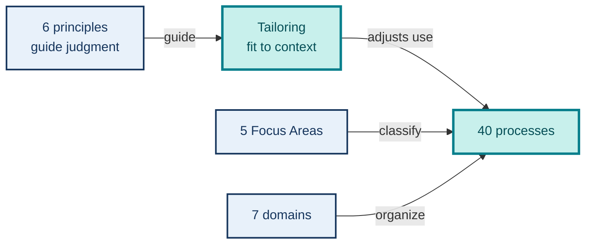
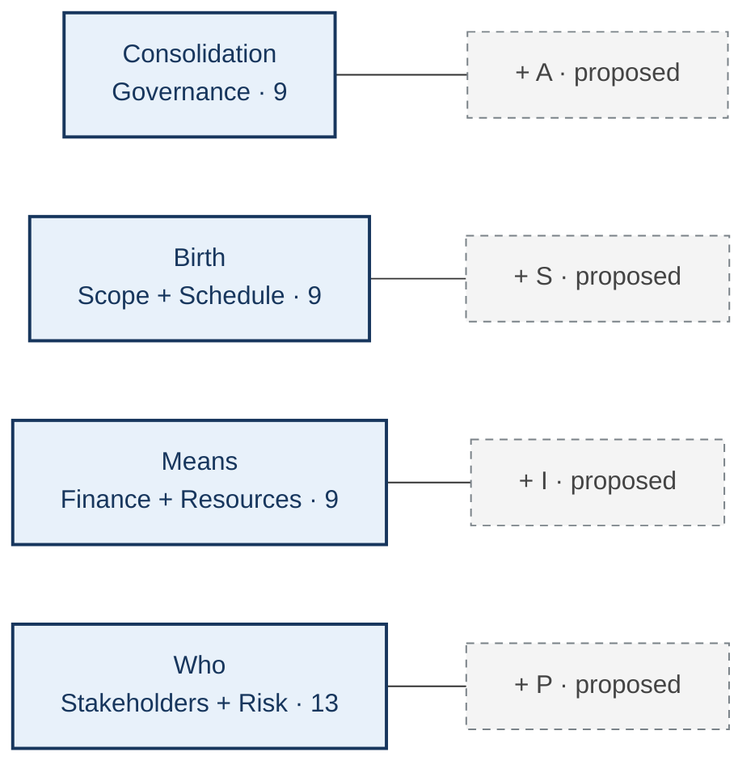

# PMBOK 8 on one page: principles, processes, and tailoring

**SIPA Privacy 2 group · PMBOK 8 synthesis**  
**Core idea:** principles guide judgment; domains and Focus Areas locate work; tailoring adjusts how it is carried out.

## Figure P1 — How the parts relate

<!-- Future layout: upper band. Four cards around a central "40 processes"
card: principles guide judgment; seven domains contain processes; five Focus
Areas classify them; tailoring adjusts application. Use different verbs on
arrows to avoid implying equivalence among the axes. Dark blue denotes PMBOK 8
content; teal highlights tailoring. No decorative icons. Alt text: four
distinct relationships around the 40 PMBOK 8 processes. Source: PMI (2025),
Standard §§3–4 and Guide §§2–3. -->

**Six principles:** holistic view · focus on value · embedded quality · accountable leadership · sustainability across project areas · empowered culture. **Tailoring:** select an initial approach → tailor for the organization → tailor for the project → improve continuously; process elements may be added, modified, removed, blended, or aligned.

## Figure P2 — 40 processes across 7 domains × 5 Focus Areas

<!-- Future layout: the largest, central figure. A 7×5 heat map with numbers
in every cell, row totals on the right, column totals below. Stronger color
means more processes, never greater importance. ST/IN includes Identify
Stakeholders. Keep labels and numbers readable from a distance and without
color. Alt text: distribution of 40 processes across seven domains and five
Focus Areas. Source: PMI (2025), Guide, Table 2-1. -->

| Domain | IN | PL | EX | MC | CL | Total |
| --- | ---: | ---: | ---: | ---: | ---: | ---: |
| Governance | 1 | 2 | 3 | 2 | 1 | 9 |
| Scope | 0 | 4 | 0 | 2 | 0 | 6 |
| Schedule | 0 | 2 | 0 | 1 | 0 | 3 |
| Finance | 0 | 3 | 0 | 1 | 0 | 4 |
| Stakeholders | 1 | 2 | 2 | 2 | 0 | 7 |
| Resources | 0 | 2 | 2 | 1 | 0 | 5 |
| Risk | 0 | 4 | 1 | 1 | 0 | 6 |
| **Total** | **2** | **19** | **8** | **10** | **1** | **40** |

**Key:** IN Initiating · PL Planning · EX Executing · MC Monitoring and Controlling · CL Closing. A process count is not a measure of duration or importance.

## Figure P3 — Four concentrations for reading the seven domains

<!-- Future layout: visual footer with four equal-sized cards. The solid part
of each card contains official PMBOK 8 domains and process counts. A dashed
gray tag with a plus sign denotes a possible SIPA addition. Heading must say:
"analytical grouping in this report; not an official PMI classification".
Who is the same size as the other cards because this report covers the full
guide. Alt text: seven domains grouped into four concentrations with proposed
extension topics kept separate from official process counts. -->

**Reading note:** the four concentrations and SIPA tags are an **analytical grouping in this report**; the seven domains and 40 processes belong to PMBOK 8. **Main source:** PROJECT MANAGEMENT INSTITUTE. *PMBOK Guide*, 8th ed., 2025, Standard §§3–4 and Guide §§2–3.
