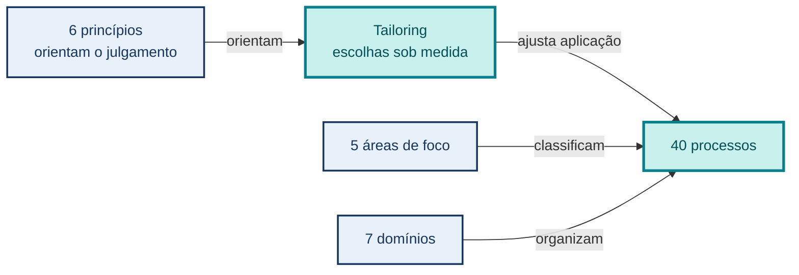
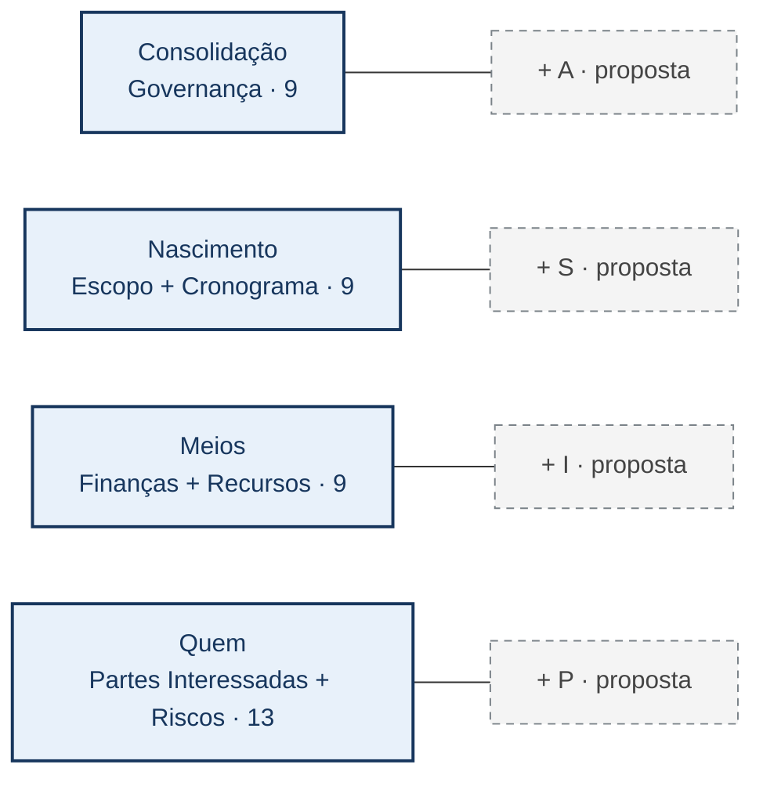

# PMBOK 8 em uma página: princípios, processos e adaptação

**Grupo SIPA Privacidade 2 · Síntese PMBOK 8**  
**Ideia central:** princípios orientam decisões; domínios e áreas de foco ajudam a localizar o trabalho; *tailoring* ajusta a forma de executá-lo.

## Figura P1 — Como as peças se relacionam

<!-- Composição futura: faixa superior. Quatro cartões ao redor de um cartão
central "40 processos": princípios orientam escolhas; sete domínios abrigam
processos; cinco áreas de foco os classificam; tailoring ajusta sua aplicação.
As setas têm verbos diferentes para evitar a ideia de equivalência entre eixos.
Usar azul escuro para conteúdo PMBOK 8 e turquesa só para tailoring. Nenhum
ícone decorativo. Texto alternativo: quatro relações distintas em torno dos
40 processos do PMBOK 8. Fonte: PMI (2025), Standard §§3–4 e Guide §§2–3. -->

**Seis princípios:** visão holística · foco em valor · qualidade incorporada · liderança responsável · sustentabilidade em todas as áreas · cultura empoderada. **Tailoring:** escolher abordagem inicial → adaptar à organização → adaptar ao projeto → melhorar continuamente; processos podem ser adicionados, modificados, removidos, combinados ou alinhados.

## Figura P2 — 40 processos em 7 domínios × 5 áreas de foco

<!-- Composição futura: figura central e maior. Mapa de calor 7×5 com números
em todas as células, total de linha à direita e total de coluna abaixo. Cor
mais intensa indica mais processos, nunca maior importância. A célula ST/IN
contém Identify Stakeholders. Manter letras e números legíveis à distância e
em impressão sem cor. Texto alternativo: distribuição dos 40 processos entre
sete domínios e cinco áreas de foco. Fonte: PMI (2025), Guide, Tabela 2-1. -->

| Domínio | IN | PL | EX | MC | CL | Total |
| --- | ---: | ---: | ---: | ---: | ---: | ---: |
| Governança | 1 | 2 | 3 | 2 | 1 | 9 |
| Escopo | 0 | 4 | 0 | 2 | 0 | 6 |
| Cronograma | 0 | 2 | 0 | 1 | 0 | 3 |
| Finanças | 0 | 3 | 0 | 1 | 0 | 4 |
| Partes Interessadas | 1 | 2 | 2 | 2 | 0 | 7 |
| Recursos | 0 | 2 | 2 | 1 | 0 | 5 |
| Riscos | 0 | 4 | 1 | 1 | 0 | 6 |
| **Total** | **2** | **19** | **8** | **10** | **1** | **40** |

**Legenda:** IN Iniciação · PL Planejamento · EX Execução · MC Monitoramento e Controle · CL Encerramento. Contagem de processos ≠ duração ou importância de uma área.

## Figura P3 — Quatro concentrações para ler os sete domínios

<!-- Composição futura: rodapé visual com quatro cartões iguais. Parte sólida
de cada cartão = domínios oficiais PMBOK 8 e quantidade de processos. Etiqueta
cinza tracejada com sinal + = possível extensão SIPA. Cabeçalho explícito:
"agrupamento analítico deste trabalho; não é classificação oficial do PMI".
Dar a Quem o mesmo tamanho dos outros cartões, pois esta síntese cobre o guia
inteiro. Texto alternativo: sete domínios agrupados em quatro concentrações,
com quatro temas de extensão separados da contagem oficial. -->

**Aviso de leitura:** as quatro concentrações e as etiquetas SIPA são **agrupamento analítico deste trabalho**; os sete domínios e seus 40 processos são do PMBOK 8. **Fonte principal:** PROJECT MANAGEMENT INSTITUTE. *PMBOK Guide*, 8ª ed., 2025, Standard §§3–4 e Guide §§2–3.
