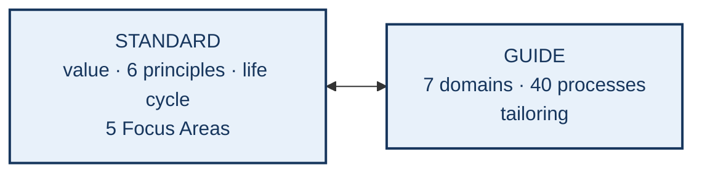
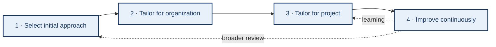
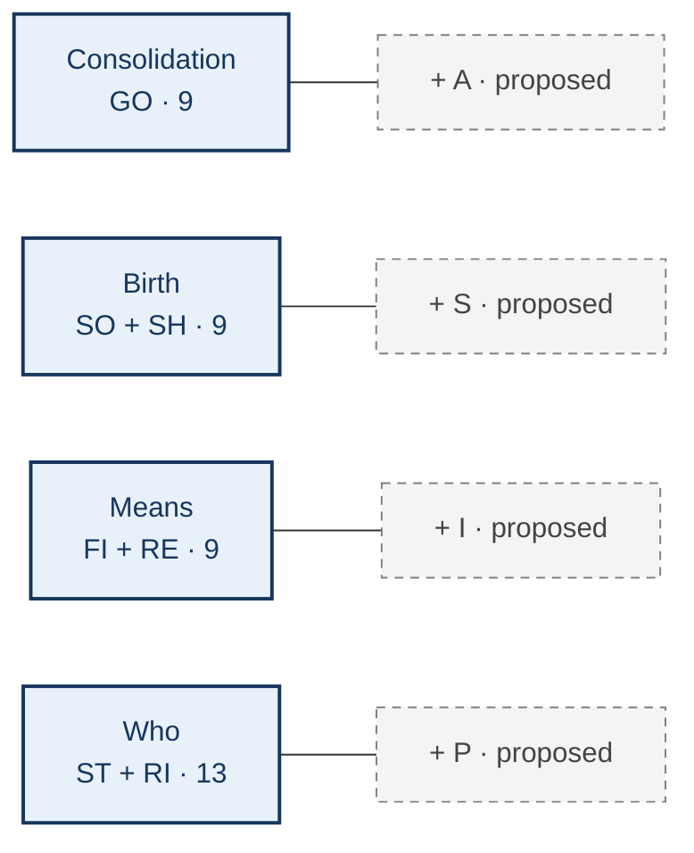

# PMBOK 8: principles, Focus Areas, performance domains, and tailoring

**P3D assignment · SIPA Privacy 2 group**  
**Nature:** technical synthesis of PMBOK 8, with an analytical grouping of the domains clearly separated from PMI's official structure.

## Abstract

This report synthesizes *The Standard for Project Management* and *A Guide to the Project Management Body of Knowledge* in the eighth edition of PMBOK. Its purpose is to explain how six principles guide judgment, five Focus Areas organize activities, and seven performance domains contain 40 illustrative processes. The emphasis is on *tailoring*: choosing a development approach, practices, processes, and engagement methods that fit the organization and the project, then revisiting those choices in light of results. One table maps each process to its domain and Focus Area; a 7 × 5 matrix summarizes the distribution, and another matrix outlines connections between principles and domains. Four concentrations—Consolidation, Birth, Means, and Who—are used as an **analytical grouping in this report**, without attributing them to PMI's official structure. Privacy appears only in a short tailoring example for a digital-twin project; this report proposes no new PMBOK 8 process.

**Keywords:** PMBOK 8; project management; principles; Focus Areas; performance domains; processes; tailoring.

## 1. Purpose, source, and method

PMBOK 8 brings together a *Standard*, which presents project management foundations, and a *Guide*, which organizes performance domains, processes, inputs, outputs, tools, and tailoring considerations. The complete PMI edition is the **sole bibliographic reference** of this synthesis. Original English names are retained; Portuguese translations in the companion report are working translations. Process counts and names were checked against Table 2-1 and §§2.1–2.7 of the *Guide*. The six principles and their domain connections were checked against chapter 3 of the *Standard*; tailoring against chapter 3 of the *Guide* (PMI, 2025).

The synthesis is functional: for each element, ask **which decision it guides**, **where it appears**, and **which result is sought**. The 40-process inventory is complete so that the count can be audited, but the descriptions do not reproduce the book. PMBOK 8 states that processes and their sample inputs and outputs illustrate technical practice rather than prescribe a methodology. Listing 40 processes therefore does not mean that every project must execute all 40 formally (PMI, 2025, *Guide*, §2).

**Figure 1 — Complementary roles of the two parts.** The *Standard* provides value orientation, principles, and life-cycle guidance; the *Guide* details domains and tailoring choices. The two-way arrow represents joint reading, not a hierarchy between books. *Source: original synthesis based on the structure of PMI (2025).*

<!-- Future design: two equal-sized blocks, Standard and Guide. The first has
value delivery, six principles, and five Focus Areas; the second has seven
domains, 40 processes, and tailoring. A double arrow means reciprocal use.
Dark blue denotes official content. Do not add the SIPA grouping to this image.
Alt text: the two parts of PMBOK 8 complement each other. -->

The distinction aids reading without isolating the ideas. Value delivery informs choices in every domain; *Guide* processes can be configured for different development approaches. Principle, Focus Area, domain, and process are not interchangeable terms: each answers a different management question.

## 2. Foundations and the six *Standard* principles

### 2.1 Value, governance, and the life cycle

A project is a temporary endeavor that creates a unique result within an organization and a value delivery system. Portfolios, programs, projects, and operations are related, but have different purposes and horizons. Governance guides decisions and accountability; project management translates these decisions into coordinated work. Value is not identical to a physical or digital deliverable: it depends on outcomes and benefits as understood by the organization and stakeholders (PMI, 2025, *Standard*, §§1–2).

A project life cycle divides the endeavor into phases. Its development approach may be **predictive**, **adaptive**, or **hybrid**, depending on how much is known about the work, the possibility of change, delivery cadence, and organizational conditions. Different components of one project may use different approaches. Focus Areas do not replace phases: planning, executing, and controlling can recur across multiple phases (PMI, 2025, *Standard*, §4).

### 2.2 Principles as criteria for judgment

The *Standard* organizes its mindset into three pairs: **proactivity** (holistic view and quality), **value orientation** (value and sustainability), and **ownership** (accountable leadership and an empowered culture). The table turns each principle into a practical question; it is not a replacement for PMI's definition (PMI, 2025, *Standard*, §§3.2–3.8).

| Code and official principle | Practical question | Consequence for a decision |
| --- | --- | --- |
| **1AHV — Adopt a Holistic View** | Which dependencies and effects beyond the immediate deliverable matter? | Examine links among domains, organization, people, and environment. |
| **2FOV — Focus on Value** | What result justifies the work, and how can value be reassessed? | Compare alternatives by expected benefit, not just task volume. |
| **3QPD — Embed Quality Into Processes and Deliverables** | How will quality be built into and checked during the work? | Set criteria, reviews, and corrections early. |
| **4BAL — Be an Accountable Leader** | Who owns and explains difficult choices? | Make responsibility, criteria, and escalation visible. |
| **5SPA — Integrate Sustainability Within All Project Areas** | Which effects persist for people, environment, and organization? | Include long-term consequences in scope, resource, and risk choices. |
| **6BEC — Build an Empowered Culture** | Can the team act, learn, and raise problems? | Enable trust, responsible autonomy, and feedback channels. |

Principles cross all seven domains. Focus on Value can guide a financial decision, a scope choice, or a risk response; quality can appear in requirements, schedule milestones, and team capability. No principle belongs exclusively to one domain. Section 6 summarizes these interfaces without inventing scores.

## 3. Five Focus Areas and process distribution

The *Project Management Focus Areas* are **Initiating (IN), Planning (PL), Executing (EX), Monitoring and Controlling (MC), and Closing (CL)**. They group management practices but do not impose a rigid sequence or equal the phases of a life cycle. A project may initiate a phase, plan an increment, execute, review performance, and replan even under an adaptive overall approach (PMI, 2025, *Standard*, §4.5; *Guide*, Table 2-1).

| Area | Guiding question | PMBOK 8 processes |
| --- | --- | ---: |
| IN | What should be authorized, and who is involved? | **2** |
| PL | How should plans, requirements, resources, costs, communications, and risk responses be integrated? | **19** |
| EX | How should the work, engagement, and responses be carried out? | **8** |
| MC | How should results be compared with objectives and deviations addressed? | **10** |
| CL | How should a phase or project be formally closed and its results transitioned? | **1** |

**Figure 2 — A 7 × 5 map of the 40 processes.** Cells count processes; they do **not** measure importance. *Identify Stakeholders* belongs to Initiating in the PDF's Table 2-1. Including it produces Focus Area totals of 2 + 19 + 8 + 10 + 1 = 40. *Source: PMI (2025),* Guide, *Table 2-1; counts and presentation by the authors.*

<!-- Future design: heat map with GO, SO, SH, FI, ST, RE, RI as rows and IN,
PL, EX, MC, CL as columns. Show the number inside every cell; zero stays white.
Include row and column totals. Legend reads "number of processes", never
"domain quality". Alt text: 7-domain by 5-Focus-Area matrix totaling 40. -->

| Domain | IN | PL | EX | MC | CL | Total |
| --- | ---: | ---: | ---: | ---: | ---: | ---: |
| Governance (GO) | 1 | 2 | 3 | 2 | 1 | 9 |
| Scope (SO) | 0 | 4 | 0 | 2 | 0 | 6 |
| Schedule (SH) | 0 | 2 | 0 | 1 | 0 | 3 |
| Finance (FI) | 0 | 3 | 0 | 1 | 0 | 4 |
| Stakeholders (ST) | 1 | 2 | 2 | 2 | 0 | 7 |
| Resources (RE) | 0 | 2 | 2 | 1 | 0 | 5 |
| Risk (RI) | 0 | 4 | 1 | 1 | 0 | 6 |
| **Total** | **2** | **19** | **8** | **10** | **1** | **40** |

Planning contains 19 processes, but this does not mean it takes nearly half of a project's time. The matrix classifies processes rather than duration, cost, or importance. Governance appears in all five areas, while other domains have more concentrated distributions. Monitoring may update decisions in any domain; a zero in a cell does not mean that the topic ceases to matter there (PMI, 2025, *Guide*, §2).

## 4. The seven *Guide* performance domains

A domain brings together concerns and practices active across a project. The *Guide* presents key concepts, processes, tailoring considerations, interactions with other domains, and ways of checking results for each one. Domains operate concurrently rather than as isolated departments (PMI, 2025, *Guide*, §2).

**Governance (GO, 9 processes)** integrates decisions, execution, quality, knowledge, changes, performance, and closing to keep the project aligned with intended value. Tailoring adjusts decision authority, review forums, approval rigor, and information cadence to the scale and criticality of the work (PMI, 2025, *Guide*, §2.1).

**Scope (SO, 6)** turns needs into requirements, boundaries, and work structure, then monitors and validates what was delivered. Requirements may be detailed earlier when conditions are stable or evolve through successive deliveries when learning is essential (PMI, 2025, *Guide*, §2.2).

**Schedule (SH, 3)** establishes how time is planned, represented, and controlled. Schedule granularity and review frequency should follow uncertainty, dependencies, and delivery cadence (PMI, 2025, *Guide*, §2.3).

**Finance (FI, 4)** covers financial planning, cost estimates, budgeting, and control. Tailoring calibrates cost units, reserves, forecasts, and control depth to value and financial exposure (PMI, 2025, *Guide*, §2.4).

**Stakeholders (ST, 7)** identifies relevant people and organizations, plans engagement and communication, manages interactions, and checks their effectiveness. Channels, frequency, and participation depth depend on context and information needs (PMI, 2025, *Guide*, §2.5).

**Resources (RE, 5)** plans, estimates, acquires, and coordinates people and physical means, then monitors their use. Tailoring considers skill availability, suppliers, distributed work, and how the team is led (PMI, 2025, *Guide*, §2.6).

**Risk (RI, 6)** plans the management of uncertainty, identifies and analyzes risks, prepares and implements responses, and monitors effectiveness. Analytical rigor should match decision criticality, threats, and opportunities (PMI, 2025, *Guide*, §2.7).

### 4.1 Auditable inventory of all 40 processes

The table retains **PMI's official English names**. Area codes IN, PL, EX, MC, and CL correspond to section 3. Presence in this inventory does not compel formal execution in every project; applicability and intensity depend on tailoring (PMI, 2025, *Guide*, Table 2-1 and §§2.1–2.7).

| # | Domain | Area | Official process name |
| ---: | --- | --- | --- |
| 1 | GO | IN | *Initiate Project or Phase* |
| 2 | GO | PL | *Integrate and Align Project Plans* |
| 3 | GO | PL | *Plan Sourcing Strategy* |
| 4 | GO | EX | *Manage Project Execution* |
| 5 | GO | EX | *Manage Quality Assurance* |
| 6 | GO | EX | *Manage Project Knowledge* |
| 7 | GO | MC | *Monitor and Control Project Performance* |
| 8 | GO | MC | *Assess and Implement Changes* |
| 9 | GO | CL | *Close Project or Phase* |
| 10 | SO | PL | *Plan Scope Management* |
| 11 | SO | PL | *Elicit and Analyze Requirements* |
| 12 | SO | PL | *Define Scope* |
| 13 | SO | PL | *Develop Scope Structure* |
| 14 | SO | MC | *Monitor and Control Scope* |
| 15 | SO | MC | *Validate Scope* |
| 16 | SH | PL | *Plan Schedule Management* |
| 17 | SH | PL | *Develop Schedule* |
| 18 | SH | MC | *Monitor and Control Schedule* |
| 19 | FI | PL | *Plan Financial Management* |
| 20 | FI | PL | *Estimate Costs* |
| 21 | FI | PL | *Develop Budget* |
| 22 | FI | MC | *Monitor and Control Finances* |
| 23 | ST | IN | *Identify Stakeholders* |
| 24 | ST | PL | *Plan Stakeholder Engagement* |
| 25 | ST | PL | *Plan Communications Management* |
| 26 | ST | EX | *Manage Stakeholder Engagement* |
| 27 | ST | EX | *Manage Communications* |
| 28 | ST | MC | *Monitor Stakeholder Engagement* |
| 29 | ST | MC | *Monitor Communications* |
| 30 | RE | PL | *Plan Resource Management* |
| 31 | RE | PL | *Estimate Resources* |
| 32 | RE | EX | *Acquire Resources* |
| 33 | RE | EX | *Lead the Team* |
| 34 | RE | MC | *Monitor and Control Resourcing* |
| 35 | RI | PL | *Plan Risk Management* |
| 36 | RI | PL | *Identify Risks* |
| 37 | RI | PL | *Perform Risk Analysis* |
| 38 | RI | PL | *Plan Risk Responses* |
| 39 | RI | EX | *Implement Risk Responses* |
| 40 | RI | MC | *Monitor Risks* |

The inventory exposes real dependencies. A Scope requirement may demand resources, budget, and a Governance choice; a schedule change may alter risks and stakeholder expectations. A domain and Focus Area locate a process without limiting its interactions. Tailoring considerations and result checks in the *Guide* discourage mechanical use of the list (PMI, 2025, *Guide*, §2).

## 5. Tailoring

### 5.1 Why and what to tailor

Chapter 3 of the *Guide* argues that no single project management approach fits every project. Too few processes can leave critical decisions unmanaged; too many can consume effort without creating value. Tailoring seeks a sufficient approach for the context, subject to organizational and contractual constraints. Criticality, scale, duration, complexity, industry standards, culture, stakeholder numbers, and organizational maturity all shape the decision (PMI, 2025, *Guide*, §§3.1–3.2).

Three aspects can be tailored. **Life cycle and development approach:** select phases, cadence, and a predictive, adaptive, or hybrid combination. **Processes:** decide which practices should be explicit and how rigorous they need to be. **Engagement:** adjust participation, authority, collaboration, and communication. Tailoring crosses the seven domains; it is not a one-time choice made before execution (PMI, 2025, *Guide*, §3.3).

For a process, the *Guide* identifies five operations: **add** an element for a unique condition, **modify** inputs/outputs/tools, **remove** what does not add value, **blend** elements for a better result, and **align** definitions and application. These operations do not permit teams to ignore legal or contractual duties. They configure management practice within real constraints (PMI, 2025, *Guide*, §3.3.2).

### 5.2 Four steps and feedback

**Figure 3 — The tailoring cycle.** The path begins with an initial development approach, proceeds through organization-level and project-level tailoring, and returns to earlier decisions through ongoing improvement. The return arrow represents diagnosis and learning. *Source: descriptive adaptation of PMI (2025),* Guide, *§3.4 and Figure 3-1.*

<!-- Future design: four numbered blocks with solid arrows and a dashed arrow
from improvement to earlier choices. Put criticality, scale, team, culture,
and contract in a side panel as constraints rather than extra process steps.
List the five process actions below. Alt text: four tailoring steps with review. -->

The first step selects an approach suited to product, cadence, and uncertainty. The second considers organizational policy and portfolio or program context. The third adjusts the approach for the particular project. The fourth uses results, retrospectives, and other evidence to retain or revise choices. Domain result checks and tailoring diagnostics connect monitoring to improvement (PMI, 2025, *Guide*, §§3.4–3.6).

**Hypothetical IT example.** A digital-twin project supporting decisions at a recycling cooperative could use predictive milestones for acquiring equipment and adaptive cycles to test data dashboards. The team would tailor operator communication, access rules, and risk-review frequency to its setting. Privacy can influence requirements and existing decisions without being treated as an eighth official domain. The example illustrates tailoring; it does not describe an implemented project or add to the 40-process inventory.

## 6. How principles cross the domains

The *Standard*'s *Connected Performance Domains* sections describe links between the six principles and all seven domains. The matrix below summarizes **one characteristic contribution in each cell**. It is an analytical paraphrase of §§3.3.3–3.8.3, not a strength, priority, or compliance scale (PMI, 2025). All 42 cells represent relationships.

| Principle | GO | SO | SH | FI | ST | RE | RI |
| --- | --- | --- | --- | --- | --- | --- | --- |
| **1AHV** Holistic view | integrated choices | alignment | dependencies | priorities | inclusion | integration | linked risks |
| **2FOV** Value | decision criteria | avoid excess | benefit timing | viability | perceived value | alternatives | pragmatic response |
| **3QPD** Quality | accountability | requirements | review milestones | less rework | feedback | competence | prevent defects |
| **4BAL** Accountable leader | transparent decisions | resolve disputes | schedule agreement | financial integrity | secure support | responsible use | own risk |
| **5SPA** Sustainability | lasting effects | sustainable requirements | timing impacts | investment | trust | materials and people | social risks |
| **6BEC** Empowered culture | dialogue | adjust requirements | team ideas | reduce waste | participation | learning | discuss thresholds |

**Figure 4 — Principle–domain relationship matrix.** A future graphic can color-code the *Standard*'s three mindset pairs while retaining short text for accessibility without color. The matrix is not a performance score. *Source: original synthesis from PMI (2025),* Standard, *§§3.2–3.8.*

<!-- Future design: 6 rows × 7 columns, with a key for GO/SO/SH/FI/ST/RE/RI.
Use three subtle row-band colors for the three mindset pairs. Do not apply a
numerical intensity scale. Alt text: six principles affect seven domains in
different ways. -->

This reading avoids two mistakes. Principles should not be turned into extra processes; they guide judgment. Domains should not become silos: a quality choice in Scope may require budget, skills, and a risk response. Project management must keep those choices coherent.

## 7. Four concentrations as an analytical grouping

To present the seven domains in blocks, this report uses **four analytical concentrations**: **Consolidation** contains Governance; **Birth** contains Scope and Schedule; **Means** contains Finance and Resources; **Who** contains Stakeholders and Risk. This grouping **is not an official PMBOK 8 component**. Labels A, S, I, and P denote possible additions in business analysis, sustainability, innovation, and privacy. They do not enter the 40-process total and are not defined here as new PMI processes.

**Figure 5 — Grouping seven domains into four concentrations.** The totals 9, 9, 9, and 13 cover existing processes only. Dashed-outline cards distinguish proposed extension themes from official domains. *Source for domains and counts: PMI (2025),* Guide, *Table 2-1. Grouping and SIPA labels: analytical organization in this report.*

<!-- Future design: four cards with title, domain abbreviations, and process
count. A solid blue band denotes official PMBOK 8 domains; a small dashed gray
card denotes +A, +S, +I, or +P. Do not draw causal arrows between groups.
Alt text: 7 domains and 40 processes arranged in 4 analytical blocks. -->

The grouping supports discussion and work allocation but does not replace the *Guide*'s organization. Governance still interacts with every domain; a decision involving people can also involve scope, schedule, finance, and resources. The analytical map should therefore be read alongside the process and principle tables, not as a boundary between unrelated areas.

## 8. Critical synthesis and limits

The eighth edition combines **principle-guided judgment** with **technical detail** and emphasizes tailoring. This combination avoids treating a process list as a universal recipe or invoking principles without a way to review decisions. The 40-process table maps possible actions; the tailoring cycle explains why their form, intensity, and combination vary. Reading the *Standard* and *Guide* together makes those choices easier to trace (PMI, 2025).

The four concentrations here are a reading device, not a substitute for PMI's official index. The digital-twin example is hypothetical and does not demonstrate realized benefit. This synthesis does not validate a SIPA extension or measure project performance. A real application would need to select indicators, owners, artifacts, and review frequency and to check organization-specific and contractual constraints.

## 9. Correspondence with the *Final report* output

The *Guide* describes the *Final report* in *Close Project or Phase* as a project- or phase-performance summary (PMI, 2025, §2.1.6.9). This document is a **literature synthesis**, not a report on a completed implementation. The correspondence is therefore explicit:

| *Final report* item | Application here |
| --- | --- |
| Project/phase description | Purpose and method of the PMBOK 8 reading (§1) |
| Scope and completion criteria | Coverage of principles, areas, domains, processes, tailoring; no completed implementation |
| Quality | Cross-checking process names and totals in the PDF; reviewing relationships and translations |
| Costs and variances | Not measured in this bibliographic activity |
| Final-product validation | Text available for review; external acceptance not demonstrated |
| Schedule and benefits | Academic submission has a deadline; application benefits remain hypotheses |
| Business need | Need for project management guidance that can be tailored |
| Risks and issues | Risk of confusing official structure with analytical grouping or oversimplifying the source |

## Reference

PROJECT MANAGEMENT INSTITUTE (PMI). *The Standard for Project Management and A Guide to the Project Management Body of Knowledge (PMBOK Guide)*. 8th ed., 2025. [Consulted edition, PDF](<../../../documentos/PMBOK8/PMBOK® Guide 8th Edition (Project Management Institute).pdf>).
